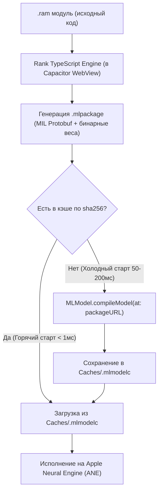

# CoreML JIT-компиляция на iOS (iPhone / iPad)

> Проектная схема, не реализованный backend Rank. Указанные ниже времена
> компиляции и назначения ANE — предварительные предположения, не результаты
> измерений на iPhone. Фактическое сравнение на Mac и его ограничения записаны
> в [README](README.md#core-ml-comparison-on-mac-2026-10-27); текущий MVP использует LiteRT.


Документ описывает архитектуру и реализацию компиляции модулей `mlRank` (`.ram`) на лету прямо на устройствах Apple под управлением iOS/iPadOS через **Apple Neural Engine (ANE)** и **Metal GPU**.

---

## 1. Встроенный компилятор iOS: как работает JIT без Mac

Распространённое заблуждение — считать, что для компиляции CoreML-модели обязательно нужен Mac с установленным Xcode.

**В операционную систему iOS/iPadOS встроен полноценный системный компилятор CoreML (`coremlcompiler`)**. Apple предоставляет официальный рантайм-API в фреймворке `CoreML`:

```swift
let compiledModelURL = try await MLModel.compileModel(at: packageURL)
```

### Двухэтапный жизненный цикл `.ram` на iPhone:



1. **Генерация промежуточного представления (`.mlpackage`):**  
   TypeScript-компилятор Rank строит статический SSA-граф и сохраняет директорию `.mlpackage` во временную папку приложения (`tmp/` или `Documents/`). Она содержит декларацию вычислительного графа в формате Apple MIL (Model Intermediate Language) и плоские бинарные буферы весов.
2. **Аппаратная JIT-компиляция (`MLModel.compileModel`):**  
   Системный компилятор iOS переводит MIL-граф в бинарный код, специализированный под **конкретный чип данного устройства** (например, A16, A17 Pro, A18 Pro или M2/M4). Он строит оптимальное расписание тайлинга памяти SRAM для Apple Neural Engine и шейдеры Metal.
3. **Кэширование артефакта (`.mlmodelc`):**  
   Результат компиляции кэшируется в `CachesDirectory` по ключу `sha256(исходный код .ram + веса)`. При повторном вызове компиляция пропускается полностью.

---

## 2. Два режима компиляции

### Режим А: On-Device JIT (Автономный на iPhone)
* **Когда используется:** Обычная работа мобильного приложения (`@arrrank/mobile`). Пользователь запускает или редактирует скрипты прямо на телефоне.
* **Требования к сети/хосту:** Полностью автономно (0 внешних зависимостей).
* **Время компиляции:** 
  * Простые графы (Hello World, MLP): **20–60 мс**.
  * Свёрточные сети и блоки внимания: **100–300 мс**.
  * 12 слоев GPT-2: **1.5–3 секунды** (только при первом холодном запуске).
  * Повторные вызовы из кэша: **< 1 мс**.

### Режим Б: Cross-Compilation на Mac (Оффлайн сборка)
* **Когда используется:** Подготовка предустановленных моделей в составе IPA-пакета приложения или пакетный запуск тестов в CI.
* **Команда на Mac:**
  ```sh
  xcrun coremlcompiler compile model.mlpackage ./output/
  ```
  Полученная папка `model.mlmodelc` копируется напрямую в бандл приложения в `packages/mobile/ios/App/App/`.

---

## 3. Реализация нативного Capacitor-моста (`CoreMLPlugin.swift`)

Для интеграции с мобильным клиентом Rank в каталог [`packages/mobile/ios/App/App/`](file:///Users/kmmbvnr/Workspace/Playground/09-Rank/packages/mobile/ios/App/App/) добавляется легковесный Swift-плагин.

### Пример реализации:

```swift
import Foundation
import CoreML
import Capacitor

@objc(CoreMLPlugin)
public class CoreMLPlugin: CAPPlugin {
    // Таблица загруженных моделей в памяти: modelId -> MLModel
    private var loadedModels: [String: MLModel] = [:]

    @objc func compileAndLoad(_ call: CAPPluginCall) {
        guard let packagePath = call.getString("packagePath") else {
            call.reject("Missing packagePath")
            return
        }

        Task {
            do {
                let packageURL = URL(fileURLWithPath: packagePath)
                let modelHash = call.getString("modelHash") ?? UUID().uuidString
                
                // Путь в директории кэша
                let fileManager = FileManager.default
                let cacheDir = fileManager.urls(for: .cachesDirectory, in: .userDomainMask).first!
                let cachedModelURL = cacheDir.appendingPathComponent("\(modelHash).mlmodelc")

                let finalCompiledURL: URL
                if fileManager.fileExists(atPath: cachedModelURL.path) {
                    // 1. Попадание в кэш
                    finalCompiledURL = cachedModelURL
                } else {
                    // 2. Компиляция на лету системным компилятором iOS
                    let tempCompiledURL = try await MLModel.compileModel(at: packageURL)
                    try fileManager.moveItem(at: tempCompiledURL, to: cachedModelURL)
                    finalCompiledURL = cachedModelURL
                }

                // Конфигурация: приоритет Neural Engine и Metal
                let config = MLModelConfiguration()
                config.computeUnits = .all // ANE + GPU + CPU fallback

                let model = try MLModel(contentsOf: finalCompiledURL, configuration: config)
                let modelId = UUID().uuidString
                self.loadedModels[modelId] = model

                call.resolve([
                    "modelId": modelId,
                    "cached": finalCompiledURL == cachedModelURL
                ])
            } catch {
                call.reject("CoreML compilation failed: \(error.localizedDescription)")
            }
        }
    }

    @objc func predict(_ call: CAPPluginCall) {
        guard let modelId = call.getString("modelId"),
              let model = self.loadedModels[modelId] else {
            call.reject("Model not found")
            return
        }

        guard let inputsDict = call.getObject("inputs") else {
            call.reject("Missing inputs")
            return
        }

        Task {
            do {
                // Создание MLFeatureProvider из переданных Float32Array / Float16Array
                let featureProvider = try DictionaryFeatureProvider(dictionary: inputsDict)
                let prediction = try await model.prediction(from: featureProvider)
                
                // Сериализация выходных MLMultiArray обратно в JS
                var outputsDict: [String: Any] = [:]
                for featureName in prediction.featureNames {
                    if let multiArray = prediction.featureValue(for: featureName)?.multiArrayValue {
                        outputsDict[featureName] = multiArray.toArray()
                    }
                }

                call.resolve(["outputs": outputsDict])
            } catch {
                call.reject("Prediction failed: \(error.localizedDescription)")
            }
        }
    }
}
```

---

## 4. Конфигурация ускорителей (`computeUnits`)

CoreML позволяет точно настраивать, какие аппаратные блоки задействовать:

| Конфигурация | Что задействуется | Рекомендация для mlRank |
| :--- | :--- | :--- |
| `MLComputeUnits.all` | ANE + GPU + CPU | **По умолчанию.** Планировщик Apple сам распределяет матричные слои на ANE, а редукции/хвосты на GPU. |
| `MLComputeUnits.cpuAndNeuralEngine` | Только ANE + CPU | Идеально для максимальной энергоэффективности (минимальный расход батареи телефона). |
| `MLComputeUnits.cpuAndGPU` | Только Metal GPU + CPU | Полезно для отладки, если конкретный оператор не поддерживается текущей ревизией ANE. |
| `MLComputeUnits.cpuOnly` | Только процессор | Режим эталонного оракула для верификации численной точности (`atol/rtol`). |

---

## 5. Особенности компиляции под ANE (Apple Neural Engine)

Чтобы скомпилированный граф гарантированно исполнялся на **ANE**, а не сбрасывался на CPU:
1. **Тип данных `.f16`:** Родной тип для всех поколений ANE — 16-битные числа с плавающей точкой. Вычисления в `.f32` перенаправляются на GPU или CPU.
2. **Статические размеры:** Размеры тензоров должны быть фиксированными либо использовать перечислимые формы (`shape ... end` / `ct.EnumeratedShapes`).
3. **Выравнивание каналов:** Измерения каналов и признаков желательно делать кратными 16 (например, 64, 128, 768).
