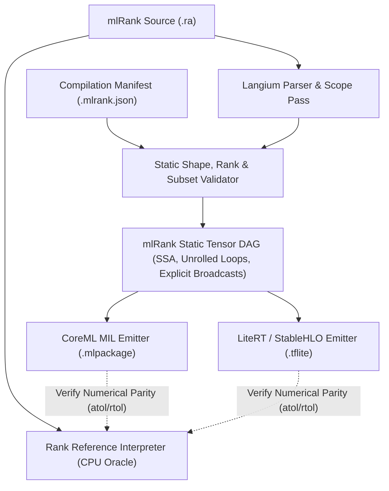

# mlRank (MVP Specification)

**Status:** Draft MVP — 2026-10-25  
**Target backends:** Apple CoreML (MIL / ANE / Metal GPU), Google LiteRT (TFLite FlatBuffers / StableHLO / GPU & NPU Delegates), ARM TOSA.

`mlRank` is a **strict, statically compilable subset of Rank** designed for hardware neural accelerators (NPUs and GPUs). Every valid `mlRank` program is a valid Rank program that executes deterministically in the standard Rank CPU interpreter without syntax changes to the core language.

By restricting dynamic runtime constructs that cause accelerator fallbacks (such as data-dependent shapes, unbounded loops, and arbitrary-precision integers during kernel execution), `mlRank` guarantees **1-to-1 lowering** into static tensor computation graphs for CoreML and LiteRT.

---

## 1. Design Principles

1. **Zero syntax fork:** `mlRank` does not alter Rank grammar. A `.ra` file written in `mlRank` runs as-is in the Rank REPL and CLI (`npx @arrrank/cli`), which serves as the bit-exact / numerical reference oracle.
2. **Static Shape & Rank Decidability:** The rank ($R$) and concrete dimensions ($[d_1, \dots, d_R]$) of every intermediate value must be statically derivable from the input contract before execution begins.
3. **Pure Dataflow DAG:** Within compiled regions, arrays follow strict value semantics. Both eager bindings (`A = ...`) and recipe bindings (`A' = ...`) may be fused into on-chip SRAM / register tiles by the target compiler, provided the observable output tensors of the program remain identical.
4. **Hardware-Native Operator Boundaries:** Using the `use ml` vocabulary (see [Issue #413](https://github.com/kmmbvnr/rank/issues/413)), high-level operations (`softmax`, `layernorm`, `rmsnorm`, `linear`, `conv2d`, `attention`) are preserved as first-class macro-nodes rather than prematurely decomposed into scalar loops.

---

## 2. Program Structure, Inputs & Compilation Contract

Just as standard Rank scripts use top-level `option` declarations (`use cli`) bindable from the workspace or CLI, an `mlRank` program is a top-level script or pure `fun` whose input tensors, weights, and compile-time constants are bound at the boundary and specialized via an external **Compilation Manifest**.

### Example: Self-Attention Block in `mlRank`

```rank
rem attention_block.ra
use linalg
use ml
use numbers
use sequences

rem Inputs bound from workspace or runner
option Dim integer = 64

Q = array shape 16 Dim fill 0.0
K = array shape 16 Dim fill 0.0
V = array shape 16 Dim fill 0.0
Gamma = array shape Dim fill 1.0

rem 1. Pre-normalization (rank-1 cell op)
Qn' = (Q 1e-5 rmsnorm) * Gamma
Kn' = (K 1e-5 rmsnorm) * Gamma

rem 2. Scaled dot-product attention
Out = Qn Kn V attention
```

### External Compilation Manifest (`model.mlrank.json`)

To keep `.ra` source files clean and compatible with the standard interpreter, hardware target types (`f16`, `f32`, `i32`) and static input shapes are supplied externally when compiling to CoreML or LiteRT:

```json
{
  "source": "attention_block.ra",
  "target": "coreml",
  "precision": "f16",
  "inputs": {
    "Q":     { "dtype": "f16", "shape": [16, 64] },
    "K":     { "dtype": "f16", "shape": [16, 64] },
    "V":     { "dtype": "f16", "shape": [16, 64] },
    "Gamma": { "dtype": "f16", "shape": [64], "role": "weight" }
  },
  "outputs": ["Out"]
}
```

* **Inputs vs. Weights:** Tensors marked with `"role": "weight"` can be baked as constant weights into the `.mlpackage` / `.tflite` FlatBuffer (enabling offline NPU weight packing and INT8/INT4 quantization), while regular inputs become runtime model inputs.
* **Precision Lowering:** While the Rank interpreter evaluates `real` as IEEE-754 `Float64` and `integer` as exact `BigInt`, the `mlRank` compiler lowers:
  * `real` $\rightarrow$ `f32` or `f16` (per manifest policy)
  * `integer` $\rightarrow$ `i32` (for indices/shapes)
  * `boolean` $\rightarrow$ `bool` / `i8` mask

---

## 3. Allowed vs. Forbidden Language Constructs (MVP)

To ensure full NPU/GPU compatibility without CPU fallbacks, `mlRank` enforces the following subset rules during static validation:

| Category | Allowed in `mlRank` MVP | Forbidden in `mlRank` MVP (Why) |
| :--- | :--- | :--- |
| **Data Types** | `real`, `integer`, `boolean`, homogeneous dense `array` (Rank $0..5$), closed `record` and `tuple` (staticaly unrolled structs of tensors). | `text`, `bytes`, `table`, `map`, `set`, `heap`, `deque`, `dsu`, `graph`, heterogeneous arrays. |
| **Control Flow** | Straight-line statements; `for i in Start to/till End [by Step]` where bounds are compile-time constants (statically unrolled by compiler). | `while` loops, recursion, `for` over dynamic tensor values, `if` / `else` branching on tensor elements. |
| **Conditionals** | Elementwise `Mask choose TrueVal FalseVal` (lowers to `mb.select` / `tosa.select` with static shape). | Boolean mask filtering `Data Mask` or `filter` (produces data-dependent shapes, breaking NPU memory planners). |
| **Addressing** | Static slices (`0 till 16`), `#` whole-axis selectors, `transpose`, `reshape` (with static target shape), integer tensor indexing along leading axes (`Embeddings Tokens` $\rightarrow$ `gather`). | Out-of-bounds dynamic slicing, scatter updates with overlapping runtime indices. |
| **Functions** | Non-recursive user `fun` definitions (inlined as subgraph blocks during lowering). | First-class dynamic function closures or runtime callback dispatch. |
| **Side Effects** | None inside the compiled graph (pure value transformations). | File I/O (`use io`), `stdin`, random generation (`use random`) inside inference graph, throwing dynamic exceptions. |

### Loop Unrolling for Multi-Layer Models

Because transformer and CNN architectures repeat identical blocks $L$ times, `mlRank` allows `for` loops over static integer ranges. When `Layers` is a constant array/tuple of records (or indexed weight slices), the compiler unrolls the loop into a static sequence of graph layers:

```rank
Hidden = Input
for i in 0 till 12
  W1 = Weights1 i
  W2 = Weights2 i
  Mid' = (Hidden W1 linear) gelu
  Hidden = Hidden + (Mid W2 linear)
end
```

---

## 4. Operator Catalogue & Hardware Lowering

`mlRank` combines core Rank tensor operations with the stateless `use ml` vocabulary ([Issue #413](https://github.com/kmmbvnr/rank/issues/413)). Every operation has a fixed intrinsic cell rank so Rank's frame-broadcasting model eliminates manual `unsqueeze` and `transpose` boilerplate.

### 4.1 Core Math, Reductions & Structural Ops

Already built into Rank (`core`, `use numbers`, `use linalg`, `use sequences`, `use stats`):

| Rank Form | Cell Rank | Shape Contract | CoreML MIL | LiteRT / TOSA |
| :--- | :--- | :--- | :--- | :--- |
| `+`, `-`, `*`, `/`, `**`, `min`, `max` | `0 0` | Broadcast frames | `mb.add`, `mb.mul`, `mb.real_div`, `mb.pow`, `mb.minimum`, `mb.maximum` | `ADD`, `MUL`, `DIV`, `POW`, `MINIMUM`, `MAXIMUM` |
| `equal`, `less`, `greater`, `and`, `or`, `not` | `0 0` / `0` | Broadcast frames | `mb.equal`, `mb.less`, `mb.logical_and`, ... | `EQUAL`, `LESS`, `LOGICAL_AND`, ... |
| `Mask choose A B` | `0 0 0` | `s, s, s -> s` | `mb.select` | `SELECT_V2` / `tosa.select` |
| `abs`, `sqrt`, `exp`, `log`, `sin`, `cos`, `tanh` | `0` | `s -> s` | `mb.abs`, `mb.sqrt`, `mb.exp`, `mb.log`, `mb.tanh` | `ABS`, `SQRT`, `EXP`, `LOG`, `TANH` |
| `sum`, `mean`, `min`, `max`, `std` (`[axis A]`) | `all` / `axis` | Collapses reduced axes | `mb.reduce_sum`, `mb.reduce_mean`, `mb.reduce_min`, `mb.reduce_max` | `SUM`, `MEAN`, `REDUCE_MIN`, `REDUCE_MAX` |
| `Values max .index` / `min .index` | `1` / `axis` | `['d'] -> []` | `mb.reduce_argmax`, `mb.reduce_argmin` | `ARG_MAX`, `ARG_MIN` |
| `A matmul B [rank 2 2]` | `all` / `2 2` | `[..., M, K], [..., K, N] -> [..., M, N]` | `mb.matmul` | `BATCH_MATMUL` / `tosa.matmul` |
| `A reshape D1 D2 ...` | `all` | Preserves element count | `mb.reshape` | `RESHAPE` |
| `A transpose [axis ...]` | `all` | Permutes axes | `mb.transpose` | `TRANSPOSE` |
| `Emb Indices` (array addressing) | special | Replaces leading axis with index shape | `mb.gather` | `GATHER` / `tosa.gather` |

### 4.2 Elementwise Activations & Clamping (`use ml`, Default Cell Rank: `0`)

Map scalars `s -> s` across any tensor shape and fuse directly into preceding `conv2d` / `linear` / `matmul` operations on NPU and GPU:

| Rank Form | Cell Rank | Formula | CoreML MIL | LiteRT / TOSA |
| :--- | :--- | :--- | :--- | :--- |
| `X relu` | `0` | $\max(0, x)$ | `mb.relu` | `RELU` / `tosa.clamp` |
| `X Alpha leakyrelu` | `0 0` | $\max(\alpha x, x)$ | `mb.leaky_relu` | `LEAKY_RELU` |
| `X Alpha elu` | `0 0` | $x \ge 0 ? x : \alpha(e^x - 1)$ | `mb.elu` | `ELU` |
| `X sigmoid` | `0` | $\frac{1}{1 + e^{-x}}$ | `mb.sigmoid` | `LOGISTIC` / `tosa.sigmoid` |
| `X silu` | `0` | $x \cdot \sigma(x)$ | `mb.silu` | `MUL(x, LOGISTIC(x))` |
| `X gelu` | `0` | $x \cdot \Phi(x)$ | `mb.gelu` | `GELU` |
| `X softplus` | `0` | $\ln(1 + e^x)$ | `mb.softplus` | `LOG(ADD(1, EXP(x)))` |
| `X Low High clip` | `0 0 0` | $\min(\max(x, \text{low}), \text{high})$ | `mb.clip` | `tosa.clamp` |

### 4.3 Vector Normalizations (`use ml`, Default Cell Rank: `1`)

Because these operations declare intrinsic cell rank `1` (`['d'] -> ['d']`), applying them to a 2D `[Batch, Dim]` or 3D `[Batch, Seq, Dim]` tensor automatically normalizes the trailing feature dimension without requiring `transpose` or `rank` modifiers:

| Rank Form | Cell Rank | Shape Contract | CoreML MIL | LiteRT / TOSA |
| :--- | :--- | :--- | :--- | :--- |
| `Scores softmax` | `1` | `['d'] -> ['d']` | `mb.softmax(axis=-1)` | `SOFTMAX` |
| `Scores logsoftmax` | `1` | `['d'] -> ['d']` | `mb.log_softmax(axis=-1)` | `LOG_SOFTMAX` |
| `X Eps layernorm` | `1 0` | `['d'], [] -> ['d']` | `mb.layer_norm(axes=[-1])` | Fused `MEAN` + `RSQRT` subgraph |
| `X Eps rmsnorm` | `1 0` | `['d'], [] -> ['d']` | `mb.rms_norm` / fused subgraph | Fused `MUL` + `MEAN` + `RSQRT` |
| `X normalize` | `1` | `['d'] -> ['d']` | `mb.l2_norm` | `L2_NORMALIZATION` |

*(Note: Explicit `axis A` overrides the default trailing axis and lowers to the `axis=A` attribute in CoreML MIL or an axis-specialized reduction in LiteRT).*

### 4.4 Linear, Spatial & Attention Macro-Kernels (`use ml`)

Providing explicit high-level operators allows the compiler to emit dedicated hardware macro-instructions (such as ANE convolution engines and Metal FlashAttention) instead of materializing intermediate `window` tensors:

| Rank Form | Default Cell Rank | Shape Contract | CoreML MIL | LiteRT / TOSA |
| :--- | :--- | :--- | :--- | :--- |
| `X W [Bias] linear` | `1 2 [1]` | `[..., In], [In, Out] -> [..., Out]` | `mb.linear` / `mb.matmul + mb.add` | `FULLY_CONNECTED` |
| `X Kernel conv2d [stride S] [padding P]` | spatial macro | `[..., H, W, Cin], [Kh, Kw, Cin, Cout] -> [..., Ho, Wo, Cout]` | `mb.conv` | `CONV_2D` / `tosa.conv2d` |
| `X Window maxpool2d [stride S] [padding P]` | spatial macro | `[..., H, W, C] -> [..., Ho, Wo, C]` | `mb.max_pool` | `MAX_POOL_2D` |
| `X Window avgpool2d [stride S] [padding P]` | spatial macro | `[..., H, W, C] -> [..., Ho, Wo, C]` | `mb.avg_pool` | `AVERAGE_POOL_2D` |
| `Q K V attention` | `2 2 2` | `[..., Nq, Dk], [..., Nk, Dk], [..., Nk, Dv] -> [..., Nq, Dv]` | `mb.scaled_dot_product_attention` | Fused SDPA subgraph |
| `Indices Classes onehot` | `0 0` | `[], [] -> ['classes']` | `mb.one_hot` | `ONE_HOT` |
| `Values K topk` | `1 0` | `['d'], [] -> tuple(['k'], ['k'])` | `mb.topk` | `TOP_K_V2` |

---

## 5. Compiler Lowering Pipeline



### Key Lowering Transformations

1. **Rank-Modifier Broadcast Insertion (`rank L R`):**
   In Rank, `Scores - Tops rank 1 0` subtracts a rank-0 scalar cell `Tops[b]` from each rank-1 row `Scores[b, :]`. CoreML MIL and LiteRT expect trailing-axis numpy-style broadcasting. The `mlRank` compiler automatically inserts a static `reshape` / `expand_dims` (`[B] -> [B, 1]`) on the lower-cell-rank operand.
2. **Window + Reduce Idiom Lifting:**
   Even if a user writes `B' = A window W stride S padding P` followed by `B max axis 2 3` (instead of `maxpool2d`), the `mlRank` IR recognizer fuses the lazy window view and reduction into a native `max_pool2d` operator without materializing the 4D windowed tensor.
3. **Layout Adaptation (`NHWC` vs `NCHW`):**
   Apple Neural Engine (CoreML) executes convolutions in `NCHW` (channels-first), whereas LiteRT GPU/NPU delegates require `NHWC` (channels-last). The `mlRank` compiler can insert layout transpositions at graph boundaries or fold weight transpositions at compile time.
4. **Automated Oracle Verification (like `@arrrank/compile verify`):**
   Just as the Rust compiler workflow compares stdout byte-for-byte against the Rank interpreter, the `mlRank` verifier runs the `.ra` file on the CPU interpreter and compares output tensors against the compiled CoreML / LiteRT model within precision tolerances (`rtol=1e-3, atol=1e-3` for `f16`; `rtol=1e-5, atol=1e-6` for `f32`).
