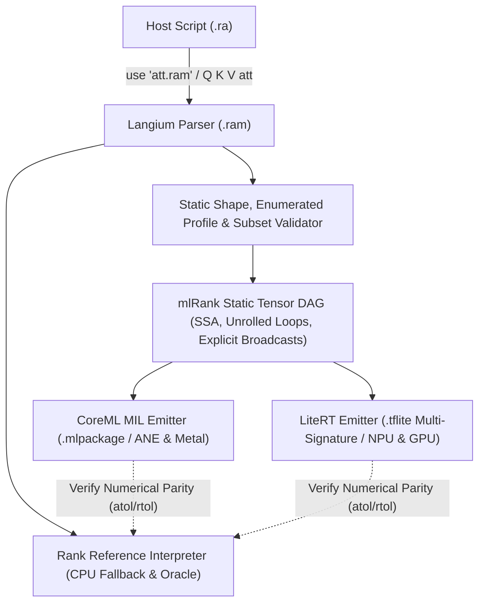

# mlRank (`.ram` MVP Specification)

## Implemented Hello World subset

The prototype supports fixed-shape real tensor inputs, ReLU, and broadcast
`.f32` expressions using `+`, `*`, `softmax`, `linear`, `layernorm`, and `gelu_new` with baked `option` constants. Import it with `use "hello.ram"` and call `X hello`.
See [the ReLU example](../../demos/mlrank/main.ra) and
[the affine example](../../demos/mlrank/affine.ra), and
[the linear example](../../demos/mlrank/linear.ra).
Baked constants accept real-valued `array shape ... fill` expressions or
array literals with explicit shapes (or one-dimensional literals), or binary `.rwt` attachments (see below).
`X W linear` accepts `X[...,M,K]` and baked `W[K,N]`, producing `[...,M,N]`.
Each tensor has its own statically checked shape. `+` and `*` align trailing axes;
matching dimensions or dimensions of size 1 broadcast, as in ordinary Rank arithmetic.
For example, `[M,N] + [N]` adds a bias to each row. Explicit `rank L R`, scalar
literals, weight overrides and multiple runtime inputs remain unsupported.
Baked arithmetic constants with rank 4 must have batch dimension 1; other batch
sizes are rejected because the GPU backend does not preserve those constants correctly.
The compiler aligns operands using static reshapes (constant reshapes are baked),
with explicit spatial axes for matrices to keep LiteRT tensor layouts consistent.
Softmax uses the last axis and requires `.f32`. Simple `Name = expression`
assignments bind names to graph nodes in source order. Rebinding a name leaves
earlier tensors unchanged; using a computed name twice reuses its node.
Deferred, compound and indexed assignments remain unsupported.

```rank
use ml
option X .f32 shape 2 3
Old = X
X = X relu
H = Old softmax
return H
```

Changing source or referenced binary weights recompiles the model on the next call.
The softmax check runs 60 calls per host across ranks 1–4, large positive and
negative logits, equal logits, singleton rows, aliases and reused results.
Mac, Intel UHD and OnePlus Adreno 619 passed with full GPU delegation and maximum
absolute errors below 8e-8. Checks include output shapes, row sums and model caching.
The Android check also edits a RAM tab, runs the source, and verifies persistence
after reload. Generate it with `node scripts/mlrank-softmax-check.mjs --android`
and run `output/playwright/ram-softmax.js` in the WebView; verify native placement
with `scripts/mlrank-android-placement.mjs`.

From the repository root, with Node.js 22.12+ and `uv` installed:

```sh
npm run mlrank:setup
npm run build
npm run rank -- demos/mlrank/main.ra
node scripts/mlrank-check.mjs
node scripts/mlrank-affine-check.mjs
node scripts/mlrank-linear-check.mjs
node scripts/mlrank-broadcast-check.mjs
node scripts/mlrank-softmax-check.mjs
node scripts/mlrank-mlp-check.mjs
node scripts/mlrank-norm-check.mjs
```

`mlrank:setup` installs Python 3.12 and LiteRT 2.3.0 in
`node_modules/.cache/mlrank`. `RANK_ML_PYTHON` can select another Python
environment containing `ai-edge-litert==2.3.0` and NumPy.
The desktop bridge retains one Python process and one compiled model.
The host loads a model once and invokes its opaque ID with new inputs. Repeated calls reuse its buffers; a new graph replaces the resident model.
The helper exits with the host process. GPU checks report cold preparation,
warm preparation, execution and host round-trip time separately.

The Android app includes LiteRT. Open **GPU Hello World** in the command menu,
then **Run program**. **GPU Linear** opens the matrix multiplication and bias example. The upper tabs contain the main program and its attached
`hello.ram`. **+** creates another RAM module, inserts its `use "name.ram"` at the start
of Program and appends `X name` at the end. Prepare `X` with the declared
shape before running. Creating a module edits source without executing it.
Switching tabs keeps the main
REPL state and unfinished text; it does not execute code. Sources are saved
together in the notebook. Exporting a program with modules produces a ZIP
containing `main.ra`, the `.ram` sources, binary `.rwt` weights and a notebook snapshot. The ZIP can
also be imported. Programs without modules keep their existing `.ra` export.

For a local Mac browser session, run `npm run dev --workspace @arrrank/web`
and open `/console.html`. The Vite development server supplies the native GPU
bridge. Static hosting does not supply this bridge. Desktop requests use POST bodies.
Android sends request bodies through Capacitor; the worker waits for the result
using an opaque request ID. Tensor data and model bytes never travel in URLs.

The prototype emits a TFLite graph and uses LiteRT GPU on every platform:
Metal on macOS, OpenCL on the tested Android devices, and WebGPU/Vulkan on
the tested Intel Linux host. CoreML and NPU execution remain proposals.
Arithmetic currently requires `.f32`; `.f16` supports ReLU only. The arithmetic
check compares against ordinary Rank execution with `atol=1e-5, rtol=1e-6`,
allowing FP32 intermediate rounding and fusion. This is a workload acceptance
tolerance, not a universal error bound for arbitrarily long expressions.
The linear subset accepts rank-2–4 inputs and rank-2 weights, including dimensions not divisible
by 16 or 32. It emits LiteRT `FULLY_CONNECTED` with weights transposed once
to `[N,K]` during compilation; no host multiplication or explicit padding is used.
This is GPU execution, not a claim of AMX or Hexagon NPU execution.
The shape of each tensor has 1–4 positive dimensions, with at most 1,048,576 elements.
Inputs must contain finite Rank `real` values; integers are not narrowed.
`.f16` and `.f32` round at the input/output boundary. LiteRT transport and computation use float32 tensors; both native bridges
explicitly request FP32 GPU precision. `.f16` describes boundary rounding,
not FP16 intermediate arithmetic. This proves the declared ReLU result within the chosen
tolerance; it does not establish hardware FP16 arithmetic. Binary16 values
outside ±65504 are rejected.

The desktop runtime checks `is_fully_accelerated()` and rejects partial
delegation. Android requests only the GPU accelerator. Kotlin LiteRT 2.3.0
does not expose the corresponding placement query; verify all graph nodes
using native delegate logs. The response reports `gpuOnlyRequested`,
not an invented placement result. There is no interpreter fallback when
the GPU runtime is unavailable.

Mac M5 and Intel UHD (Comet Lake) passed `mlrank-check.mjs`: maximum absolute
errors were 0 and 5.96e-8 respectively, against an absolute tolerance of 1e-4.
The standalone LiteRT probe delegated 1 of 1 nodes on Adreno 810 and Adreno 619.
The Android APK also ran the `.ra` example on OnePlus BE2029 (Android 11,
Adreno 619); its native log confirmed 1 of 1 delegated nodes. Three cached
calls matched the CPU reference with a maximum absolute error of 5.96e-8.
The affine graph (`Mul + Add + Relu`, 4096 elements) also passed on all three
hosts, including changing baked weights and repeated calls. Maximum absolute
error versus Rank was 3.06e-5; Android delegated all 3 nodes. Generate the
Android check with `node scripts/mlrank-android-fixtures.mjs`, then run
`output/playwright/ram-affine.js` through Playwright attached to the WebView.
Afterwards, `node scripts/mlrank-android-placement.mjs SERIAL APP_PID` checks
native delegation logs for that app process. A successful API response alone
is not proof of full Android placement.
The linear check passed on Mac M5, Intel UHD and OnePlus Adreno 619;
Android delegated both nodes (`FULLY_CONNECTED` and `RELU`).
It uses nonuniform weights, rectangular and odd shapes, output
expansion/contraction, repeated calls and changed weights. It compares against
Rank `matmul` with `atol=1e-5, rtol=1e-5`. Generate the Android check with
`node scripts/mlrank-linear-check.mjs --android`, then run
`output/playwright/ram-linear.js` in the WebView and check native placement logs.
The notebook and its selected RAM tab survived a WebView reload.
These checks establish correctness and placement for this workload, not a
speedup. Linux WebGPU profiling in the standalone tool is unsupported; run
that probe without `--use_profiler=true`.

## LayerNorm and GELU (stage 9)

Both operations accept rank 1–4 `.f32` tensors and preserve shape.
`X layernorm` normalizes each last-axis row using population variance and
epsilon `1e-5`. To override epsilon, use `X Epsilon layernorm`, where
`Epsilon` is a positive baked one-element FP32 tensor. Apply learned scale
and bias using existing broadcasting:

```rank
use ml
option X .f32 shape 2 3
option Epsilon .f32 shape 1 = array 0.00001
option Scale .f32 shape 3 = array 1.0 0.5 2.0
option Bias .f32 shape 3 = array 0.0 0.1 -0.1
H = (X Epsilon layernorm) * Scale + Bias
return H gelu_new
```

Run [normalize.ra](../../demos/mlrank/normalize.ra) for this example.
Scale and bias may also come from the existing binary attachments.
`gelu_new` uses the tanh approximation
`0.5*x*(1+tanh(sqrt(2/pi)*(x+0.044715*x³)))`, matching the
[Transformers definition](https://github.com/huggingface/transformers/blob/main/src/transformers/activations.py).
The [GPT-2 configuration](https://huggingface.co/openai-community/gpt2/blob/main/config.json)
selects this activation and epsilon `1e-5`. This is not the erf GELU variant.

LayerNorm lowers to SUM, division, subtraction, multiplication and reciprocal
square root; GELU lowers to arithmetic and TANH. All operations must delegate
to GPU. No dedicated LayerNorm kernel or performance improvement is claimed.
The first centering pass is followed by a second centering of the residual:
in exact arithmetic the residual mean is zero; in FP32 this corrects mean
rounding on constant and almost constant rows with a large offset.
Variance is then computed from these centered residuals.
A MEAN-based prototype produced an error around 117 on Metal for a row near
1000 with a small spread, despite correct intermediate variance when evaluated
separately. SUM/division avoids that full-graph failure. The precise backend
rewrite responsible has not been established.

[Recorded checks](../../benchmarks/baselines/2026-10-27-mlrank-normalization.json):
36 fixtures, including ranks 1–4, singleton channels, width 768, negative and
saturated GELU inputs, constant rows (including 1000.25), small variance,
large offsets, custom epsilon, affine scale/bias, and a normalized two-linear
MLP with GELU. The reference uses independent scalar equations in double
precision with FP32 input/weight values. Every output passes
`abs(error) <= 1e-5 + 1e-5*abs(reference)`.

| Host | Calls | Maximum absolute error |
| --- | ---: | ---: |
| Mac M5 / Metal | 72 | 1.64e-7 |
| Intel UHD / jack.lan | 72 | 2.14e-7 |
| OnePlus Adreno 619 | 216 | 2.84e-7 |

Desktop checks run through the ordinary Rank interpreter and native bridge.
Android fixtures exercise the native bridge; the separate
`packages/web/test/ram-norm-ui.playwright.js` checks compilation from the RAM
tab, execution, and persistence after reload in the installed APK.
The new APK is installed and this UI check passed on the unlocked OnePlus:
RAM-tab compilation, execution, and source persistence after reload. The test
restores its original example source afterward.
The captured Android log contains 13 full-placement records; older records were
evicted from the log buffer, so this is not a per-fixture placement audit.
Generate native Android fixtures with `node scripts/mlrank-norm-check.mjs --android`
and run `output/playwright/ram-norm.js`. Placement evidence is captured with
`scripts/mlrank-android-placement.mjs`.
These are correctness checks, not latency measurements or guarantees for all
finite FP32 magnitudes: intermediate arithmetic can still overflow, as in the
existing arithmetic operators. Expanded subgraphs count toward the 128-tensor
limit. Weight upload/creation UX remains deferred.

## Complete small MLP

Open **GPU MLP** → **Run program**, or run `npm run rank -- demos/mlrank/mlp.ra`.
[The program](../../demos/mlrank/mlp.ra) calls [classifier.ram](../../demos/mlrank/classifier.ram):
a batch of four inputs passes through two linear layers with bias, ReLU and softmax.
The shapes are `[4,2] → [4,3] → [4,2]`. Output columns are classes 0 (equal bits)
and 1 (different bits); selecting the larger probability gives XOR.

These are analytically constructed weights, authored for this example on 2026-10-27,
not a trained checkpoint. For input `(x,y)`, the hidden vector is
`[max(x+y,0), max(x+y-1,0), max(y-x,0)]`. The third feature adds the same offset
to both logits, exercising a width of three without changing the probabilities.
The logits are `[2-4*h0+8*h1+h2, -2+4*h0-8*h1+h2]`.
This model demonstrates inference mechanics; it does not establish accuracy on a real dataset.

| Input | Hidden | Logits | Probabilities [0, 1] | Class |
| --- | --- | --- | --- | --- |
| 0, 0 | 0, 0, 0 | 2, -2 | 0.98201379, 0.01798621 | 0 |
| 0, 1 | 1, 0, 1 | -1, 3 | 0.01798621, 0.98201379 | 1 |
| 1, 0 | 1, 0, 0 | -2, 2 | 0.01798621, 0.98201379 | 1 |
| 1, 1 | 2, 1, 0 | 2, -2 | 0.98201379, 0.01798621 | 0 |

`node scripts/mlrank-mlp-check.mjs` compares hidden values and logits with CPU Rank
and independent scalar equations, then checks probabilities and classes. It also
covers negative and fractional inputs, five repeat calls per graph and changed weights.
The changed weights must replace the cached model. Mac, Intel and OnePlus each passed
42 calls with maximum absolute error `5.48e-8` or less (`atol=rtol=1e-5`).
Desktop placement was checked through LiteRT; Android delegated all 12 nodes of the
full MLP. Its menu example ran, survived reload and ran again. Archive round-trip
coverage verifies the main source and attached weights together.

For Android, generate `output/playwright/ram-mlp.js` using
`node scripts/mlrank-mlp-check.mjs --android`; run it through Playwright attached to
the app WebView, then run `node scripts/mlrank-android-placement.mjs SERIAL APP_PID`.
Restart the app before timing a first call. Capture `adb -s SERIAL shell dumpsys
meminfo com.arrrank.app` before and after for app memory snapshots.

### Stage 6 measurements (2026-10-27, before binary weights)

Milliseconds, batch of four, first full MLP call followed by five cached calls.
Cold means a fresh native runtime; OS and driver caches were not cleared.
Warm columns are medians, not throughput benchmarks.

| Host | Cold round trip | Cold prepare | Warm round trip | Warm execute + I/O | Warm transport + scheduling |
| --- | ---: | ---: | ---: | ---: | ---: |
| Mac | 67.58 | 15.36 | 0.51 | 0.42 | 0.08 |
| Intel | 165.19 | 44.92 | 0.92 | 0.64 | 0.28 |
| OnePlus | 556.90 | 494.61 | 24.20 | 2.67 | 21.64 |

At stage 6 the serialized model was 2,072 bytes, including original and transposed weights.
It was sent on every call: request bodies are 2,817 bytes on desktop and
2,802 bytes on Android for the truth-table input. Input and output tensors are
32 bytes each. Transport time above is a residual that includes JSON, IPC and
scheduling; native execution includes buffer writes and reads. These are not
separate measurements of GPU kernel time or device transfer bandwidth.

After the checks, Python helper RSS was 50,912 KiB on Mac
and 113,876 KiB on Intel. OnePlus app PSS changed from
135,242 to 183,004 KiB; app RSS changed from 244,688 to 296,068 KiB across the checks
and UI reload. These snapshots include runtime/UI overhead and are not peak memory
or tensor allocation measurements; Android excludes separate WebView renderer
processes. No speedup or memory saving is claimed.

[Recorded samples](../../benchmarks/baselines/2026-10-27-mlrank-mlp.json) retain all
calls and measurement boundaries. These measurements describe stage 6; stage 7 below changes the transport. Stage 8 below compares CPU timing and separates native costs.

## Binary weights and model lifecycle

The MLP uses four `.rwt` files beside `classifier.ram`. Ordinary Rank still imports
only the module; a baked option names its attachment:

```rank
option W1 .f32 shape 2 3 = "w1.rwt"
```

Names are lowercase letters, digits and underscores followed by `.rwt`, with no
system paths. The CLI resolves them beside the module. Android and browser workers
resolve them from the current notebook. Export the program as ZIP to replace weights
on desktop, then import the ZIP. The attachment bytes are authoritative; a native
compiled model is disposable and is never stored in the archive. There is no separate
attachment editor in this MVP.

RWT1 consists of four magic bytes `RWT1`, a little-endian uint32 JSON-header length,
a UTF-8 header, and little-endian float32 payload. The header declares `dtype: "f32"`,
`shape` and the payload's hexadecimal SHA-256. The compiler checks the declared option
shape, dtype, exact byte length, checksum and finite values before GPU submission.
`encodeRamWeights(shape, values)` creates the format. Regenerate the analytical example
with `node scripts/mlrank-weights.mjs` after building the interpreter.

The wire protocol has `load` (model bytes once), `invoke` (model ID and inputs) and
`release`. One native model is resident per runtime. Loading another model disposes
the old buffers and model; alternating modules therefore requires reloading. An
expired or released ID returns `STALE_MODEL`. The host reloads and retries once;
ordinary execution errors are not retried. Runtime shutdown also releases resources.
Source or weight changes produce a new graph. Weight bytes are checked on each call,
so file reads and hashing still contribute to host cost.

Tensor inputs and outputs remain JSON arrays. The small MLP does not justify another
binary tensor protocol yet: its repeated invoke body is 109 bytes on desktop and
94 bytes on Android. There are no model bytes in either repeated request. The current
FlatBuffer is 1,924 bytes instead of 2,072: unused original linear-weight buffers are
omitted, and reshaped constants sharing the same values reuse their buffer. The host
compiler still retains decoded weights; this is not a peak-memory saving claim.

Limits remain 1,048,576 elements per tensor, 32 MiB of source constants and 128 graph
nodes. Transport independently rejects JSON requests above 32 MiB, including base64
expansion: the constant limit alone does not guarantee a model fits. Notebook binary
attachments are capped at 8 MiB total and 64 files; archives at 16 MiB uncompressed.
The current native JSON store reads large snapshots in chunks to avoid SQLite's
single-row CursorWindow limit. A 2,800,116-byte attachment (3,733,559-byte snapshot)
passed native save/read checks. The stage 8 measurements below do not justify raising these limits; larger models need further memory and transfer checks.

Verification commands:

```sh
node scripts/mlrank-mlp-check.mjs
node scripts/mlrank-lifecycle-check.mjs
node scripts/mlrank-mlp-check.mjs --android
```

Mac, Intel and OnePlus each passed 42 GPU calls with maximum absolute error below
5.48e-8, including changed binary weights. Android logs confirmed full delegation
(12/12 nodes for the full MLP, 9/9 for intermediate outputs). Desktop lifecycle checks
also cover explicit release, a real helper restart and changed attachment bytes in
an already imported module. Archive tests preserve source and binary bytes exactly.
The menu example ran and survived reload on Mac and Android. On OnePlus, replacing
the persisted binary bias changed the output; restoring it recovered the original
result. The saved binary MLP also ran after restarting the final APK.
[Stage 7 samples](../../benchmarks/baselines/2026-10-27-mlrank-weights.json) record request
sizes and lifecycle events. Android timings were collected with the lock screen
active and must not be compared as performance measurements.

## MLP cost measurements (stage 8)

Two runs per host, five fixed shapes, three warm-up calls and 15 interleaved CPU/GPU
samples per shape. Call order and two deterministic inputs alternate. Another 15 GPU
calls with profiling disabled follow each case. Every result is checked against
independent scalar equations, including the softmax, at `atol=rtol=1e-5`.
All 340 GPU calls per host passed; maximum absolute error was below `1.38e-7`.
Desktop runtimes reported full delegation. A live Android log captured 12/12 delegated
nodes for each of the five models in the second run.

The table shows the range of the **two run medians**, in milliseconds, as **CPU / GPU**.
Dimensions mean batch x input width x hidden width x output width. These are application
call costs, not isolated matrix multiplication throughput.

| Dimensions | Mac M5 | Intel i7-10750H / UHD | OnePlus / Adreno 619 |
| --- | ---: | ---: | ---: |
| 4 x 2 x 3 x 2 | 0.99-1.30 / 0.55-0.77 | 3.63-4.01 / 1.25-1.27 | 9.30-12.60 / 11.60-12.50 |
| 256 x 2 x 3 x 2 | 19.38-26.66 / 0.99-1.29 | 78.77-78.91 / 1.97-2.13 | 191.50-196.50 / 21.00-23.60 |
| 1 x 64 x 128 x 32 | 1.48-2.07 / 0.63-1.07 | 4.11-4.20 / 1.20-1.40 | 9.20-10.70 / 13.60-14.90 |
| 16 x 64 x 128 x 32 | 8.88-11.99 / 1.01-1.61 | 21.23-21.45 / 2.42-2.46 | 38.50-39.10 / 17.50-17.80 |
| 16 x 128 x 256 x 64 | 38.76-57.10 / 1.90-2.71 | 91.98-92.01 / 4.22-4.35 | 140.80-144.10 / 44.80-48.10 |

On desktop, GPU calls beat this CPU Rank program for all tested shapes after preparation.
On OnePlus, the small XOR case is near the crossover: the winner changes between runs.
For one `64 -> 128 -> 32` input, CPU is faster in both runs. Batches of 16 and 256 favor
GPU in both runs. This does not compare GPU with optimized native CPU BLAS: CPU Rank
uses float64 arithmetic and its current interpreter/array operations; GPU uses float32.
The error checks establish numerical agreement within the stated tolerance.

The first native call also loads and prepares the model. It takes roughly 0.3-0.6 seconds
on OnePlus in this workload. Only the first case starts a fresh native runtime; the other
cases load new models into the existing process. Driver caches are not cleared. RAM
compilation and interpreter import are measured separately, before timed calls. The
first standalone compile includes parser/JIT startup; later compiles share that startup.
Do not add standalone compile time to import time: import already compiles the module.

### Where time goes

For the largest case `[16,128,256,64]`, ranges below are the two run medians in ms:

| Host | Input conversion + write | Runtime dispatch | Readback / wait | Output packing | JSON + IPC + scheduling residual | Rank host work |
| --- | ---: | ---: | ---: | ---: | ---: | ---: |
| mac | 0.05-0.09 | 0.45-0.53 | 0.01-0.01 | 0.01-0.01 | 0.69-1.01 | 0.70-1.03 |
| intel | 0.15-0.15 | 0.38-0.42 | 0.89-0.96 | 0.01-0.01 | 1.46-1.54 | 1.23-1.23 |
| android | 0.71-1.21 | 0.62-0.67 | 1.44-1.70 | 0.14-0.14 | 28.56-31.42 | 6.00-6.00 |

Dispatch and readback must be considered together: LiteRT can wait for GPU completion
in either call. Neither number alone is GPU kernel time. Input timing includes native
array conversion/validation and buffer write. Output packing means conversion into
an array for JSON; encoding itself remains in the residual. The residual subtracts
native preparation/execution from host bridge wall time and includes JSON codecs,
worker/pipe or Capacitor transport and scheduling. It is not device bandwidth.
Rank host work includes checking weight contents, boundary conversion and result
materialization. Weight lookup is in-memory here; desktop filesystem I/O is excluded.

The non-profiled control preserves the same conclusions for wide single-input and
batched Android cases, but its timings differ from the interleaved samples. It runs
later, so JIT, GC and scheduling also differ; the delta is not a pure profiling-overhead
measurement. Raw samples retain both paths.

### Memory and scope

Serialized models range from 1,924 to 199,744 bytes. Source weight attachments range
from small XOR constants to about 194 KiB; input/output tensors are tracked separately.
The measured desktop processes reached 455-461 MiB host RSS high-water marks on Mac and 428-442 MiB on Intel,
including CPU computations, compiler, libraries and the benchmark. Native helper peaks
were about 54 MiB on Mac and 114 MiB on Intel. These are process measurements, not model
arenas or incremental weight allocation.

On Android, app PSS snapshots were about 132-165 MiB. The largest observed `/proc`
VmHWM was about 238 MiB, but that field decreased between later snapshots; it cannot
establish a reliable lifetime peak in this run. The separate WebView renderer, where
Rank and the CPU benchmark execute, is excluded. A complete Android memory peak remains
unmeasured. No memory saving is claimed from these numbers.

The measured workspace includes existing uncommitted integer-comparison changes. The
same compiled interpreter was used on the three hosts; its content hash and affected
source paths are recorded with the samples. Node versions differ between desktop hosts,
and WebView has its own engine. Compare CPU and GPU within a host, not host rankings.

### Decision and reproduction

Use batches when latency requirements permit. Keep the single-input path for correctness
and interactive use, but do not promise GPU acceleration for tiny Android calls. There
is no evidence here for adding fusion, custom kernels, an arena allocator or a binary
tensor protocol now. Android bridge/host work costs more than dispatch plus readback;
optimizing kernels alone cannot remove it. If mobile latency becomes the next target,
measure batching and transport/serialization changes first. Attachment versioning could
remove repeated content hashing, but belongs with the deferred weight-editing workflow.
The next roadmap step remains LayerNorm and GELU.

```sh
npx tsc -b tsconfig.build.json
node benchmarks/mlrank/run-costs.mjs > costs.json
node benchmarks/mlrank/build-android.mjs
# Attach playwright-cli to the foreground app WebView, then:
playwright-cli -s=costs run-code --filename output/playwright/ram-costs.js
```

For Android, use a build containing the native profiling fields, keep the screen unlocked
and Rank in the foreground, and capture native `tflite` logs live: logcat's ring buffer
can overwrite earlier placements. The generated benchmark runs in a dedicated worker
using the same synchronous XHR/Capacitor route as the application. It creates no notebooks
and releases each native model. Capture `dumpsys meminfo com.arrrank.app` and the app's
`/proc/PID/status` before and after; retain the raw accounting fields separately.

[Source and samples](../../benchmarks/baselines/2026-10-27-mlrank-costs.json) record all
calls, compiler/import times, model/tensor sizes, memory observations and placement.

## Proposed full MVP

**Status:** Draft MVP — 2026-10-25  
**File extension:** `.ram` (Rank Accelerator Module)  
**Target backends:** Apple CoreML (MIL / ANE / Metal GPU), Google LiteRT (TFLite FlatBuffers / StableHLO / GPU & NPU Delegates), ARM TOSA, and Rank CPU Interpreter fallback.

`mlRank` is a **statically compilable subset of Rank** stored in `.ram` files and designed for hardware neural accelerators (NPUs and GPUs). Every `.ram` file is a self-contained Rank module that declares its typed/shaped tensor inputs via `option`, expresses computation using pure tensor dataflow, and returns its outputs via `return`.

Crucially, **no external JSON manifest is needed**, and **`.ram` modules can be imported and executed directly from ordinary `.ra` files** using Rank's standard `use` / `run` module mechanism.

*For an incremental, step-by-step implementation guide from a simple NPU "Hello World" to a full GPT-2 model, see the [Implementation Roadmap](ROADMAP.md). For on-device JIT compilation details on iPhone/iPad, see [CoreML on iOS](IOS_COREML.md). For interactive visualization (`use viz`) and the training environment design, see [Training Environment & Visualization](TRAINING_ENVIRONMENT.md).*

---

## 1. Core Design Principles

1. **Self-Contained `.ram` Modules:** A `.ram` file contains everything the compiler needs inside the source code itself: hardware precision tags (`.f16`, `.f32`, `.bf16`, `.i32`, `.i8`), static or enumerated shapes (`shape ...`), weights, and outputs (`return`).
2. **Callable `.ram` Functions from `.ra`:** Importing `use "att.ram"` registers `att` as a directly callable function in the `.ra` workspace (`Out = Q K V att`). On devices with CoreML or LiteRT, the runtime compiles `.ram` into an accelerator graph and caches it; on environments without an NPU/GPU (or in the browser/REPL), it executes natively in the Rank CPU interpreter.
3. **Hardware-Native Precision via Labels:** Hardware numeric types are written as standard Rank label literals (`.f16`, `.bf16`, `.f32`, `.f8`, `.i32`, `.i16`, `.i8`, `.u8`, `.bool`), avoiding new reserved keywords in the parser.
4. **Static & Enumerated Shapes:** Every intermediate tensor's rank ($R$) and dimensions ($[d_1, \dots, d_R]$) are decidable at compile time for each shape profile.

---

## 2. `.ram` Program Structure: `option`, Shapes & `return`

In `.ram`, `use ml` extends `option` declarations to accept **hardware precision labels** and **`shape` contracts**, while top-level `return` defines the graph's output tensor (or `record` of tensors).

### 2.1 Inputs vs. Constant Weights (`option`)

* **Runtime Input (`option` without `=`):** Declares a positional parameter of the `.ram` function in declaration order.
* **Baked Weight / Parameter (`option` with `= DefaultExpr`):** Declares a model weight or hyperparameter. When compiling to CoreML / LiteRT, its default value (or workspace override) is baked into the `.mlpackage` / `.tflite` constant buffer (enabling offline NPU weight packing and quantization).

```rank
rem att.ram
use linalg
use ml
use numbers
use sequences

rem Positional runtime inputs (no default '=')
option Q .f16 shape 16 64
option K .f16 shape 16 64
option V .f16 shape 16 64

rem Baked weight (has default '=')
option Gamma .f16 shape 64 = array shape 64 fill 1.0

Qn' = (Q 1e-5 rmsnorm) * Gamma
Kn' = (K 1e-5 rmsnorm) * Gamma

Out = Qn Kn V attention
return Out
```

Multiple outputs use an ordinary Rank `record`:

```rank
return record
  .logits = Logits
  .hidden = Hidden
end
```

### 2.2 Hardware Precision Labels

Because `.f16`, `.f32`, etc. are standard Rank `LabelLiteral` tokens (`.word`), they require zero new reserved words:

| Label | Meaning | CoreML MIL Type | LiteRT / TOSA Type | CPU Interpreter Execution |
| :--- | :--- | :--- | :--- | :--- |
| `.f32` | IEEE-754 float32 | `fp32` | `FLOAT32` | `real` (clamped/rounded to f32 at boundary) |
| `.f16` | IEEE-754 float16 | `fp16` (ANE native) | `FLOAT16` | `real` |
| `.bf16` | bfloat16 | `bf16` (M2+/A15+ GPU) | `BFLOAT16` | `real` |
| `.f8` | FP8 (E4M3 / E5M2) | Quantized LUT / `fp8` | `FLOAT8_E4M3FN` | `real` |
| `.i32` | 32-bit signed int | `int32` | `INT32` | `integer` (checked 32-bit range) |
| `.i16` | 16-bit signed int | `int16` | `INT16` | `integer` (checked 16-bit range) |
| `.i8` | 8-bit signed int | `int8` | `INT8` | `integer` (checked `-128..127`) |
| `.u8` | 8-bit unsigned int | `uint8` | `UINT8` | `integer` (checked `0..255`) |
| `.bool` | Boolean mask | `bool` | `BOOL` | `boolean` |

### 2.3 Fixed and Enumerated Shapes (`shape ... end`)

Hardware NPUs (both Apple Neural Engine and Qualcomm/MediaTek NPUs via LiteRT) require pre-allocated SRAM tile schedules and static arena layouts. Truly unbounded dynamic shapes often force an NPU fallback to CPU. However, **both CoreML and LiteRT natively support a finite list of enumerated shapes**:

* **CoreML (`ct.EnumeratedShapes`):** Allows up to ~128 predefined shapes per input (e.g. prompt buckets `[1, 64]`, `[1, 128]`, `[1, 256]` or image resolutions). ANE pre-compiles optimized plans for each shape in the set.
* **LiteRT (Multi-Signature Subgraphs / Shape Buckets):** Allows exporting a `.tflite` model with multiple named signatures (`shape_0`, `shape_1`, `shape_2`) sharing the exact same weight buffers in the FlatBuffer, or dispatching across pre-sized arena buckets with zero weight duplication.

In `.ram`, a single fixed shape is written inline, while **enumerated shapes** use a multi-line `shape ... end` block (one shape profile per line, matching `record ... end` and `array shape ... end`):

```rank
rem Single fixed shape (inline):
option Image .f16 shape 1 224 224 3

rem Enumerated shapes (one profile per line, closed by 'end'):
option Tokens .i32 shape
  1 64
  1 128
  1 256
end
```

If several inputs use `shape ... end` blocks, they must declare the same number of rows, and row $k$ across all inputs forms the $k$-th compilation profile.

---

## 3. Calling `.ram` from `.ra` as a Function

Importing a `.ram` file with `use "att.ram"` binds a callable function named after the file stem (`att`) — or the explicit alias in `use "att.ram" as my_att`.

Its positional parameters correspond to the `.ram` file's runtime `option` declarations (those without a `=` default), in top-to-bottom declaration order:

```rank
rem main.ra — ordinary Rank script (tables, I/O, text, loops allowed)
use sequences
use "att.ram"

rem Prepare inputs in full Rank
Q = array 1 to 1024 reshape 16 64 real
K = array 1 to 1024 reshape 16 64 real
V = array 1 to 1024 reshape 16 64 real

rem Call att.ram directly like a regular Rank function!
Out = Q K V att
Out shape print
```

To override baked weights or inspect module fields before compiling, use an alias:

```rank
use "att.ram" as M
M.Gamma = NewGamma
Out = Q K V M.att
```

### What happens when `Q K V att` is called:
1. **Static Validation:** The compiler verifies that `att.ram` obeys all `mlRank` subset rules and that the arguments `Q`, `K`, `V` match one of the declared `shape` profiles.
2. **Accelerator Compilation & Caching:**
   * **macOS / iOS:** Lowers `att.ram` to CoreML MIL, compiles `.mlmodelc` in cache (keyed by `.ram` source + weight hashes), and executes on ANE / Metal.
   * **Android / Linux (`@arrrank/mobile`):** Lowers `att.ram` to a LiteRT FlatBuffer (`.tflite`), initializes the GPU / NPU delegate, and runs inference.
   * **Fallback / Reference Mode:** Executes the `.ram` body directly in the Rank CPU interpreter, validating input/output precision and shape contracts.

---

## 4. Allowed vs. Forbidden Language Constructs (MVP)

To guarantee zero CPU fallbacks inside a `.ram` file, the validator enforces:

| Category | Allowed in `.ram` MVP | Forbidden in `.ram` MVP (Why) |
| :--- | :--- | :--- |
| **Data Types** | `.f32`, `.f16`, `.bf16`, `.f8`, `.i32`, `.i16`, `.i8`, `.u8`, `.bool`, homogeneous dense `array` (Rank $0..5$), closed `record` and `tuple`. | `text`, `bytes`, `table`, `map`, `set`, `heap`, `deque`, `dsu`, `graph`, heterogeneous arrays. |
| **Control Flow** | Straight-line statements; `for i in Start to/till End [by Step]` where bounds are compile-time constants (statically unrolled by compiler). | `while` loops, recursion, `for` over dynamic tensor values, `if` / `else` branching on tensor elements. |
| **Conditionals** | Elementwise `Mask choose TrueVal FalseVal` (lowers to `mb.select` / `tosa.select` with static shape). | Boolean mask filtering `Data Mask` or `filter` (produces data-dependent shapes, breaking NPU memory planners). |
| **Addressing** | Static slices (`0 till 16`), `#` whole-axis selectors, `transpose`, `reshape` (with static target shape), integer tensor indexing along leading axes (`Embeddings Tokens` $\rightarrow$ `gather`). | Out-of-bounds dynamic slicing, scatter updates with overlapping runtime indices. |
| **Functions** | Non-recursive user `fun` definitions (inlined as subgraph blocks during lowering). | First-class dynamic function closures or runtime callback dispatch. |
| **Side Effects** | None inside `.ram` (pure value transformations). | File I/O (`use io`), `stdin`, random generation (`use random`) inside inference graph, throwing dynamic exceptions. |

### Static Loop Unrolling Example in `.ram`

Transformer and CNN stacks use compile-time `for` loops over layer indices:

```rank
Hidden = Input
for i in 0 till 12
  W1 = Weights1 i
  W2 = Weights2 i
  Mid' = (Hidden W1 linear) gelu
  Hidden = Hidden + (Mid W2 linear)
end
return Hidden
```

---

## 5. Operator Catalogue & Hardware Lowering

`mlRank` combines core Rank tensor operations with the stateless `use ml` vocabulary ([Issue #413](https://github.com/kmmbvnr/rank/issues/413)). Every operation has a fixed intrinsic cell rank so Rank's frame-broadcasting model eliminates manual `unsqueeze` and `transpose` boilerplate.

### 5.1 Core Math, Reductions & Structural Ops

Already built into Rank (`core`, `use numbers`, `use linalg`, `use sequences`, `use stats`):

| Rank Form | Cell Rank | Shape Contract | CoreML MIL | LiteRT / TOSA |
| :--- | :--- | :--- | :--- | :--- |
| `+`, `-`, `*`, `/`, `**`, `min`, `max` | `0 0` | Broadcast frames | `mb.add`, `mb.mul`, `mb.real_div`, `mb.pow`, `mb.minimum`, `mb.maximum` | `ADD`, `MUL`, `DIV`, `POW`, `MINIMUM`, `MAXIMUM` |
| `equal`, `less`, `greater`, `and`, `or`, `not` | `0 0` / `0` | Broadcast frames | `mb.equal`, `mb.less`, `mb.logical_and`, ... | `EQUAL`, `LESS`, `LOGICAL_AND`, ... |
| `Mask choose A B` | `0 0 0` | `s, s, s -> s` | `mb.select` | `SELECT_V2` / `tosa.select` |
| `abs`, `sqrt`, `exp`, `log`, `sin`, `cos`, `tanh` | `0` | `s -> s` | `mb.abs`, `mb.sqrt`, `mb.exp`, `mb.log`, `mb.tanh` | `ABS`, `SQRT`, `EXP`, `LOG`, `TANH` |
| `sum`, `mean`, `min`, `max`, `std` (`[axis A]`) | `all` / `axis` | Collapses reduced axes | `mb.reduce_sum`, `mb.reduce_mean`, `mb.reduce_min`, `mb.reduce_max` | `SUM`, `MEAN`, `REDUCE_MIN`, `REDUCE_MAX` |
| `Values max .index` / `min .index` | `1` / `axis` | `['d'] -> []` | `mb.reduce_argmax`, `mb.reduce_argmin` | `ARG_MAX`, `ARG_MIN` |
| `A matmul B [rank 2 2]` | `all` / `2 2` | `[..., M, K], [..., K, N] -> [..., M, N]` | `mb.matmul` | `BATCH_MATMUL` / `tosa.matmul` |
| `A reshape D1 D2 ...` | `all` | Preserves element count | `mb.reshape` | `RESHAPE` |
| `A transpose [axis ...]` | `all` | Permutes axes | `mb.transpose` | `TRANSPOSE` |
| `Emb Indices` (array addressing) | special | Replaces leading axis with index shape | `mb.gather` | `GATHER` / `tosa.gather` |

### 5.2 Elementwise Activations & Clamping (`use ml`, Default Cell Rank: `0`)

Map scalars `s -> s` across any tensor shape and fuse directly into preceding `conv2d` / `linear` / `matmul` operations on NPU and GPU:

| Rank Form | Cell Rank | Formula | CoreML MIL | LiteRT / TOSA |
| :--- | :--- | :--- | :--- | :--- |
| `X relu` | `0` | $\max(0, x)$ | `mb.relu` | `RELU` / `tosa.clamp` |
| `X Alpha leakyrelu` | `0 0` | $\max(\alpha x, x)$ | `mb.leaky_relu` | `LEAKY_RELU` |
| `X Alpha elu` | `0 0` | $x \ge 0 ? x : \alpha(e^x - 1)$ | `mb.elu` | `ELU` |
| `X sigmoid` | `0` | $\frac{1}{1 + e^{-x}}$ | `mb.sigmoid` | `LOGISTIC` / `tosa.sigmoid` |
| `X silu` | `0` | $x \cdot \sigma(x)$ | `mb.silu` | `MUL(x, LOGISTIC(x))` |
| `X gelu` | `0` | $x \cdot \Phi(x)$ | `mb.gelu` | `GELU` |
| `X softplus` | `0` | $\ln(1 + e^x)$ | `mb.softplus` | `LOG(ADD(1, EXP(x)))` |
| `X Low High clip` | `0 0 0` | $\min(\max(x, \text{low}), \text{high})$ | `mb.clip` | `tosa.clamp` |

### 5.3 Vector Normalizations (`use ml`, Default Cell Rank: `1`)

Because these operations declare intrinsic cell rank `1` (`['d'] -> ['d']`), applying them to a 2D `[Batch, Dim]` or 3D `[Batch, Seq, Dim]` tensor automatically normalizes the trailing feature dimension without requiring `transpose` or `rank` modifiers:

| Rank Form | Cell Rank | Shape Contract | CoreML MIL | LiteRT / TOSA |
| :--- | :--- | :--- | :--- | :--- |
| `Scores softmax` | `1` | `['d'] -> ['d']` | `mb.softmax(axis=-1)` | `SOFTMAX` |
| `Scores logsoftmax` | `1` | `['d'] -> ['d']` | `mb.log_softmax(axis=-1)` | `LOG_SOFTMAX` |
| `X Eps layernorm` | `1 0` | `['d'], [] -> ['d']` | `mb.layer_norm(axes=[-1])` | Fused `MEAN` + `RSQRT` subgraph |
| `X Eps rmsnorm` | `1 0` | `['d'], [] -> ['d']` | `mb.rms_norm` / fused subgraph | Fused `MUL` + `MEAN` + `RSQRT` |
| `X normalize` | `1` | `['d'] -> ['d']` | `mb.l2_norm` | `L2_NORMALIZATION` |

*(Note: Explicit `axis A` overrides the default trailing axis and lowers to the `axis=A` attribute in CoreML MIL or an axis-specialized reduction in LiteRT).*

### 5.4 Linear, Spatial & Attention Macro-Kernels (`use ml`)

Providing explicit high-level operators allows the compiler to emit dedicated hardware macro-instructions (such as ANE convolution engines and Metal FlashAttention) instead of materializing intermediate `window` tensors:

| Rank Form | Default Cell Rank | Shape Contract | CoreML MIL | LiteRT / TOSA |
| :--- | :--- | :--- | :--- | :--- |
| `X W [Bias] linear` | `1 2 [1]` | `[..., In], [In, Out] -> [..., Out]` | `mb.linear` / `mb.matmul + mb.add` | `FULLY_CONNECTED` |
| `X Kernel conv2d [stride S] [padding P]` | spatial macro | `[..., H, W, Cin], [Kh, Kw, Cin, Cout] -> [..., Ho, Wo, Cout]` | `mb.conv` | `CONV_2D` / `tosa.conv2d` |
| `X Window maxpool2d [stride S] [padding P]` | spatial macro | `[..., H, W, C] -> [..., Ho, Wo, C]` | `mb.max_pool` | `MAX_POOL_2D` |
| `X Window avgpool2d [stride S] [padding P]` | spatial macro | `[..., H, W, C] -> [..., Ho, Wo, C]` | `mb.avg_pool` | `AVERAGE_POOL_2D` |
| `Q K V attention` | `2 2 2` | `[..., Nq, Dk], [..., Nk, Dk], [..., Nk, Dv] -> [..., Nq, Dv]` | `mb.scaled_dot_product_attention` | Fused SDPA subgraph |
| `Indices Classes onehot` | `0 0` | `[], [] -> ['classes']` | `mb.one_hot` | `ONE_HOT` |
| `Values K topk` | `1 0` | `['d'], [] -> tuple(['k'], ['k'])` | `mb.topk` | `TOP_K_V2` |

---

## 6. Compiler Lowering Pipeline



### Key Lowering Transformations

1. **Rank-Modifier Broadcast Insertion (`rank L R`):**
   In Rank, `Scores - Tops rank 1 0` subtracts a rank-0 scalar cell `Tops[b]` from each rank-1 row `Scores[b, :]`. CoreML MIL and LiteRT expect trailing-axis numpy-style broadcasting. The `mlRank` compiler automatically inserts a static `reshape` / `expand_dims` (`[B] -> [B, 1]`) on the lower-cell-rank operand.
2. **Enumerated Shapes Lowering (`shape ... end`):**
   When `option` declares a `shape ... end` block, the compiler propagates each row's shape profile through the DAG:
   * For **CoreML**, it emits `ct.EnumeratedShapes(shapes=[[1, 64], [1, 128], [1, 256]])` on the MIL function input.
   * For **LiteRT**, it emits multi-signature subgraphs (`shape_0`, `shape_1`, `shape_2`) sharing the constant weight buffers in a single `.tflite` file, selecting the matching signature when `Q K V att` is called based on the runtime input's actual shape.
3. **Window + Reduce Idiom Lifting:**
   Even if a user writes `B' = A window W stride S padding P` followed by `B max axis 2 3` (instead of `maxpool2d`), the `mlRank` IR recognizer fuses the lazy window view and reduction into a native `max_pool2d` operator without materializing the 4D windowed tensor.
4. **Layout Adaptation (`NHWC` vs `NCHW`):**
   Apple Neural Engine (CoreML) executes convolutions in `NCHW` (channels-first), whereas LiteRT GPU/NPU delegates require `NHWC` (channels-last). The `mlRank` compiler can insert layout transpositions at graph boundaries or fold weight transpositions at compile time.

## Structural operations and multiple inputs (stage 10)

FP32 RAM modules support these static forms using Rank syntax:

- `X reshape 2 3`: positive literal dimensions, unchanged element count.
- `X transpose` reverses axes; `X transpose axis 0 2 1` gives a full permutation.
- `X # (1 till 3)` selects columns 1 and 2; `to` includes its upper endpoint.
  Ranges must be nonempty and in bounds. `#` and omitted trailing selectors keep whole axes.
- `concat X Y axis 1`: at least two tensors, matching other dimensions; default axis 0.
- `X matmul Y`: two matrices. `X matmul Y rank 2 2` also broadcasts leading batch dimensions.
- `X W linear`: baked 2-D weights, with leading input dimensions preserved.

Negative indices/axes, inferred reshape dimensions, gathers, scalar selectors,
empty tensors and dynamic structural arguments are outside this subset.
General `rank` modifiers remain unsupported; `matmul rank 2 2` is the specific matrix-cell form.
The tensor size and 128-node graph limits still apply, including internal expansion.

Declare additional runtime inputs with `option` without a default:

```rank
use ml
option X .f32 shape 2 3
option Y .f32 shape 3 2
return X matmul Y
```

In `product.ram`, this exports the ordinary Rank function `X product Y`.
Inputs follow declaration order and are checked separately before dispatch.
All multiple-input modules require FP32. Reloading changed source still checks
new shapes; changing the function arity requires importing again.

The existing JSON body contains flattened inputs in declaration order. Input
sizes accompany model loading, not every invocation. Each native input gets its
own buffer; model reuse and stale-handle recovery follow the existing lifecycle.
No input data is carried in a URL.

Batched linear uses reshape → FULLY_CONNECTED → reshape. Matmul uses
BATCH_MATMUL. On Metal, implicit expansion of crossed singleton batch axes gave
incorrect values for `[2,1,3,5] × [1,3,5,7]`. The compiler explicitly expands batch
axes with GPU concat nodes before matmul. This is a correctness workaround;
copy elimination and performance improvements are not claimed.

Validation on 2026-10-27: 25 fixtures, 75 GPU calls each on Mac and Intel,
150 on OnePlus. All matched ordinary CPU Rank and an independent scalar
reference at atol=rtol=1e-5; maximum absolute error was below 1.02e-7.
Native Android logs recorded full delegation for all 25 model loads in the
second run. The app test edits RAM, runs QKV from Program, reloads and checks
source persistence, then restores the example.

Run `node scripts/mlrank-structure-check.mjs`; add `--android` to generate
`output/playwright/ram-structure.js`. The UI check is
`packages/web/test/ram-structure-ui.playwright.js`. The small source example is
[`structure.ra`](../../demos/mlrank/structure.ra) with [`qkv.ram`](../../demos/mlrank/qkv.ram).
Its constant weights demonstrate graph structure, not a trained attention model.
[Recorded results](../../benchmarks/baselines/2026-10-27-mlrank-structure.json)
cover correctness, not speed or peak memory. The full test suite was not run.
