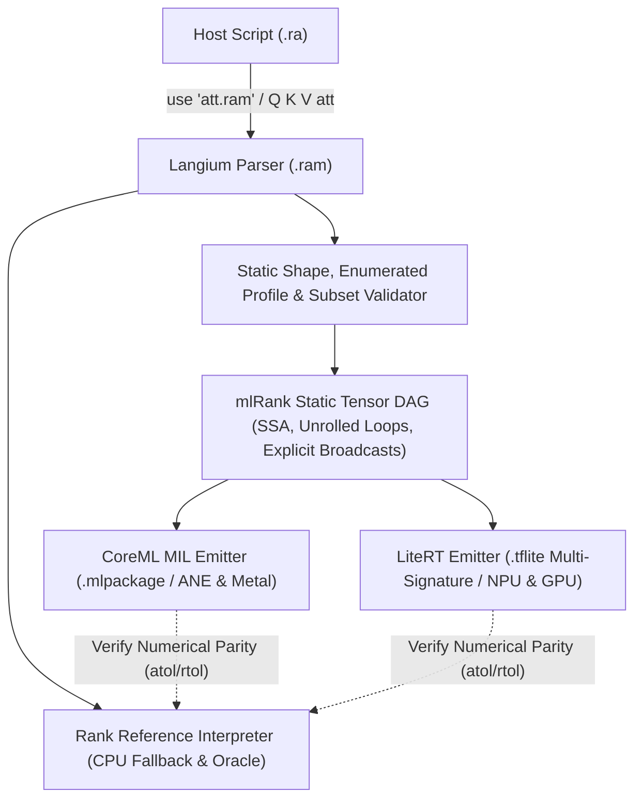

# mlRank (`.ram` MVP Specification)

## Implemented Hello World subset

The prototype supports fixed-shape real tensor inputs, ReLU, and broadcast
`.f32` expressions using `+`, `*`, `softmax`, `linear`, `layernorm`, and `gelu_new` with baked `arg` constants. Import it with `use "hello.ram"` and call `X hello`.
See [the ReLU example](../../demos/mlrank/main.ra) and
[the affine example](../../demos/mlrank/affine.ra), and
[the linear example](../../demos/mlrank/linear.ra).
Baked constants evaluate ordinary Rank array expressions at compile time: literals,
`array shape ... fill`, ranges, arithmetic, reshape, transpose, and other array
operations from `core`, `sequences`, `numbers`, and `linalg`. Earlier baked options
are available; runtime inputs and host I/O are not. The result must be a numeric
array with exactly the declared shape. Integer and real elements are materialized
and rounded to finite FP32 values; existing size limits still apply. For example,
`arg W .f32 shape 2 3 = (1 to 6) reshape 2 3` and
`arg W .f32 shape 2 3 = array shape 2 3 fill 1` both work.
A string default still names a binary `.rwt` attachment (see below).
`X W linear` accepts `X[...,M,K]` and baked `W[K,N]`, producing `[...,M,N]`.
Each tensor has its own statically checked shape. `+` and `*` align trailing axes;
matching dimensions or dimensions of size 1 broadcast, as in ordinary Rank arithmetic.
For example, `[M,N] + [N]` adds a bias to each row. General `rank L R`, scalar graph literals and weight overrides remain unsupported.
`matmul rank 2 2` and multiple runtime inputs are supported (see stage 10 below).
Baked arithmetic constants with rank 4 must have batch dimension 1; other batch
sizes are rejected because the GPU backend does not preserve those constants correctly.
The compiler aligns operands using static reshapes (constant reshapes are baked),
with explicit spatial axes for matrices to keep LiteRT tensor layouts consistent.
Softmax uses the last axis and requires `.f32`. Simple `Name = expression`
assignments bind names to graph nodes in source order. Rebinding a name leaves
earlier tensors unchanged; using a computed name twice reuses its node.
Deferred, compound and indexed assignments remain unsupported.

```rank
use ml
arg X .f32 shape 2 3
Old = X
X = X relu
H = Old softmax
return H
```

Changing source or referenced binary weights recompiles the model on the next call.
The softmax check runs 60 calls per host across ranks 1–4, large positive and
negative logits, equal logits, singleton rows, aliases and reused results.
Mac, Intel UHD and OnePlus Adreno 619 passed with full GPU delegation and maximum
absolute errors below 8e-8. Checks include output shapes, row sums and model caching.
The Android check also edits a RAM tab, runs the source, and verifies persistence
after reload. Generate it with `node scripts/mlrank-softmax-check.mjs --android`
and run `output/playwright/ram-softmax.js` in the WebView; verify native placement
with `scripts/mlrank-android-placement.mjs`.

From the repository root, with Node.js 22.12+ and `uv` installed:

```sh
npm run mlrank:setup
npm run build
npm run rank -- demos/mlrank/main.ra
node scripts/mlrank-check.mjs
node scripts/mlrank-affine-check.mjs
node scripts/mlrank-linear-check.mjs
node scripts/mlrank-broadcast-check.mjs
node scripts/mlrank-softmax-check.mjs
node scripts/mlrank-mlp-check.mjs
node scripts/mlrank-norm-check.mjs
```

`mlrank:setup` installs Python 3.12 and LiteRT 2.3.0 in
`node_modules/.cache/mlrank`. `RANK_ML_PYTHON` can select another Python
environment containing `ai-edge-litert==2.3.0` and NumPy.
The desktop bridge retains one Python process and up to four compiled models.
The host loads each part once and invokes its opaque ID with new inputs. Repeated calls reuse its buffers; cache admission evicts the least recently used parts when necessary.
The helper exits with the host process. GPU checks report cold preparation,
warm preparation, execution and host round-trip time separately.

The Android app includes LiteRT. Open **GPU Hello World** in the command menu,
then **Run program**. **GPU Linear** opens the matrix multiplication and bias example. The upper tabs contain the main program and its attached
`hello.ram`. **+** creates another RAM module, inserts its `use "name.ram"` at the start
of Program and appends `X name` at the end. Prepare `X` with the declared
shape before running. Creating a module edits source without executing it.
Switching tabs keeps the main
REPL state and unfinished text; it does not execute code. Sources are saved
together in the notebook. Exporting a program with modules produces a ZIP
containing `main.ra`, the `.ram` sources, binary `.rwt` weights and a notebook snapshot. The ZIP can
also be imported. Programs without modules keep their existing `.ra` export.

For a local Mac browser session, run `npm run dev --workspace @arrrank/web`
and open `/console.html`. The Vite development server supplies the native GPU
bridge. Static hosting does not supply this bridge. Desktop requests use POST bodies.
Android sends request bodies through Capacitor; the worker waits for the result
using an opaque request ID. Tensor data and model bytes never travel in URLs.

The prototype emits a TFLite graph and uses LiteRT GPU on every platform:
Metal on macOS, OpenCL on the tested Android devices, and WebGPU/Vulkan on
the tested Intel Linux host. CoreML and NPU execution remain proposals.
Arithmetic currently requires `.f32`; `.f16` supports ReLU only. The arithmetic
check compares against ordinary Rank execution with `atol=1e-5, rtol=1e-6`,
allowing FP32 intermediate rounding and fusion. This is a workload acceptance
tolerance, not a universal error bound for arbitrarily long expressions.
The linear subset accepts rank-2–4 inputs and rank-2 weights, including dimensions not divisible
by 16 or 32. It emits LiteRT `FULLY_CONNECTED` with weights transposed once
to `[N,K]` during compilation; no host multiplication or explicit padding is used.
This is GPU execution, not a claim of AMX or Hexagon NPU execution.
Tensor shapes have 1–4 positive dimensions. Computed tensors and baked constants
allow at most 1,048,576 elements; file runtime inputs allow up to 4,194,304 elements
each, with a 64 MiB aggregate input budget (see resident projection below).
Inputs must contain finite Rank `real` values; integers are not narrowed.
`.f16` and `.f32` round at the input/output boundary. LiteRT transport and computation use float32 tensors; both native bridges
explicitly request FP32 GPU precision. `.f16` describes boundary rounding,
not FP16 intermediate arithmetic. This proves the declared ReLU result within the chosen
tolerance; it does not establish hardware FP16 arithmetic. Binary16 values
outside ±65504 are rejected.

The desktop runtime checks `is_fully_accelerated()` and rejects partial
delegation. Android requests only the GPU accelerator. Kotlin LiteRT 2.3.0
does not expose the corresponding placement query; verify all graph nodes
using native delegate logs. The response reports `gpuOnlyRequested`,
not an invented placement result. There is no interpreter fallback when
the GPU runtime is unavailable.

Mac M5 and Intel UHD (Comet Lake) passed `mlrank-check.mjs`: maximum absolute
errors were 0 and 5.96e-8 respectively, against an absolute tolerance of 1e-4.
The standalone LiteRT probe delegated 1 of 1 nodes on Adreno 810 and Adreno 619.
The Android APK also ran the `.ra` example on OnePlus BE2029 (Android 11,
Adreno 619); its native log confirmed 1 of 1 delegated nodes. Three cached
calls matched the CPU reference with a maximum absolute error of 5.96e-8.
The affine graph (`Mul + Add + Relu`, 4096 elements) also passed on all three
hosts, including changing baked weights and repeated calls. Maximum absolute
error versus Rank was 3.06e-5; Android delegated all 3 nodes. Generate the
Android check with `node scripts/mlrank-android-fixtures.mjs`, then run
`output/playwright/ram-affine.js` through Playwright attached to the WebView.
Afterwards, `node scripts/mlrank-android-placement.mjs SERIAL APP_PID` checks
native delegation logs for that app process. A successful API response alone
is not proof of full Android placement.
The linear check passed on Mac M5, Intel UHD and OnePlus Adreno 619;
Android delegated both nodes (`FULLY_CONNECTED` and `RELU`).
It uses nonuniform weights, rectangular and odd shapes, output
expansion/contraction, repeated calls and changed weights. It compares against
Rank `matmul` with `atol=1e-5, rtol=1e-5`. Generate the Android check with
`node scripts/mlrank-linear-check.mjs --android`, then run
`output/playwright/ram-linear.js` in the WebView and check native placement logs.
The notebook and its selected RAM tab survived a WebView reload.
These checks establish correctness and placement for this workload, not a
speedup. Linux WebGPU profiling in the standalone tool is unsupported; run
that probe without `--use_profiler=true`.

## LayerNorm and GELU (stage 9)

Both operations accept rank 1–4 `.f32` tensors and preserve shape.
`X layernorm` normalizes each last-axis row using population variance and
epsilon `1e-5`. To override epsilon, use `X Epsilon layernorm`, where
`Epsilon` is a positive baked one-element FP32 tensor. Apply learned scale
and bias using existing broadcasting:

```rank
use ml
arg X .f32 shape 2 3
arg Epsilon .f32 shape 1 = array 0.00001
arg Scale .f32 shape 3 = array 1.0 0.5 2.0
arg Bias .f32 shape 3 = array 0.0 0.1 -0.1
H = X Epsilon layernorm * Scale + Bias
return H gelu_new
```

Run [normalize.ra](../../demos/mlrank/normalize.ra) for this example.
Scale and bias may also come from the existing binary attachments.
`gelu_new` uses the tanh approximation
`0.5*x*(1+tanh(sqrt(2/pi)*(x+0.044715*x³)))`, matching the
[Transformers definition](https://github.com/huggingface/transformers/blob/main/src/transformers/activations.py).
The [GPT-2 configuration](https://huggingface.co/openai-community/gpt2/blob/main/config.json)
selects this activation and epsilon `1e-5`. This is not the erf GELU variant.

LayerNorm lowers to SUM, division, subtraction, multiplication and reciprocal
square root; GELU lowers to arithmetic and TANH. All operations must delegate
to GPU. No dedicated LayerNorm kernel or performance improvement is claimed.
The first centering pass is followed by a second centering of the residual:
in exact arithmetic the residual mean is zero; in FP32 this corrects mean
rounding on constant and almost constant rows with a large offset.
Variance is then computed from these centered residuals.
A MEAN-based prototype produced an error around 117 on Metal for a row near
1000 with a small spread, despite correct intermediate variance when evaluated
separately. SUM/division avoids that full-graph failure. The precise backend
rewrite responsible has not been established.

[Recorded checks](../../benchmarks/baselines/2026-10-27-mlrank-normalization.json):
36 fixtures, including ranks 1–4, singleton channels, width 768, negative and
saturated GELU inputs, constant rows (including 1000.25), small variance,
large offsets, custom epsilon, affine scale/bias, and a normalized two-linear
MLP with GELU. The reference uses independent scalar equations in double
precision with FP32 input/weight values. Every output passes
`abs(error) <= 1e-5 + 1e-5*abs(reference)`.

| Host | Calls | Maximum absolute error |
| --- | ---: | ---: |
| Mac M5 / Metal | 72 | 1.64e-7 |
| Intel UHD / jack.lan | 72 | 2.14e-7 |
| OnePlus Adreno 619 | 216 | 2.84e-7 |

Desktop checks run through the ordinary Rank interpreter and native bridge.
Android fixtures exercise the native bridge; the separate
`packages/web/test/ram-norm-ui.playwright.js` checks compilation from the RAM
tab, execution, and persistence after reload in the installed APK.
The new APK is installed and this UI check passed on the unlocked OnePlus:
RAM-tab compilation, execution, and source persistence after reload. The test
restores its original example source afterward.
The captured Android log contains 13 full-placement records; older records were
evicted from the log buffer, so this is not a per-fixture placement audit.
Generate native Android fixtures with `node scripts/mlrank-norm-check.mjs --android`
and run `output/playwright/ram-norm.js`. Placement evidence is captured with
`scripts/mlrank-android-placement.mjs`.
These are correctness checks, not latency measurements or guarantees for all
finite FP32 magnitudes: intermediate arithmetic can still overflow, as in the
existing arithmetic operators. Expanded subgraphs count toward the 128-tensor
limit. Weight upload/creation UX remains deferred.

## Complete small MLP

Open **GPU MLP** → **Run program**, or run `npm run rank -- demos/mlrank/mlp.ra`.
[The program](../../demos/mlrank/mlp.ra) calls [classifier.ram](../../demos/mlrank/classifier.ram):
a batch of four inputs passes through two linear layers with bias, ReLU and softmax.
The shapes are `[4,2] → [4,3] → [4,2]`. Output columns are classes 0 (equal bits)
and 1 (different bits); selecting the larger probability gives XOR.

These are analytically constructed weights, authored for this example on 2026-10-27,
not a trained checkpoint. For input `(x,y)`, the hidden vector is
`[max(x+y,0), max(x+y-1,0), max(y-x,0)]`. The third feature adds the same offset
to both logits, exercising a width of three without changing the probabilities.
The logits are `[2-4*h0+8*h1+h2, -2+4*h0-8*h1+h2]`.
This model demonstrates inference mechanics; it does not establish accuracy on a real dataset.

| Input | Hidden | Logits | Probabilities [0, 1] | Class |
| --- | --- | --- | --- | --- |
| 0, 0 | 0, 0, 0 | 2, -2 | 0.98201379, 0.01798621 | 0 |
| 0, 1 | 1, 0, 1 | -1, 3 | 0.01798621, 0.98201379 | 1 |
| 1, 0 | 1, 0, 0 | -2, 2 | 0.01798621, 0.98201379 | 1 |
| 1, 1 | 2, 1, 0 | 2, -2 | 0.98201379, 0.01798621 | 0 |

`node scripts/mlrank-mlp-check.mjs` compares hidden values and logits with CPU Rank
and independent scalar equations, then checks probabilities and classes. It also
covers negative and fractional inputs, five repeat calls per graph and changed weights.
The changed weights must replace the cached model. Mac, Intel and OnePlus each passed
42 calls with maximum absolute error `5.48e-8` or less (`atol=rtol=1e-5`).
Desktop placement was checked through LiteRT; Android delegated all 12 nodes of the
full MLP. Its menu example ran, survived reload and ran again. Archive round-trip
coverage verifies the main source and attached weights together.

For Android, generate `output/playwright/ram-mlp.js` using
`node scripts/mlrank-mlp-check.mjs --android`; run it through Playwright attached to
the app WebView, then run `node scripts/mlrank-android-placement.mjs SERIAL APP_PID`.
Restart the app before timing a first call. Capture `adb -s SERIAL shell dumpsys
meminfo com.arrrank.app` before and after for app memory snapshots.

### Stage 6 measurements (2026-10-27, before binary weights)

Milliseconds, batch of four, first full MLP call followed by five cached calls.
Cold means a fresh native runtime; OS and driver caches were not cleared.
Warm columns are medians, not throughput benchmarks.

| Host | Cold round trip | Cold prepare | Warm round trip | Warm execute + I/O | Warm transport + scheduling |
| --- | ---: | ---: | ---: | ---: | ---: |
| Mac | 67.58 | 15.36 | 0.51 | 0.42 | 0.08 |
| Intel | 165.19 | 44.92 | 0.92 | 0.64 | 0.28 |
| OnePlus | 556.90 | 494.61 | 24.20 | 2.67 | 21.64 |

At stage 6 the serialized model was 2,072 bytes, including original and transposed weights.
It was sent on every call: request bodies are 2,817 bytes on desktop and
2,802 bytes on Android for the truth-table input. Input and output tensors are
32 bytes each. Transport time above is a residual that includes JSON, IPC and
scheduling; native execution includes buffer writes and reads. These are not
separate measurements of GPU kernel time or device transfer bandwidth.

After the checks, Python helper RSS was 50,912 KiB on Mac
and 113,876 KiB on Intel. OnePlus app PSS changed from
135,242 to 183,004 KiB; app RSS changed from 244,688 to 296,068 KiB across the checks
and UI reload. These snapshots include runtime/UI overhead and are not peak memory
or tensor allocation measurements; Android excludes separate WebView renderer
processes. No speedup or memory saving is claimed.

[Recorded samples](../../benchmarks/baselines/2026-10-27-mlrank-mlp.json) retain all
calls and measurement boundaries. These measurements describe stage 6; stage 7 below changes the transport. Stage 8 below compares CPU timing and separates native costs.

## Binary weights and model lifecycle

The MLP uses four `.rwt` files beside `classifier.ram`. Ordinary Rank still imports
only the module; a baked option names its attachment:

```rank
arg W1 .f32 shape 2 3 = "w1.rwt"
```

Names are lowercase letters, digits and underscores followed by `.rwt`, with no
system paths. The CLI resolves them beside the module. Android and browser workers
resolve them from the current notebook. Export the program as ZIP to replace weights
on desktop, then import the ZIP. The attachment bytes are authoritative; a native
compiled model is disposable and is never stored in the archive. There is no separate
attachment editor in this MVP.

RWT1 consists of four magic bytes `RWT1`, a little-endian uint32 JSON-header length,
a UTF-8 header, and little-endian float32 payload. The header declares `dtype: "f32"`,
`shape` and the payload's hexadecimal SHA-256. The compiler checks the declared option
shape, dtype, exact byte length, checksum and finite values before GPU submission.
`encodeRamWeights(shape, values)` creates the format. Regenerate the analytical example
with `node scripts/mlrank-weights.mjs` after building the interpreter.

The wire protocol has `load` (model bytes once), `invoke` (model ID and inputs) and
`release`. Up to four native models share a 128 MiB reservation budget per runtime.
Alternating resident modules reuses their buffers and file inputs. An
expired or released ID returns `STALE_MODEL`. The host reloads and retries once;
ordinary execution errors are not retried. Runtime shutdown also releases resources.
Source or weight changes produce a new graph. Weight bytes are checked on each call,
so file reads and hashing still contribute to host cost.

Ordinary tensor inputs and outputs use JSON arrays; file-backed inputs and
retained GPU handles use the paths described below. The small MLP does not justify another
binary tensor protocol yet: its repeated invoke body is 109 bytes on desktop and
94 bytes on Android. There are no model bytes in either repeated request. The current
FlatBuffer is 1,924 bytes instead of 2,072: unused original linear-weight buffers are
omitted, and reshaped constants sharing the same values reuse their buffer. The host
compiler still retains decoded weights; this is not a peak-memory saving claim.

This small-model path retains 1,048,576 elements per tensor, 32 MiB of source
constants and 128 graph nodes. Larger file runtime inputs use the separate limits
described below. Transport independently rejects JSON requests above 32 MiB, including base64
expansion: the constant limit alone does not guarantee a model fits. Notebook binary
attachments are capped at 8 MiB total and 64 files; archives at 16 MiB uncompressed.
The current native JSON store reads large snapshots in chunks to avoid SQLite's
single-row CursorWindow limit. A 2,800,116-byte attachment (3,733,559-byte snapshot)
passed native save/read checks. The stage 8 measurements below do not justify raising these limits; larger models need further memory and transfer checks.

Verification commands:

```sh
node scripts/mlrank-mlp-check.mjs
node scripts/mlrank-lifecycle-check.mjs
node scripts/mlrank-mlp-check.mjs --android
```

Mac, Intel and OnePlus each passed 42 GPU calls with maximum absolute error below
5.48e-8, including changed binary weights. Android logs confirmed full delegation
(12/12 nodes for the full MLP, 9/9 for intermediate outputs). Desktop lifecycle checks
also cover explicit release, a real helper restart and changed attachment bytes in
an already imported module. Archive tests preserve source and binary bytes exactly.
The menu example ran and survived reload on Mac and Android. On OnePlus, replacing
the persisted binary bias changed the output; restoring it recovered the original
result. The saved binary MLP also ran after restarting the final APK.
[Stage 7 samples](../../benchmarks/baselines/2026-10-27-mlrank-weights.json) record request
sizes and lifecycle events. Android timings were collected with the lock screen
active and must not be compared as performance measurements.

## MLP cost measurements (stage 8)

Two runs per host, five fixed shapes, three warm-up calls and 15 interleaved CPU/GPU
samples per shape. Call order and two deterministic inputs alternate. Another 15 GPU
calls with profiling disabled follow each case. Every result is checked against
independent scalar equations, including the softmax, at `atol=rtol=1e-5`.
All 340 GPU calls per host passed; maximum absolute error was below `1.38e-7`.
Desktop runtimes reported full delegation. A live Android log captured 12/12 delegated
nodes for each of the five models in the second run.

The table shows the range of the **two run medians**, in milliseconds, as **CPU / GPU**.
Dimensions mean batch x input width x hidden width x output width. These are application
call costs, not isolated matrix multiplication throughput.

| Dimensions | Mac M5 | Intel i7-10750H / UHD | OnePlus / Adreno 619 |
| --- | ---: | ---: | ---: |
| 4 x 2 x 3 x 2 | 0.99-1.30 / 0.55-0.77 | 3.63-4.01 / 1.25-1.27 | 9.30-12.60 / 11.60-12.50 |
| 256 x 2 x 3 x 2 | 19.38-26.66 / 0.99-1.29 | 78.77-78.91 / 1.97-2.13 | 191.50-196.50 / 21.00-23.60 |
| 1 x 64 x 128 x 32 | 1.48-2.07 / 0.63-1.07 | 4.11-4.20 / 1.20-1.40 | 9.20-10.70 / 13.60-14.90 |
| 16 x 64 x 128 x 32 | 8.88-11.99 / 1.01-1.61 | 21.23-21.45 / 2.42-2.46 | 38.50-39.10 / 17.50-17.80 |
| 16 x 128 x 256 x 64 | 38.76-57.10 / 1.90-2.71 | 91.98-92.01 / 4.22-4.35 | 140.80-144.10 / 44.80-48.10 |

On desktop, GPU calls beat this CPU Rank program for all tested shapes after preparation.
On OnePlus, the small XOR case is near the crossover: the winner changes between runs.
For one `64 -> 128 -> 32` input, CPU is faster in both runs. Batches of 16 and 256 favor
GPU in both runs. This does not compare GPU with optimized native CPU BLAS: CPU Rank
uses float64 arithmetic and its current interpreter/array operations; GPU uses float32.
The error checks establish numerical agreement within the stated tolerance.

The first native call also loads and prepares the model. It takes roughly 0.3-0.6 seconds
on OnePlus in this workload. Only the first case starts a fresh native runtime; the other
cases load new models into the existing process. Driver caches are not cleared. RAM
compilation and interpreter import are measured separately, before timed calls. The
first standalone compile includes parser/JIT startup; later compiles share that startup.
Do not add standalone compile time to import time: import already compiles the module.

### Where time goes

For the largest case `[16,128,256,64]`, ranges below are the two run medians in ms:

| Host | Input conversion + write | Runtime dispatch | Readback / wait | Output packing | JSON + IPC + scheduling residual | Rank host work |
| --- | ---: | ---: | ---: | ---: | ---: | ---: |
| mac | 0.05-0.09 | 0.45-0.53 | 0.01-0.01 | 0.01-0.01 | 0.69-1.01 | 0.70-1.03 |
| intel | 0.15-0.15 | 0.38-0.42 | 0.89-0.96 | 0.01-0.01 | 1.46-1.54 | 1.23-1.23 |
| android | 0.71-1.21 | 0.62-0.67 | 1.44-1.70 | 0.14-0.14 | 28.56-31.42 | 6.00-6.00 |

Dispatch and readback must be considered together: LiteRT can wait for GPU completion
in either call. Neither number alone is GPU kernel time. Input timing includes native
array conversion/validation and buffer write. Output packing means conversion into
an array for JSON; encoding itself remains in the residual. The residual subtracts
native preparation/execution from host bridge wall time and includes JSON codecs,
worker/pipe or Capacitor transport and scheduling. It is not device bandwidth.
Rank host work includes checking weight contents, boundary conversion and result
materialization. Weight lookup is in-memory here; desktop filesystem I/O is excluded.

The non-profiled control preserves the same conclusions for wide single-input and
batched Android cases, but its timings differ from the interleaved samples. It runs
later, so JIT, GC and scheduling also differ; the delta is not a pure profiling-overhead
measurement. Raw samples retain both paths.

### Memory and scope

Serialized models range from 1,924 to 199,744 bytes. Source weight attachments range
from small XOR constants to about 194 KiB; input/output tensors are tracked separately.
The measured desktop processes reached 455-461 MiB host RSS high-water marks on Mac and 428-442 MiB on Intel,
including CPU computations, compiler, libraries and the benchmark. Native helper peaks
were about 54 MiB on Mac and 114 MiB on Intel. These are process measurements, not model
arenas or incremental weight allocation.

On Android, app PSS snapshots were about 132-165 MiB. The largest observed `/proc`
VmHWM was about 238 MiB, but that field decreased between later snapshots; it cannot
establish a reliable lifetime peak in this run. The separate WebView renderer, where
Rank and the CPU benchmark execute, is excluded. A complete Android memory peak remains
unmeasured. No memory saving is claimed from these numbers.

The measured workspace includes existing uncommitted integer-comparison changes. The
same compiled interpreter was used on the three hosts; its content hash and affected
source paths are recorded with the samples. Node versions differ between desktop hosts,
and WebView has its own engine. Compare CPU and GPU within a host, not host rankings.

### Decision and reproduction

Use batches when latency requirements permit. Keep the single-input path for correctness
and interactive use, but do not promise GPU acceleration for tiny Android calls. There
is no evidence here for adding fusion, custom kernels, an arena allocator or a binary
tensor protocol now. Android bridge/host work costs more than dispatch plus readback;
optimizing kernels alone cannot remove it. If mobile latency becomes the next target,
measure batching and transport/serialization changes first. Attachment versioning could
remove repeated content hashing, but belongs with the deferred weight-editing workflow.
The next roadmap step remains LayerNorm and GELU.

```sh
npx tsc -b tsconfig.build.json
node benchmarks/mlrank/run-costs.mjs > costs.json
node benchmarks/mlrank/build-android.mjs
# Attach playwright-cli to the foreground app WebView, then:
playwright-cli -s=costs run-code --filename output/playwright/ram-costs.js
```

For Android, use a build containing the native profiling fields, keep the screen unlocked
and Rank in the foreground, and capture native `tflite` logs live: logcat's ring buffer
can overwrite earlier placements. The generated benchmark runs in a dedicated worker
using the same synchronous XHR/Capacitor route as the application. It creates no notebooks
and releases each native model. Capture `dumpsys meminfo com.arrrank.app` and the app's
`/proc/PID/status` before and after; retain the raw accounting fields separately.

[Source and samples](../../benchmarks/baselines/2026-10-27-mlrank-costs.json) record all
calls, compiler/import times, model/tensor sizes, memory observations and placement.

## Proposed full MVP

**Status:** Draft MVP — 2026-10-25  
**File extension:** `.ram` (Rank Accelerator Module)  
**Target backends:** Apple CoreML (MIL / ANE / Metal GPU), Google LiteRT (TFLite FlatBuffers / StableHLO / GPU & NPU Delegates), ARM TOSA, and Rank CPU Interpreter fallback.

`mlRank` is a **statically compilable subset of Rank** stored in `.ram` files and designed for hardware neural accelerators (NPUs and GPUs). Every `.ram` file is a self-contained Rank module that declares its typed/shaped tensor inputs via `arg`, expresses computation using pure tensor dataflow, and returns its outputs via `return`.

Crucially, **no external JSON manifest is needed**, and **`.ram` modules can be imported and executed directly from ordinary `.ra` files** using Rank's standard `use` / `run` module mechanism.

*For an incremental, step-by-step implementation guide from a simple NPU "Hello World" to a full GPT-2 model, see the [Implementation Roadmap](ROADMAP.md). For on-device JIT compilation details on iPhone/iPad, see [CoreML on iOS](IOS_COREML.md). For interactive visualization (`use viz`) and the training environment design, see [Training Environment & Visualization](TRAINING_ENVIRONMENT.md).*

---

## 1. Core Design Principles

1. **Self-Contained `.ram` Modules:** A `.ram` file contains everything the compiler needs inside the source code itself: hardware precision tags (`.f16`, `.f32`, `.bf16`, `.i32`, `.i8`), static or enumerated shapes (`shape ...`), weights, and outputs (`return`).
2. **Callable `.ram` Functions from `.ra`:** Importing `use "att.ram"` registers `att` as a directly callable function in the `.ra` workspace (`Out = Q K V att`). On devices with CoreML or LiteRT, the runtime compiles `.ram` into an accelerator graph and caches it; on environments without an NPU/GPU (or in the browser/REPL), it executes natively in the Rank CPU interpreter.
3. **Hardware-Native Precision via Labels:** Hardware numeric types are written as standard Rank label literals (`.f16`, `.bf16`, `.f32`, `.f8`, `.i32`, `.i16`, `.i8`, `.u8`, `.bool`), avoiding new reserved keywords in the parser.
4. **Static & Enumerated Shapes:** Every intermediate tensor's rank ($R$) and dimensions ($[d_1, \dots, d_R]$) are decidable at compile time for each shape profile.

---

## 2. `.ram` Program Structure: `arg`, Shapes & `return`

In `.ram`, `use ml` extends `arg` declarations to accept **hardware precision labels** and **`shape` contracts**, while top-level `return` defines the graph's output tensor (or `record` of tensors).

### 2.1 Inputs vs. Constant Weights (`arg`)

* **Runtime Input (`arg` without `=`):** Declares a positional parameter of the `.ram` function in declaration order.
* **Baked Weight / Parameter (`arg` with `= DefaultExpr`):** Declares a model weight or hyperparameter. When compiling to CoreML / LiteRT, its default value (or workspace override) is baked into the `.mlpackage` / `.tflite` constant buffer (enabling offline NPU weight packing and quantization).

```rank
rem att.ram
use linalg
use ml
use numbers
use sequences

rem Positional runtime inputs (no default '=')
arg Q .f16 shape 16 64
arg K .f16 shape 16 64
arg V .f16 shape 16 64

rem Baked weight (has default '=')
arg Gamma .f16 shape 64 = array shape 64 fill 1.0

Qn' = (Q 1e-5 rmsnorm) * Gamma
Kn' = (K 1e-5 rmsnorm) * Gamma

Out = Qn Kn V attention
return Out
```

Multiple outputs use an ordinary Rank `record`:

```rank
return record
  .logits = Logits
  .hidden = Hidden
end
```

### 2.2 Hardware Precision Labels

Because `.f16`, `.f32`, etc. are standard Rank `LabelLiteral` tokens (`.word`), they require zero new reserved words:

| Label | Meaning | CoreML MIL Type | LiteRT / TOSA Type | CPU Interpreter Execution |
| :--- | :--- | :--- | :--- | :--- |
| `.f32` | IEEE-754 float32 | `fp32` | `FLOAT32` | `real` (clamped/rounded to f32 at boundary) |
| `.f16` | IEEE-754 float16 | `fp16` (ANE native) | `FLOAT16` | `real` |
| `.bf16` | bfloat16 | `bf16` (M2+/A15+ GPU) | `BFLOAT16` | `real` |
| `.f8` | FP8 (E4M3 / E5M2) | Quantized LUT / `fp8` | `FLOAT8_E4M3FN` | `real` |
| `.i32` | 32-bit signed int | `int32` | `INT32` | `integer` (checked 32-bit range) |
| `.i16` | 16-bit signed int | `int16` | `INT16` | `integer` (checked 16-bit range) |
| `.i8` | 8-bit signed int | `int8` | `INT8` | `integer` (checked `-128..127`) |
| `.u8` | 8-bit unsigned int | `uint8` | `UINT8` | `integer` (checked `0..255`) |
| `.bool` | Boolean mask | `bool` | `BOOL` | `boolean` |

### 2.3 Fixed and Enumerated Shapes (`shape ... end`)

Hardware NPUs (both Apple Neural Engine and Qualcomm/MediaTek NPUs via LiteRT) require pre-allocated SRAM tile schedules and static arena layouts. Truly unbounded dynamic shapes often force an NPU fallback to CPU. However, **both CoreML and LiteRT natively support a finite list of enumerated shapes**:

* **CoreML (`ct.EnumeratedShapes`):** Allows up to ~128 predefined shapes per input (e.g. prompt buckets `[1, 64]`, `[1, 128]`, `[1, 256]` or image resolutions). ANE pre-compiles optimized plans for each shape in the set.
* **LiteRT (Multi-Signature Subgraphs / Shape Buckets):** Allows exporting a `.tflite` model with multiple named signatures (`shape_0`, `shape_1`, `shape_2`) sharing the exact same weight buffers in the FlatBuffer, or dispatching across pre-sized arena buckets with zero weight duplication.

In `.ram`, a single fixed shape is written inline, while **enumerated shapes** use a multi-line `shape ... end` block (one shape profile per line, matching `record ... end` and `array shape ... end`):

```rank
rem Single fixed shape (inline):
arg Image .f16 shape 1 224 224 3

rem Enumerated shapes (one profile per line, closed by 'end'):
arg Tokens .i32 shape
  1 64
  1 128
  1 256
end
```

If several inputs use `shape ... end` blocks, they must declare the same number of rows, and row $k$ across all inputs forms the $k$-th compilation profile.

---

## 3. Calling `.ram` from `.ra` as a Function

Importing a `.ram` file with `use "att.ram"` binds a callable function named after the file stem (`att`) — or the explicit alias in `use "att.ram" as my_att`.

Its positional parameters correspond to the `.ram` file's runtime `arg` declarations (those without a `=` default), in top-to-bottom declaration order:

```rank
rem main.ra — ordinary Rank script (tables, I/O, text, loops allowed)
use sequences
use "att.ram"

rem Prepare inputs in full Rank
Q = array 1 to 1024 reshape 16 64 real
K = array 1 to 1024 reshape 16 64 real
V = array 1 to 1024 reshape 16 64 real

rem Call att.ram directly like a regular Rank function!
Out = Q K V att
Out shape print
```

To override baked weights or inspect module fields before compiling, use an alias:

```rank
use "att.ram" as M
M.Gamma = NewGamma
Out = Q K V M.att
```

### What happens when `Q K V att` is called:
1. **Static Validation:** The compiler verifies that `att.ram` obeys all `mlRank` subset rules and that the arguments `Q`, `K`, `V` match one of the declared `shape` profiles.
2. **Accelerator Compilation & Caching:**
   * **macOS / iOS:** Lowers `att.ram` to CoreML MIL, compiles `.mlmodelc` in cache (keyed by `.ram` source + weight hashes), and executes on ANE / Metal.
   * **Android / Linux (`@arrrank/mobile`):** Lowers `att.ram` to a LiteRT FlatBuffer (`.tflite`), initializes the GPU / NPU delegate, and runs inference.
   * **Fallback / Reference Mode:** Executes the `.ram` body directly in the Rank CPU interpreter, validating input/output precision and shape contracts.

---

## 4. Allowed vs. Forbidden Language Constructs (MVP)

To guarantee zero CPU fallbacks inside a `.ram` file, the validator enforces:

| Category | Allowed in `.ram` MVP | Forbidden in `.ram` MVP (Why) |
| :--- | :--- | :--- |
| **Data Types** | `.f32`, `.f16`, `.bf16`, `.f8`, `.i32`, `.i16`, `.i8`, `.u8`, `.bool`, homogeneous dense `array` (Rank $0..5$), closed `record` and `tuple`. | `text`, `bytes`, `table`, `map`, `set`, `heap`, `deque`, `dsu`, `graph`, heterogeneous arrays. |
| **Control Flow** | Straight-line statements; `for i in Start to/till End [by Step]` where bounds are compile-time constants (statically unrolled by compiler). | `while` loops, recursion, `for` over dynamic tensor values, `if` / `else` branching on tensor elements. |
| **Conditionals** | Elementwise `Mask choose TrueVal FalseVal` (lowers to `mb.select` / `tosa.select` with static shape). | Boolean mask filtering `Data Mask` or `filter` (produces data-dependent shapes, breaking NPU memory planners). |
| **Addressing** | Static slices (`0 till 16`), `#` whole-axis selectors, `transpose`, `reshape` (with static target shape), integer tensor indexing along leading axes (`Embeddings Tokens` $\rightarrow$ `gather`). | Out-of-bounds dynamic slicing, scatter updates with overlapping runtime indices. |
| **Functions** | Non-recursive user `fun` definitions (inlined as subgraph blocks during lowering). | First-class dynamic function closures or runtime callback dispatch. |
| **Side Effects** | None inside `.ram` (pure value transformations). | File I/O (`use io`), `stdin`, random generation (`use random`) inside inference graph, throwing dynamic exceptions. |

### Static Loop Unrolling Example in `.ram`

Transformer and CNN stacks use compile-time `for` loops over layer indices:

```rank
Hidden = Input
for i in 0 till 12
  W1 = Weights1 i
  W2 = Weights2 i
  Mid' = (Hidden W1 linear) gelu
  Hidden = Hidden + (Mid W2 linear)
end
return Hidden
```

---

## 5. Operator Catalogue & Hardware Lowering

`mlRank` combines core Rank tensor operations with the stateless `use ml` vocabulary ([Issue #413](https://github.com/kmmbvnr/rank/issues/413)). Every operation has a fixed intrinsic cell rank so Rank's frame-broadcasting model eliminates manual `unsqueeze` and `transpose` boilerplate.

### 5.1 Core Math, Reductions & Structural Ops

Already built into Rank (`core`, `use numbers`, `use linalg`, `use sequences`, `use stats`):

| Rank Form | Cell Rank | Shape Contract | CoreML MIL | LiteRT / TOSA |
| :--- | :--- | :--- | :--- | :--- |
| `+`, `-`, `*`, `/`, `**`, `min`, `max` | `0 0` | Broadcast frames | `mb.add`, `mb.mul`, `mb.real_div`, `mb.pow`, `mb.minimum`, `mb.maximum` | `ADD`, `MUL`, `DIV`, `POW`, `MINIMUM`, `MAXIMUM` |
| `equal`, `less`, `greater`, `and`, `or`, `not` | `0 0` / `0` | Broadcast frames | `mb.equal`, `mb.less`, `mb.logical_and`, ... | `EQUAL`, `LESS`, `LOGICAL_AND`, ... |
| `Mask choose A B` | `0 0 0` | `s, s, s -> s` | `mb.select` | `SELECT_V2` / `tosa.select` |
| `abs`, `sqrt`, `exp`, `log`, `sin`, `cos`, `tanh` | `0` | `s -> s` | `mb.abs`, `mb.sqrt`, `mb.exp`, `mb.log`, `mb.tanh` | `ABS`, `SQRT`, `EXP`, `LOG`, `TANH` |
| `sum`, `mean`, `min`, `max`, `std` (`[axis A]`) | `all` / `axis` | Collapses reduced axes | `mb.reduce_sum`, `mb.reduce_mean`, `mb.reduce_min`, `mb.reduce_max` | `SUM`, `MEAN`, `REDUCE_MIN`, `REDUCE_MAX` |
| `Values max .index` / `min .index` | `1` / `axis` | `['d'] -> []` | `mb.reduce_argmax`, `mb.reduce_argmin` | `ARG_MAX`, `ARG_MIN` |
| `A matmul B [rank 2 2]` | `all` / `2 2` | `[..., M, K], [..., K, N] -> [..., M, N]` | `mb.matmul` | `BATCH_MATMUL` / `tosa.matmul` |
| `A reshape D1 D2 ...` | `all` | Preserves element count | `mb.reshape` | `RESHAPE` |
| `A transpose [axis ...]` | `all` | Permutes axes | `mb.transpose` | `TRANSPOSE` |
| `Emb Indices` (array addressing) | special | Replaces leading axis with index shape | `mb.gather` | `GATHER` / `tosa.gather` |

### 5.2 Elementwise Activations & Clamping (`use ml`, Default Cell Rank: `0`)

Map scalars `s -> s` across any tensor shape and fuse directly into preceding `conv2d` / `linear` / `matmul` operations on NPU and GPU:

| Rank Form | Cell Rank | Formula | CoreML MIL | LiteRT / TOSA |
| :--- | :--- | :--- | :--- | :--- |
| `X relu` | `0` | $\max(0, x)$ | `mb.relu` | `RELU` / `tosa.clamp` |
| `X Alpha leakyrelu` | `0 0` | $\max(\alpha x, x)$ | `mb.leaky_relu` | `LEAKY_RELU` |
| `X Alpha elu` | `0 0` | $x \ge 0 ? x : \alpha(e^x - 1)$ | `mb.elu` | `ELU` |
| `X sigmoid` | `0` | $\frac{1}{1 + e^{-x}}$ | `mb.sigmoid` | `LOGISTIC` / `tosa.sigmoid` |
| `X silu` | `0` | $x \cdot \sigma(x)$ | `mb.silu` | `MUL(x, LOGISTIC(x))` |
| `X gelu` | `0` | $x \cdot \Phi(x)$ | `mb.gelu` | `GELU` |
| `X softplus` | `0` | $\ln(1 + e^x)$ | `mb.softplus` | `LOG(ADD(1, EXP(x)))` |
| `X Low High clip` | `0 0 0` | $\min(\max(x, \text{low}), \text{high})$ | `mb.clip` | `tosa.clamp` |

### 5.3 Vector Normalizations (`use ml`, Default Cell Rank: `1`)

Because these operations declare intrinsic cell rank `1` (`['d'] -> ['d']`), applying them to a 2D `[Batch, Dim]` or 3D `[Batch, Seq, Dim]` tensor automatically normalizes the trailing feature dimension without requiring `transpose` or `rank` modifiers:

| Rank Form | Cell Rank | Shape Contract | CoreML MIL | LiteRT / TOSA |
| :--- | :--- | :--- | :--- | :--- |
| `Scores softmax` | `1` | `['d'] -> ['d']` | `mb.softmax(axis=-1)` | `SOFTMAX` |
| `Scores logsoftmax` | `1` | `['d'] -> ['d']` | `mb.log_softmax(axis=-1)` | `LOG_SOFTMAX` |
| `X Eps layernorm` | `1 0` | `['d'], [] -> ['d']` | `mb.layer_norm(axes=[-1])` | Fused `MEAN` + `RSQRT` subgraph |
| `X Eps rmsnorm` | `1 0` | `['d'], [] -> ['d']` | `mb.rms_norm` / fused subgraph | Fused `MUL` + `MEAN` + `RSQRT` |
| `X normalize` | `1` | `['d'] -> ['d']` | `mb.l2_norm` | `L2_NORMALIZATION` |

*(Note: Explicit `axis A` overrides the default trailing axis and lowers to the `axis=A` attribute in CoreML MIL or an axis-specialized reduction in LiteRT).*

### 5.4 Linear, Spatial & Attention Macro-Kernels (`use ml`)

Providing explicit high-level operators allows the compiler to emit dedicated hardware macro-instructions (such as ANE convolution engines and Metal FlashAttention) instead of materializing intermediate `window` tensors:

| Rank Form | Default Cell Rank | Shape Contract | CoreML MIL | LiteRT / TOSA |
| :--- | :--- | :--- | :--- | :--- |
| `X W [Bias] linear` | `1 2 [1]` | `[..., In], [In, Out] -> [..., Out]` | `mb.linear` / `mb.matmul + mb.add` | `FULLY_CONNECTED` |
| `X Kernel conv2d [stride S] [padding P]` | spatial macro | `[..., H, W, Cin], [Kh, Kw, Cin, Cout] -> [..., Ho, Wo, Cout]` | `mb.conv` | `CONV_2D` / `tosa.conv2d` |
| `X Window maxpool2d [stride S] [padding P]` | spatial macro | `[..., H, W, C] -> [..., Ho, Wo, C]` | `mb.max_pool` | `MAX_POOL_2D` |
| `X Window avgpool2d [stride S] [padding P]` | spatial macro | `[..., H, W, C] -> [..., Ho, Wo, C]` | `mb.avg_pool` | `AVERAGE_POOL_2D` |
| `Q K V attention` | `2 2 2` | `[..., Nq, Dk], [..., Nk, Dk], [..., Nk, Dv] -> [..., Nq, Dv]` | `mb.scaled_dot_product_attention` | Fused SDPA subgraph |
| `Indices Classes onehot` | `0 0` | `[], [] -> ['classes']` | `mb.one_hot` | `ONE_HOT` |
| `Values K topk` | `1 0` | `['d'], [] -> tuple(['k'], ['k'])` | `mb.topk` | `TOP_K_V2` |

---

## 6. Compiler Lowering Pipeline



### Key Lowering Transformations

1. **Rank-Modifier Broadcast Insertion (`rank L R`):**
   In Rank, `Scores - Tops rank 1 0` subtracts a rank-0 scalar cell `Tops[b]` from each rank-1 row `Scores[b, :]`. CoreML MIL and LiteRT expect trailing-axis numpy-style broadcasting. The `mlRank` compiler automatically inserts a static `reshape` / `expand_dims` (`[B] -> [B, 1]`) on the lower-cell-rank operand.
2. **Enumerated Shapes Lowering (`shape ... end`):**
   When `arg` declares a `shape ... end` block, the compiler propagates each row's shape profile through the DAG:
   * For **CoreML**, it emits `ct.EnumeratedShapes(shapes=[[1, 64], [1, 128], [1, 256]])` on the MIL function input.
   * For **LiteRT**, it emits multi-signature subgraphs (`shape_0`, `shape_1`, `shape_2`) sharing the constant weight buffers in a single `.tflite` file, selecting the matching signature when `Q K V att` is called based on the runtime input's actual shape.
3. **Window + Reduce Idiom Lifting:**
   Even if a user writes `B' = A window W stride S padding P` followed by `B max axis 2 3` (instead of `maxpool2d`), the `mlRank` IR recognizer fuses the lazy window view and reduction into a native `max_pool2d` operator without materializing the 4D windowed tensor.
4. **Layout Adaptation (`NHWC` vs `NCHW`):**
   Apple Neural Engine (CoreML) executes convolutions in `NCHW` (channels-first), whereas LiteRT GPU/NPU delegates require `NHWC` (channels-last). The `mlRank` compiler can insert layout transpositions at graph boundaries or fold weight transpositions at compile time.

## Structural operations and multiple inputs (stage 10)

FP32 RAM modules support these static forms using Rank syntax:

- `X reshape 2 3`: positive literal dimensions, unchanged element count.
- `X transpose` reverses axes; `X transpose axis 0 2 1` gives a full permutation.
- `X # (1 till 3)` selects columns 1 and 2; `to` includes its upper endpoint.
  Ranges must be nonempty and in bounds. `#` and omitted trailing selectors keep whole axes.
- `concat X Y axis 1`: at least two tensors, matching other dimensions; default axis 0.
- `X matmul Y`: two matrices. `X matmul Y rank 2 2` also broadcasts leading batch dimensions.
- `X W linear`: baked 2-D weights, with leading input dimensions preserved.

Negative indices/axes, inferred reshape dimensions, gathers, scalar selectors,
empty tensors and dynamic structural arguments are outside this subset.
General `rank` modifiers remain unsupported; `matmul rank 2 2` is the specific matrix-cell form.
The tensor size and 128-node graph limits still apply, including internal expansion.

Declare additional runtime inputs with `arg` without a default:

```rank
use ml
arg X .f32 shape 2 3
arg Y .f32 shape 3 2
return X matmul Y
```

In `product.ram`, this exports the ordinary Rank function `X product Y`.
Inputs follow declaration order and are checked separately before dispatch.
All multiple-input modules require FP32. Reloading changed source still checks
new shapes; changing the function arity requires importing again.

The existing JSON body contains flattened inputs in declaration order. Input
sizes accompany model loading, not every invocation. Each native input gets its
own buffer; model reuse and stale-handle recovery follow the existing lifecycle.
No input data is carried in a URL.

Batched linear uses reshape → FULLY_CONNECTED → reshape. Matmul uses
BATCH_MATMUL. On Metal, implicit expansion of crossed singleton batch axes gave
incorrect values for `[2,1,3,5] × [1,3,5,7]`. The compiler explicitly expands batch
axes with GPU concat nodes before matmul. This is a correctness workaround;
copy elimination and performance improvements are not claimed.

Validation on 2026-10-27: 26 fixtures, 78 GPU calls each on Mac and Intel,
156 on OnePlus. All matched ordinary CPU Rank and an independent scalar
reference at atol=rtol=1e-5; maximum absolute error was below 1.02e-7.
Native Android logs recorded full delegation for all 26 model loads in the
second run. The app test edits RAM, runs QKV from Program, reloads and checks
source persistence, then restores the example.

Run `node scripts/mlrank-structure-check.mjs`; add `--android` to generate
`output/playwright/ram-structure.js`. The UI check is
`packages/web/test/ram-structure-ui.playwright.js`. The small source example is
[`structure.ra`](../../demos/mlrank/structure.ra) with [`qkv.ram`](../../demos/mlrank/qkv.ram).
Its constant weights demonstrate graph structure, not a trained attention model.
[Recorded results](../../benchmarks/baselines/2026-10-27-mlrank-structure.json)
cover correctness, not speed or peak memory. The full test suite was not run.

## Core ML comparison on Mac (2026-10-27)

**Keep LiteRT as the MVP backend for now.** Core ML improves the larger matrix
case in this sample, but does not remove the need for numerical checks or make
small GPU graphs the fastest option. Adding an Apple-specific backend remains
a possible follow-up after measuring the complete attention/block workload.
The production runtime still requests GPU only; CPU rows below are explicit
benchmark controls, not a new fallback policy.

Apple M5, macOS 26.6.2; coremltools 9.0, LiteRT 2.3.0, NumPy 2.5.4.
Nine workloads, two trials in reversed order, 124 case/backend/mode runs.
Each run uses a new Python process, one first prediction, five warmups and
30 timed predictions. A final untimed prediction changes the input and checks
that model reuse observes it. References use NumPy float64 on the exact FP32
inputs and weights; acceptance is atol=rtol=1e-5.

The table gives the mean of the two warm-run medians in milliseconds. These
are in-process runtime calls including input/output handling. They exclude
Rank evaluation, JSON/IPC and Python startup; they are not kernel timings or
end-to-end app latency. All compared models use FP32, including Core ML
intermediates ([typed execution](https://apple.github.io/coremltools/docs-guides/source/convert-to-ml-program.html)).

| Workload | LiteRT CPU | LiteRT GPU | Core ML CPU | Core ML CPU+GPU |
| --- | ---: | ---: | ---: | ---: |
| LayerNorm offset, 3×7 | 0.002 | 0.554 | fails tolerance | fails tolerance |
| LayerNorm constant, 3×7 | 0.002 | 0.555 | fails tolerance | fails tolerance |
| LayerNorm, 16×768 | 0.011 | 0.545 | 0.038 | 0.040 |
| GELU, 16×768 | 0.017 | 0.522 | 0.102 | 0.101 |
| Crossed batches | 0.005 | 0.563 | 0.024 | 0.025 |
| Matmul, 1×4×16×16 | 0.005 | 0.520 | 0.026 | 0.029 |
| Matmul, 1×4×64×64 | 0.010 | 0.545 | 0.031 | 0.031 |
| Matmul, 1×8×256×256 | 0.297 | 1.242 | 0.234 | 0.927 |
| QKV → QKᵀ, 1×16×64 input | 0.006 | 0.548 | 0.030 | 0.027 |

Core ML's compute plan prefers CPU for the eight smaller workloads
(all rows except the throughput matmul), even with CPU_AND_GPU or ALL allowed.
For `1×8×256×256` matmul it prefers GPU in those modes. These are anticipated
placements from [MLComputePlan](https://apple.github.io/coremltools/source/coremltools.models.html#compute-plan),
not a device trace or a guarantee that CPU_AND_GPU means GPU-only. None of the
recorded plans preferred ANE. The CPU mode does not establish which CPU
instructions or matrix units the framework used.

The important controls and numerical results:

- On small QKV, LiteRT CPU takes 0.0059–0.0061 ms, Core ML CPU 0.0283–0.0308 ms,
  and LiteRT GPU 0.546–0.551 ms. The apparent small-graph Core ML advantage over
  LiteRT GPU largely reflects device selection; it reverses when compared to LiteRT CPU.
- On the larger matmul, Core ML CPU_AND_GPU takes 0.922–0.932 ms against
  LiteRT GPU's 1.237–1.246 ms. Core ML CPU takes 0.2339–0.2342 ms against
  LiteRT CPU's 0.294–0.299 ms. The CPU modes are faster than the GPU modes
  for this tested size, including readback and call overhead.
- The exact same implicit-broadcast TFLite graph is correct on LiteRT CPU
  but has maximum error 0.768 on LiteRT GPU for crossed batch axes.
  This isolates the failure to the GPU execution path rather than proving a
  defect in Metal itself. Explicit GPU concat expansion passes.
- Core ML's native `layer_norm` fails the strict tolerance near 1000:
  maximum error 0.000244 on offset rows and 0.0193 on constant 1000.25 rows,
  where the expected output is zero. This happens in CPU_ONLY, CPU_AND_GPU
  and ALL, with CPU preferred by the plans. Our twice-centered SUM/division
  graph passes when translated to Core ML as well as on LiteRT.
- All current RAM graphs pass on both runtimes, including the changed-input
  checks. The 14 failing runs are the two diagnostic cases above: six Core ML
  native-LayerNorm configurations per trial, and one LiteRT implicit-GPU case
  per trial. No error was hidden by widening tolerance.

Preparation and memory are separate costs. LiteRT native preparation takes
about 1.8–20.3 ms across the CPU/GPU cases. Core ML conversion takes 24.6–39.7 ms,
then compilation/loading takes 34.9–52.5 ms. Package writing is outside these
timers. The OS caches were not cleared, so these are fresh-process observations,
not guaranteed uncached startup costs. Core ML GPU throughput also has a
roughly 11 ms first prediction before its sub-millisecond warm calls.

Process peak RSS is roughly 44–177 MiB for LiteRT and 99–226 MiB for Core ML.
It includes Python, imports, input data and the reference calculation; it is
not model-arena memory and does not demonstrate lower device memory usage.
The full samples include RSS after imports and each timing component.

Reproduce in an isolated Python 3.12 environment with the versions above:

```sh
npx tsc -b tsconfig.build.json
node benchmarks/mlrank/coreml-fixtures.mjs /tmp/coreml-fixtures.json
python benchmarks/mlrank/coreml-compare.py /tmp/coreml-fixtures.json /tmp/coreml-results.json
```

The fixture exporter records the RAM compile time, source hash and model size.
The Python comparison emits both a literal translation of the lowered RAM graph
and natural Core ML operations, so the latter can avoid LiteRT-specific batch
expansion. This is a benchmark adapter, not a Core ML backend integrated into
Rank or Android. [Recorded results](../../benchmarks/baselines/2026-10-27-mlrank-coreml-comparison.json).

## Causal attention (stage 11)

[`attention.ra`](../../demos/mlrank/attention.ra) imports
[`attention.ram`](../../demos/mlrank/attention.ram), a fixed FP32 graph with Q/K/V
projection, head splitting, scaled QKᵀ, a baked causal mask, last-axis softmax,
attention × V, head merging and output projection. It uses existing RAM operations.
The deterministic example weights are not a trained checkpoint.

Validation on 2026-10-28 covers 36 fixtures: six intermediate/output stages,
three shapes and two inputs differing only at the final token. Context lengths
are 1, 3 and 5; batch sizes and head counts are 1 or 2; head width is 3.
An independent JavaScript scalar implementation supplies the reference.
Mac and Intel each pass 108 GPU calls; OnePlus passes 216. The runners check
atol=rtol=1e-5, row probability sums, exactly zero future probabilities for these
fixtures, and unchanged earlier outputs when the last token changes.

Maximum absolute error outside masked scores is below 1.06e-7. Masked scores
have absolute error up to 4.82e-4 at magnitude 10000, consistent with FP32
rounding and within the same relative tolerance. The finite -10000 mask is
validated for these bounded fixtures; this is not a guarantee for unbounded
logits or a trained checkpoint. Native Android logs confirm full GPU delegation.
The UI test compiles integer `fill 1` weights in the app, runs attention from
Program, checks the analytical output, reloads and verifies source persistence.
It restores the original example afterward.

Run `node scripts/mlrank-attention-check.mjs`; add `--android` to generate
`output/playwright/ram-attention.js` for the native bridge checks. The UI check
is `packages/web/test/ram-attention-ui.playwright.js`. `--compile-only` checks
all graph shapes without a GPU; `--write-demo --compile-only` also regenerates
the demo module. See the [recorded results](../../benchmarks/baselines/2026-10-28-mlrank-attention.json).
These are correctness checks, not a throughput or memory benchmark. The
TypeScript build, Android APK build and 27 focused interpreter tests pass;
the full test suite was not run. The next stage combines attention with
LayerNorm, residual connections and an MLP into a small transformer block.

## Small transformer block (stage 12)

[`transformer.ra`](../../demos/mlrank/transformer.ra) imports
[`transformer.ram`](../../demos/mlrank/transformer.ram). The fixed FP32 inference
block applies affine LayerNorm, causal attention, a residual addition, a second
affine LayerNorm, a 4× expansion MLP with `gelu_new`, and the second residual
addition. All projections include bias. The graph uses existing RAM operations;
its synthetic weights are not a trained checkpoint.

Validation on 2026-10-28 compares 11 stages against independent scalar JavaScript:
first normalization, QKV projection, scores, probabilities, attention output,
first residual, second normalization, MLP expansion, GELU, MLP projection and
final output. The 66 fixtures cover contexts 1/3/5, batch sizes and head counts
1/2, head width 3, and a changed final token. The perturbation differs by channel
so LayerNorm cannot remove it as a common offset. Previous outputs must remain
unchanged; probability rows must sum to one with zero future attention.

Mac and Intel each pass 198 ordinary GPU calls and six additional profiled calls;
OnePlus passes 396. Maximum absolute error is below 5.34e-7 at atol=rtol=1e-5.
Android native logs confirm full delegation for all 66 fixture loads. The app
check compiles the block from RAM source, runs it from Program, compares all
three output cells in the array viewer, reloads and checks source persistence,
then restores the example. No compiler or runtime change was needed.

The complete block contains 115 graph nodes. Serialized models occupy
10,476–12,024 bytes; constant payloads contain 932–2,636 bytes. The sum of logical
FP32/INT32 tensor sizes is 2,176–28,156 bytes; this sum is not an allocation or
GPU peak-memory measurement. Native helper peak RSS during the fixture sequence
reaches 54.8 MiB on Mac and 113.2 MiB on Intel, including the interpreter, runtime,
driver allocations and caches. Sampling Android `dumpsys meminfo com.arrrank.app`
about once per second during the final fixture sequence records a peak PSS of
189.5 MiB and RSS of 299.1 MiB for the app process. These process measurements
are not tensor-arena sizes, do not sum all separate WebView processes, and do
not establish that GPT-2 fits on any device.

Run `node scripts/mlrank-transformer-check.mjs` for desktop GPU checks and native
RSS profiles. `--compile-only` checks all fixtures without a GPU;
`--write-demo --compile-only` also regenerates the demo. `--android` generates
`output/playwright/ram-transformer.js`; `--ui` generates
`output/playwright/ram-transformer-ui.js`. The UI fixture adapts the one-token
block to the existing GPU Linear example's first input row.
[Recorded results](../../benchmarks/baselines/2026-10-28-mlrank-transformer.json)
include the scalar comparison, native memory profiles, Android memory samples
and delegation logs. TypeScript compilation and 27 focused tests pass. The full
suite was not run; this stage does not claim a throughput improvement.

Before importing a real checkpoint, review the 128-node limit: this single block
already uses 115 nodes. Also check tensor, constant, attachment and transport
limits, then choose graph partitioning or justified limit changes using actual
checkpoint sizes and device measurements.

## File-backed weights and native models (stage 13a, first slice)

Ordinary Rank can inspect Safetensors without loading the checkpoint into memory:

```rank
use io
use sequences
F = "model.safetensors" open
F safetensors
W' = F tensor "wte.weight"
Preview = W (0 till 3) #
Preview
```

The apostrophe uses Rank's existing deferred-binding semantics. An ordinary
assignment of the entire tensor materializes it. The index contains names, dtypes,
shapes and byte sizes; payload reads hold one block of at most 64 KiB per view.
Offsets use safe integers, including offsets beyond 2 GiB. See the
[IO manual](../manual/io.md#safetensors-and-tensor) for types and resource lifetime.

Desktop opens ordinary paths. Android opens `models/name.safetensors` in the
app's private `files/models` directory through bounded binary reads. These files
are separate from notebook attachments and exports. Import/file-picker UI and
automatic loading of a sharded checkpoint's index are still pending. Individual
shard files can be opened separately. This is read-only access; do not modify open
checkpoint files. Revision checks detect changes where the host exposes them,
but are not a cryptographic checkpoint identity.

The native GPU protocol now also accepts `modelFile: {path, size, sha256}` instead
of an inline `model`. Desktop requires an absolute path; Android resolves names
inside `files/models`. Both verify the complete prepared model with a streaming
SHA-256 pass (1 MiB read buffer) and load it with LiteRT's file API. Invoke/release
and stale-handle recovery are unchanged. The file must remain available and
unchanged for the resident model's lifetime. JSON carries the descriptor and
small runtime inputs/outputs, never the file payload on this path. File access
and GPU drivers may still allocate/copy memory; this is not a zero-copy claim.

This is a host API for **prepared LiteRT model files**. Existing `.ram` compilation
still builds a bounded FlatBuffer in JavaScript and uses the small-model bridge.
Compiling large tensor references into bounded native graph parts, choosing their
memory budgets and running the full GPT-2 stack remain stage 13b/13c. Safetensors
files are not passed directly to LiteRT as models. No tensor-size limits were
silently raised.

Reproduce the host checks:

```sh
npx tsc -b tsconfig.build.json
node --test packages/cli/test/safetensors.test.mjs packages/cli/test/ram-gpu.test.mjs
node scripts/mlrank-file-check.mjs
# Or select one bounded tensor from a real checkpoint for the multiplication check:
node scripts/mlrank-file-check.mjs /path/to/model.safetensors h.0.ln_1.weight
```

The file check saves a prepared model and `fixture.json` in the printed temporary
directory. `--compile-only` skips GPU execution. The Android native test template
is `packages/web/test/ram-file.playwright.js`; substitute `__FILE_FIXTURE__` with
that JSON and place the model at `files/models/filecheck.tflite`. The separate
`file-tensor-worker.playwright.js` exercises the shipped worker and viewer paging
API, without changing the user's notebook.

The large-file test uses a sparse 2,147,483,899-byte Safetensors file with a padding
tensor and six FP32 values past 2 GiB. It checks addressing and bounded reads,
not the capacity to execute a 2 GiB LLM. Real-weight native checks use the 768
values of GPT-2's `h.0.ln_1.weight` in a small elementwise multiplication graph,
not a full LayerNorm or transformer. Results are recorded in
`benchmarks/baselines/2026-10-28-mlrank-file-weights.json`.

### Runnable file-to-GPU demo

`demos/mlrank/fileweights.ra` and `doubleweights.ram` read the 768 real GPT-2
`h.0.ln_1.weight` values from `models/gpt2-ln1.safetensors` through a deferred
file tensor and pass its descriptor to the GPU module. The module computes
`X + X`; `Result` is the output. Keep `F` open until the GPU call completes.
The input payload does not enter JavaScript or the JSON request. This is not
zero-copy GPU access or large-model compilation.

The test OnePlus has the checkpoint sample and a saved **GPT-2 weights on GPU**
notebook. Use **Terminal commands → Run program** and open `real [768]` to inspect
the result. The deferred-input version was verified twice, including after reload;
16 visible values matched the reference and all 4 graph nodes were delegated.
A separate worker/native test compared all 768 results and observed only 163 bytes
of file-header reads in the WebView, with no input values serialized. On desktop,
provide the sample file at that relative path or edit the path.


### File tensor inputs to RAM

`Weights' = F tensor "name"` preserves a whole file tensor at the RAM call
boundary. The `RamGpu` host receives an optional `inputFiles` array, one descriptor
or null per declared input. Inline `input` contains only the remaining in-memory
inputs, flattened in declaration order. `createRamClient` forwards descriptors on
invoke, including stale-model recovery; model loading remains separate.

A descriptor contains `path`, `revision`, `fileSize`, `offset`, `length`, `dtype`
and `shape`. Both runtimes reject changed files, invalid ranges, nonfinite data
and unsupported dtypes before running the graph. Current descriptor transfer is
limited to F32 tensors and proved contiguous slices with `.f32` runtime inputs.
Arithmetic and noncontiguous selections remain ordinary computed arrays; they
are not replaced by their source file. Ordinary assignment still materializes. Type checks on deferred bindings
are retained when a descriptor passes through a binding wrapper.

Desktop maps only the selected byte range with NumPy memmap and copies it into
the LiteRT input buffer; the mapping is closed after the transfer. Android's
current Kotlin LiteRT API exposes `writeFloat(float[])`, so it uses a bounded
64 KiB read buffer plus the required native float array. It does not send file
payloads through the WebView. GPU buffers still need device memory. Unchanged file descriptors reuse their native
input buffers on subsequent invocations; file size and revision are checked before
reuse. An ordinary input write invalidates that buffer's file identity. Release,
eviction or release discards that model's resident inputs; helper restart discards all resident inputs. Failed writes
never mark an input resident. This does not prove the driver avoids internal copies.
File-backed baked constants and full-model partitioning remain separate work.

Runtime inputs allow up to 4,194,304 elements (16 MiB F32) each and 64 MiB in total.
Inputs above 1,048,576 elements must be file tensors. Computed tensors, outputs and
individual baked constants retain the 1,048,576-element limit; the 32 MiB constant
budget and 128-node limit remain. These are bounded graph budgets, not a claim that
all permitted graphs fit a device's memory.

`node scripts/mlrank-file-input-check.mjs` checks the complete Rank call path
with an input placed beyond 2 GiB in a sparse Safetensors file. Pass the standalone
GPT-2 LayerNorm sample as an argument to use its 768 real weights; `--compile-only`
prepares Android fixtures without running the desktop GPU. The output directory
contains `prefix.bin`, `payload.bin` and `fixture.json`; recreate the sparse input
with the recorded size and offset, without transferring gigabytes of zeros.
`packages/web/test/ram-file-input.playwright.js` validates the shipped Android
worker, native execution, viewer output and WebView file-read ranges. Results:
`benchmarks/baselines/2026-10-28-mlrank-file-input.json`.


### Resident GPT-2 QKV projection

`demos/mlrank/gpt2-qkv.ra` calls `gptqkv.ram` with the real GPT-2
`h.0.attn.c_attn.weight` matrix, shape `[768,2304]`, as a deferred file input.
It computes one token's QKV matrix product, without bias, embeddings or attention.
The 7,077,888-byte weight payload stays outside the 564-byte graph.

Mac, Intel and OnePlus checks compare all 2,304 outputs over five calls, changing activations,
rejecting a stale file descriptor and releasing/reloading the model. Only the first
call and the call after reload read weight bytes; intermediate calls report zero.
The instrumented desktop Rank path reads only the 80-byte Safetensors header per invocation.
Native profiles report `fileBytesRead` and `fileInputsReused`, as well as timings
and desktop process peak RSS. These counters measure our file reads and buffer
writes, not copies inside LiteRT or the GPU driver. The reference uses an independent
float64 scalar dot product with atol=rtol=1e-4. Timings are diagnostic samples, not
a speed benchmark. OnePlus native logs confirm delegation of the single matmul
node. Android PSS snapshots cover the whole app, not peak GPU memory. The saved
**GPT-2 QKV projection** notebook was run from the menu, inspected and run again
after reload; seven visible output values matched the reference.

Reproduce with the pinned GPT-2 revision (the range is the QKV weight payload):

```sh
mkdir -p /tmp/rank-qkv
curl -fL -H 'Range: bytes=270696403-277774290' \
  'https://huggingface.co/openai-community/gpt2/resolve/607a30d783dfa663caf39e06633721c8d4cfcd7e/model.safetensors?rank-qkv=1' \
  -o /tmp/rank-qkv/gpt2-qkv.bin
node scripts/mlrank-resident-projection-check.mjs /tmp/rank-qkv
```

The checker verifies the pinned payload SHA-256, writes `qkv.safetensors` and
`projection-fixture.json`, and rejects any payload read by the Rank JS file API.
`--compile-only` prepares Android fixtures without invoking the desktop GPU.
Place `qkv.safetensors` in the app's `files/models` directory, then run
`packages/web/test/ram-resident-projection.playwright.js` with its fixture placeholder
substituted. On desktop, the demo expects the same file under `models/`.
Native cache lifecycle tests run with
`node_modules/.cache/mlrank/bin/python packages/cli/test/ram-file-cache.test.py`.
Results: `benchmarks/baselines/2026-10-28-mlrank-resident-projection.json`.


The dedicated OnePlus test device was reachable at `192.168.1.74:38461` on
2026-10-28. Try `adb connect 192.168.1.74:38461` before treating an empty device or
mDNS list as a disconnected phone; direct connection worked when discovery did not.
Use `-s 192.168.1.74:38461` for all device commands, since another phone may be attached.
The device already had stay-awake-on-power enabled (`stay_on_while_plugged_in=7`),
ADB authorization expiry disabled (`adb_allowed_connection_time=0`) and battery
saver off. Rank was added to the Android Doze whitelist with
`adb -s 192.168.1.74:38461 shell dumpsys deviceidle whitelist +com.arrrank.app`.
These settings do not pin the wireless debugging port across device restarts.

### Locked multi-file checkpoints

Ordinary Rank now accepts `.safetensors.index.json` through the existing file API.
The `weight_map` follows the [Hugging Face checkpoint index](https://huggingface.co/docs/transformers/v4.57.2/models).
Our additional `files` map records shard byte sizes and SHA-256 digests. The local
importer `scripts/mlrank-lock-checkpoint.mjs INPUT OUTPUT` creates this map without
copying weights and prints the output index's hash. Output must be a new sibling
`.safetensors.index.json` file. Existing integrity records are verified, not silently
replaced. Pin the returned hash in the program with `F verify "..."`.

`F safetensors` reads only index/header bytes and includes the shard filename.
`F tensor "name"` verifies the selected shard once per open checkpoint, then returns
the ordinary file-backed view. The hash runs in a 64 KiB native buffer on desktop
and Android; shard payload bytes do not enter JS or the WebView. The input descriptor
still points to the shard, so the existing native buffer reuse remains available.
The counters `fileBytesRead` on GPU replies count buffer transfers, **not** the
separate checksum scan. Reopening a checkpoint hashes selected shards again.

`demos/mlrank/gpt2-checkpoint.ra` and `sharded.ram` demonstrate two real GPT-2 tensors:
LayerNorm scale and the QKV matrix, computing `(X * S) matmul W`. This is not a full
LayerNorm or attention block. Mac, Intel and OnePlus matched the independent
reference within atol=rtol=1e-4. Each Rank path read 568 bytes of index/header data;
Android confirmed five of five graph nodes on GPU and reuse of both native inputs.
The **GPT-2 checkpoint** notebook on OnePlus was run from Program and rerun after
reload; the visible output cells matched the reference.

A separate sparse-file check verifies SHA-256 over 2,147,483,881 bytes and executes
a tensor starting beyond 2 GiB on all three devices. Only 362 bytes entered JS.
Desktop RSS high-water marks and Android app RSS high-water marks are recorded;
these include the process runtime and prior work, not just GPU allocations. The
sparse test verifies bounded memory and offsets, not execution of a full-size LLM.

Reproduce after preparing the QKV and LayerNorm samples from the earlier checks:

```sh
node scripts/mlrank-checkpoint-check.mjs /tmp/rank-mlrank
node scripts/mlrank-checkpoint-large-check.mjs
node --test packages/cli/test/checkpoint.test.mjs
```

The first command writes a fixture directory with both shards, plain/locked indexes
and `fixture.json`. Android checks are in `packages/web/test/ram-checkpoint.playwright.js`
and `ram-checkpoint-large.playwright.js`; substitute their fixture placeholders
and place the files in the app's `files/models` directory. Large fixtures include
`prefix.bin` and `tail.bin` so the sparse file can be recreated without uploading
its zero-filled region. Results are in
`benchmarks/baselines/2026-10-28-mlrank-checkpoint.json`.

The full model still needs graph partitioning, larger-artifact placement checks and
embedding/head handling. The importer seals local files; downloading, the Android
file-picker workflow and automatic packaging of external checkpoints are not added.

### Multiple resident parts (stage 13b, first slice)

`demos/mlrank/gpt2-parts.ra` chains `partscale.ram` and `partqkv.ram` with
file-backed GPT-2 weights. Both parts remain resident across alternating calls.
The main Rank program chooses the parts explicitly; automatic partitioning is
not implemented. Intermediate activations still cross the host as JSON numbers;
weights do not. The existing checkpoint demo supplies the same model files.

`load.reservationBytes` reserves serialized model bytes, nominal four-byte tensor
storage for every logical node, and additional transposed constant weights used
by `linear` (deduplicated by right operand). Admission evicts least recently used
models before construction until both the four-model cap and 128 MiB total fit.
Omitting the reservation requests the entire budget, preserving exclusive
loading for legacy/prepared-model callers. Invalid reservations are rejected
before eviction. Construction failure may leave admission evictions in effect;
it does not expose a partial handle or select CPU execution.

Replies expose `residentModels`, `residentBytes` and `memoryBudgetBytes`; load
also reports `cacheEvictions`. These bytes are reservations, **not measured GPU
memory**: driver workspaces, packed weights, contexts and temporary native copies
are excluded. RSS/PSS are reported separately. This is not a physical memory cap
or proof that a full gigabyte-scale model fits.

`release` removes only its model. A stale handle causes one reload/retry of that
part, without dropping the other client handles. Android models share one LiteRT
environment, released after the last model: independent environment teardown
crashed the tested Adreno driver while another model remained alive.

Verification: `node scripts/mlrank-parts-check.mjs CHECKPOINT_FIXTURE_DIRECTORY`
uses the previous checkpoint fixture and writes `parts-fixture.json`. Substitute
that JSON for `__PARTS_FIXTURE__` in
`packages/web/test/ram-parts.playwright.js` for the Android worker check.
Evidence is in `benchmarks/baselines/2026-10-28-mlrank-parts.json`: two real parts,
reuse with zero weight reads, stale recovery, individual release and bounded
residency. Budget pressure uses a small graph with a full-budget reservation;
it does not simulate a physical GPU out-of-memory failure.

### Prepare file-backed weights (stage 13b, second slice)

Prepare one tensor explicitly on desktop before copying it to the phone:

```sh
node scripts/mlrank-prepare-weight.mjs checkpoint.safetensors TENSOR cache/weights
node scripts/mlrank-prepare-weight.mjs checkpoint.safetensors MATRIX cache/weights --transpose
```

The command accepts F32, F16 and BF16 and writes a single-tensor F32 Safetensors
file, retaining the tensor name. `--transpose` swaps the two axes of a matrix;
it is never inferred from its name. F16/BF16 expansion preserves the source
values; it does not recover precision previously lost to quantization. Nonfinite
values are rejected. Other dtypes, scalars and non-matrix transposes are rejected.

The JSON report includes the output `path`, `sha256`, `shape`, `cached`, elapsed
time and process peak RSS. The file is usable through ordinary `F tensor "name"`
and through a deferred binding passed to RAM. No runtime syntax or automatic
conversion has been added. Native GPU input limits still apply to the prepared
file; preparing a 1 GiB tensor does not make it an admissible single GPU input.

Conversion uses a 256 KiB output buffer and input chunks of at most 256 KiB.
Transpose uses 256-by-256 tiles, reading at most 1 KiB per source row. Header
parsing retains the existing 16 MiB cap; checksum buffers and Node/Rank overhead
are additional memory. There is no tensor-sized JS array or FlatBuffer constant.
The source is never overwritten. A temporary directory is published atomically
only after conversion and integrity checks complete. Failed attempts remove their
temporary files; a process kill may leave a `.prepare-*` directory to remove.

Cache identity includes the source file SHA-256, tensor name, transpose flag and
conversion version. Source changes select a new entry. Reuse verifies both source
and output checksums, so it still reads the files; it skips conversion and output
writes. Corrupt entries report an error and can be removed explicitly. Cache
entries have no automatic disk eviction; the caller owns the cache directory.
Source revision changes abort publication. After conversion the source SHA-256
is checked again, including on filesystems whose timestamps miss a rapid write.

`demos/mlrank/gpt2-prepared.ra` uses the existing two RAM modules and a prepared
checkpoint under `models/prepared/`. Reproduce its fixture and desktop GPU check:

```sh
node_modules/.cache/mlrank/bin/python scripts/mlrank-prepare-check.py EXISTING_CHECKPOINT_FIXTURE NEW_DIRECTORY
node --test packages/cli/test/prepare-weight.test.mjs
```

The check fixture stores real GPT-2 QKV weights as transposed F16, prepares them
back to F32, and computes an independent NumPy reference from those rounded
weights. Copy `qkv.safetensors`, `gpt2-ln1.safetensors` and
`locked.safetensors.index.json` from the new directory into `models/prepared/` on
Android. For the existing Android parts check, use the generated
`parts-fixture.json` and change its source path to `models/prepared/`.
Start with an empty native model cache for that admission test.

Evidence: `benchmarks/baselines/2026-10-28-mlrank-prepared-weights.json`.
GPU checks pass on Mac, Intel and OnePlus. A separate sparse F16 zero tensor
produces a real 1 GiB F32 output at about 185 MiB process peak RSS on Mac;
this tests bounded preparation, not full-model inference or quantization quality.

### Contiguous file slices on GPU (stage 13b, third slice)

A deferred contiguous selection keeps a native byte-range descriptor:

```rank
W' = F tensor "weight"
Part' = W (Start till (Start + 2048)) #
Y = Input chunkdot Part
```

This uses ordinary Rank addressing. Nested contiguous ranges and single leading
rows compose their offsets without reading the payload into JavaScript. The
selection must be contiguous in row-major storage; strided ranges, disjoint
columns and arithmetic retain their ordinary computed-array behavior. They do
not inherit a file descriptor. Ordinary assignment still materializes, so retain
the apostrophe on file-backed weights and slices. Closing or changing the source
invalidates its deferred slices. Existing binding checks and read-only dependency
rules still apply.

`demos/mlrank/file-chunks.ra` multiplies a 1-by-8192 input by an 8192-by-1024
matrix (32 MiB), explicitly taking four 2048-row blocks. Each 8 MiB weight input
fits the existing native limit. One `chunkdot.ram` graph is loaded and reused;
partial matrix products run on GPU, and the main program sums the four results
on the host. The matrix itself is never materialized in JS or copied into separate
chunk files. For a different matrix shape or a partial final block, the caller
must provide matching RAM shapes; there is no automatic graph/tensor partitioner.

Native input caching remembers the most recent slice in each model's input
buffer. Repeating that slice avoids a read; moving to a different offset uploads
the new slice. This is bounded streaming, not a cache of every chunk. Activations
and partial results still cross the host; no native activation handoff is claimed.
All current per-input, output and reservation limits remain in force.

Reproduce the deterministic synthetic fixture and desktop GPU check:

```sh
node_modules/.cache/mlrank/bin/python scripts/mlrank-chunks-fixture.py NEW_DIRECTORY
node scripts/mlrank-chunks-check.mjs NEW_DIRECTORY
node --test packages/cli/test/file-tensor-slices.test.mjs
```

The fixture builder uses NumPy to generate the reference outside the tested Rank
execution. Copy `chunks.safetensors` to Android's `models/` directory. The Android
worker check is `packages/web/test/ram-chunks.playwright.js`, with its placeholder
replaced by the generated `chunks-fixture.json`.

Evidence: `benchmarks/baselines/2026-10-28-mlrank-file-chunks.json`. Mac, Intel
and OnePlus each compare 9,216 values with the independent reference; the checker
also verifies offsets, weight traffic and same-slice reuse. Unit checks cover
nested slices, ordinary noncontiguous behavior and byte ranges beyond 2 GiB.
This demonstrates execution above the single-input size limit, not a full LLM
forward pass or execution of a gigabyte-scale model.

### Plan a large output projection (stage 13b, fourth slice)

Generate a reviewable program for `X @ W.T` from an F32 file tensor whose shape
is `[outputs, inputs]`:

```sh
node scripts/mlrank-plan-projection.mjs WEIGHTS.safetensors TENSOR NEW_DIRECTORY 3145728
```

The optional last argument is the maximum weight bytes per part (default 4 MiB,
accepted range 4 bytes through 16 MiB). The planner reads metadata and streams a
source checksum; it does not read weight values into JS arrays or copy weights.
It creates `main.ra`, `projectpart.ram`, an optional `projecttail.ram`, and
`plan.json`. Existing output directories are rejected. Failed planning does not
publish a partial program.

Rows per part are constrained by both the requested byte budget and the existing
1,048,576-element computed-tensor limit: the RAM transpose of each weight block
must also fit. A row that cannot fit is rejected. The generated input is
`[tokens, inputs]`, with one token by default, initialized to 0.5 for a runnable
example; replace that assignment with the desired activation. Both the host
input and assembled output are limited to 1,048,576 elements each. There is no
bias or activation planner yet.

The generated program pins the source SHA-256, iterates over full row blocks,
handles a smaller final block with its own compiled shape, and writes each GPU
result to its corresponding output range. All multiplication and transpose
operations run on GPU; assembly happens explicitly in Rank on the host. File
paths, slicing, module calls and output placement are visible in the generated
source. This plans one projection, not an arbitrary RAM graph or a full model.
The byte budget bounds a weight part, not physical GPU memory; `plan.json` also
reports the compiler's logical per-model reservations.

`demos/mlrank/planned-projection.ra` is the generated 32 MiB example, with its
file path changed to Android's `models/chunks.safetensors`. A 3 MiB budget selects
ten 768-row parts and a 512-row final part, two RAM modules and 11 GPU calls.
The file is the same deterministic fixture used by `file-chunks.ra`.

Reproduce the independent reference and native checks after generating a plan:

```sh
node_modules/.cache/mlrank/bin/python scripts/mlrank-projection-reference.py WEIGHTS.safetensors TENSOR reference.json
node scripts/mlrank-projection-check.mjs NEW_DIRECTORY reference.json
node --test packages/cli/test/projection-plan.test.mjs
```

For Android, substitute the resulting `projection-fixture.json` into
`packages/web/test/ram-projection.playwright.js` and change the fixture source's
file path to the installed model path. Evidence is recorded in
`benchmarks/baselines/2026-10-28-mlrank-projection-plan.json`: 16,384 numerical
comparisons per device on Mac, Intel and OnePlus. The Android process measurements
include previously resident demo models. No speedup or full-LLM execution is
claimed by this check.

### Multi-token projections (stage 13b, fifth slice)

An optional token count follows the weight-part budget:

```sh
node scripts/mlrank-plan-projection.mjs WEIGHTS.safetensors TENSOR NEW_DIRECTORY 3145728 4
node_modules/.cache/mlrank/bin/python scripts/mlrank-projection-reference.py WEIGHTS.safetensors TENSOR reference.json 4
node scripts/mlrank-projection-check.mjs NEW_DIRECTORY reference.json
```

This produces `X [4, inputs]` and `Result [4, outputs]`. Each weight part is
transferred once and used for all four rows in one GPU matrix multiplication.
Output assembly preserves token rows when writing full parts and the smaller
final part. The existing default remains one token.

Planning now checks the full host input and output element counts and each GPU
part's output size, as well as weight bytes and the computed transpose size.
Invalid token counts or shapes that exceed those limits fail before publication.
The weight budget still does not represent all physical GPU allocations.

`demos/mlrank/planned-batch-projection.ra` uses the existing 32 MiB fixture,
ten full parts and a tail, and returns `[4, 8192]`. The numerical checks use four
different input rows; the editable demo initializes them to 0.5. Mac, Intel and
OnePlus each pass 65,536 numerical comparisons. Desktop profiles confirm one
32 MiB weight pass for all four rows, without JS weight payloads. This is a
transfer-count result, not a claim of measured speedup over four separate runs.
Evidence: `benchmarks/baselines/2026-10-28-mlrank-batch-projection.json`.

This prepares the projection path for a short context; it does not implement
embedding lookup, attention across tokens, the full transformer forward or KV
cache. Activations and assembled outputs remain host values.

### Integer token IDs and GPU gather (stage 13c, first slice)

RAM now accepts `.i32` runtime inputs as indices into a real tensor's leading
axis, using ordinary Rank addressing:

```rank
use ml
arg W .f32 shape 2048 1024
arg Tokens .i32 shape 4
arg P .f32 shape 128 1024
arg Positions .i32 shape 4
return W Tokens + P Positions
```

The result is `[4, 1024]`. Repeated IDs preserve duplicates and input order.
An index input may be declared first. `.i32` values must be Rank integers in the
signed 32-bit range, and every gather ID must be nonnegative and below the table's
leading dimension. A shared ID input used with multiple tables obeys the smallest
bound. Invalid values fail before native invocation. Fractional real values,
even `2.0`, are not accepted as integer IDs.

This initial integer support is for directly declared gather indices. Integer
arithmetic, reshaping/aliasing index inputs inside RAM, integer outputs and
file-backed integer inputs are not implemented. Gather output shape combines the
index shape and the table's trailing axes, subject to existing rank and element
limits. Float computations in mixed-input modules use `.f32`.

The load protocol optionally carries `inputDtypes` (`f32` or `i32`) in input
order. Android writes int arrays for i32 inputs; desktop obtains the actual
native input dtype and writes NumPy int32. IDs are never rounded through float32.
Legacy loads without dtype metadata retain the Android float input behavior.
Native integer writers also reject fractions and values outside signed int32.
Bounds checking belongs to the compiled Rank call, before native dispatch.

`demos/mlrank/file-embedding.ra` uses two contiguous regions of the existing
synthetic `chunks.safetensors` fixture as token and positional tables. Both stay
native and are reused while the IDs change; JSON carries only eight integer IDs.
This proves the embedding path, not compatibility with a real model checkpoint.
Full vocabulary tables still need to fit the native per-input limit or be
explicitly divided; this step does not raise that limit.

```sh
node_modules/.cache/mlrank/bin/python scripts/mlrank-embedding-reference.py /path/to/chunks.safetensors reference.json
node scripts/mlrank-embedding-check.mjs /path/to/chunks.safetensors reference.json
node --test packages/cli/test/ram-gather.test.mjs
```

The Android check is `packages/web/test/ram-embedding.playwright.js`, using
`reference.json.fixture.json` emitted above. Evidence is in
`benchmarks/baselines/2026-10-28-mlrank-embedding.json`: Mac, Intel and OnePlus
match 12,288 values each, reuse both weight inputs, and retain GPU-only execution.
The Android delegate log places all six lowered nodes on LITERT_CL. Boundary
checks cover negative/out-of-range IDs, noninteger input, and exact integer
transport beyond float32's consecutive-integer range.

### Real GPT-2 block 0 (stage 13c, second slice)

`demos/mlrank/gpt2-block0.ra` runs token/position embeddings and the first
GPT-2 block for token IDs `[0,1,2,3]` at positions `[0,1,2,3]`. Its weights come
from `openai-community/gpt2`, revision
`607a30d783dfa663caf39e06633721c8d4cfcd7e`. The fixture contains all 12 tensors
of block 0 and only the first four rows of each embedding table: 28,376,064
payload bytes, stored as F32 Safetensors. It is an extracted test fixture,
not a complete GPT-2 checkpoint or a general vocabulary lookup.

The program explicitly calls three modules:

- `gpt2embed.ram`: integer token and position gather, then addition.
- `gpt2attn.ram`: pre-LayerNorm with learned scale/bias, QKV projection,
  12 attention heads of width 64, causal softmax, output projection and residual.
- `gpt2mlp.ram`: pre-LayerNorm, expansion to 3072, `gelu_new`, projection back
  to 768 and residual.

The attention and MLP graphs are separate because the combined graph exceeds
the current 128-tensor limit. No compiler limit was raised. Each boundary returns
3072 F32 values through Rank/host transport before the next GPU call. Weights use
file descriptors and remain resident across repeated calls. This step proves
numerical correctness of one block; it does not measure full-model speed or
eliminate activation copies.

Reproduce with the existing mlRank Python environment (NumPy and `curl` required).
The fixture command requires a new output directory and downloads verified byte
ranges from the pinned checkpoint, not the whole model:

```sh
node_modules/.cache/mlrank/bin/python scripts/mlrank-gpt2-block-fixture.py /tmp/gpt2-block0
node scripts/mlrank-gpt2-block-check.mjs /tmp/gpt2-block0
```

For the demo, place the generated file at `models/gpt2-block0.safetensors`.
Its SHA-256 is checked explicitly by the program. On the test OnePlus the file
is installed in the app's private `files/models` directory, and **GPT-2 block 0**
is saved as a runnable notebook with all three modules.

The independent NumPy float64 reference covers embeddings, both residual outputs,
LayerNorm, QKV, attention probabilities and GELU. A second input changes each
component of the last token differently; earlier GPU output tokens must remain
exactly unchanged. Masked probabilities must be zero and rows must sum to one.
The per-value comparison uses `abs(error) <= 5e-4 + abs(reference) * 1e-4`.
Mac and Intel check 43,200 values each; Android also checks worker-returned values
(46,272 comparisons). Maximum absolute block-output error is `5.34e-5` on Mac
and `1.99e-4` on Intel and OnePlus. All three Android graphs are fully delegated
to OpenCL (6/6, 52/52 and 47/47 operations). Native replay reads no weight bytes.
Results: `benchmarks/baselines/2026-10-28-mlrank-gpt2-block0.json`.
Android test template: `packages/web/test/ram-gpt2-block.playwright.js`, replacing
`__GPT2_BLOCK_FIXTURE__` with the generated `block-fixture.json`.

The next section covers the 12-block stack and final LayerNorm. Full embedding/LM
head tables and logits comparison remain in stage 13c; tokenization and generation
remain stage 14.

### Twelve GPT-2 blocks and final LayerNorm (stage 13c, third slice)

`demos/mlrank/gpt2-stack.ra` runs all 12 blocks and the final learned LayerNorm
for four tokens. It uses the same pinned GPT-2 revision as the block-0 check.
The extracted file contains 148 tensors and 340,248,576 payload bytes. Token and
position embeddings still contain only rows 0..3; there is no vocabulary-wide
LM head or logits output yet. The result is the final hidden state `[4,768]`.

The loop in ordinary Rank selects each block's tensors by name, calls
`gpt2attn.ram` and `gpt2mlp.ram`, and carries `X` to the next iteration.
`gpt2norm.ram` applies the final LayerNorm. The same four compiled graphs serve
all blocks and repeated runs. File ranges change between blocks, so the native
runtime replaces their weight buffers. It does not keep all 12 blocks' weights
on the GPU. The existing 128-tensor, four-model and 128 MiB reservation limits
are unchanged.

The four graph reservations total 30,230,544 bytes (28.83 MiB). That is a logical
reservation, not total device memory. In this check the native desktop runtime
reported peak RSS of 120 MiB on Mac and about 157 MiB on Intel. The Android native
app process reported up to about 201 MiB PSS during profile replays; this excludes
separate WebView processes and is not a whole-device memory limit. Each pass reads
about 340 MB of weight payload into the native buffers. Embedding and final
LayerNorm weights can remain cached, but the block weights are read again on the
next pass. Activations still pass through the host between calls. These results
establish bounded graph reuse and correctness, not an optimized generation path.

Generate a new fixture directory and check it with:

```sh
node_modules/.cache/mlrank/bin/python scripts/mlrank-gpt2-block-fixture.py /tmp/gpt2-stack --layers 12
node scripts/mlrank-gpt2-stack-check.mjs /tmp/gpt2-stack
```

The default fixture command still produces the original block-0 file with the
same SHA-256. The 12-layer fixture streams its final checksum and constructs the
NumPy reference one block at a time. Place `gpt2-stack.safetensors` in `models/`
to run the demo. It verifies the file checksum before evaluating the program.
The test OnePlus has **GPT-2 12 blocks** saved with its four RAM modules and the
loop as one notebook cell.

The check runs the original input, an input with a nonuniform change to the last
token, then the original input again. Each run makes 26 GPU calls: embedding,
24 block parts, final LayerNorm. It compares every attention residual, block
output and final result against an independent float64 NumPy reference. Earlier
tokens must remain exactly equal at every depth, and the repeated run must
reproduce all GPU outputs exactly. The tolerance remains
`abs(error) <= 5e-4 + abs(reference) * 1e-4`.

Each device passed 248,832 comparisons. Maximum absolute final-hidden-state
errors were `5.23e-5` (Mac), `2.82e-4` (Intel) and `3.58e-4` (OnePlus).
Larger intermediate values had absolute errors up to `2.61e-3`, within the same
relative tolerance. Android delegated all operations to OpenCL: 6/6 embedding,
52/52 attention, 47/47 MLP and 22/22 final normalization. The Android check
replays the exact worker requests to inspect every block and memory counters;
its 78 profiling calls are additional to the 78 worker calls. These checks are
not throughput benchmarks.

Evidence: `benchmarks/baselines/2026-10-29-mlrank-gpt2-stack.json`.
Android template: `packages/web/test/ram-gpt2-stack.playwright.js`, replacing
`__GPT2_STACK_FIXTURE__` with the generated `stack-fixture.json`.
The next section covers full-vocabulary embeddings and LM-head projection with
shared weights, bounded input ranges and logits comparison.

### Full-vocabulary GPT-2 forward (stage 13c, fixed four-token context)

`demos/mlrank/gpt2-forward.ra` returns `[4,50257]` logits from the pinned GPT-2
checkpoint. It includes all 12 blocks, final LayerNorm, the complete 50,257-row
token table, all 1024 positional rows and the LM head. The extracted F32 file
contains 148 tensors and 497,759,232 payload bytes. The token table is stored
once: both input embeddings and the output projection reference `wte.weight`.

The ordinary Rank program selects one contiguous token row and one position row
per input token. `gpt2row.ram` adds them on the GPU. This avoids loading the full
token table for an embedding lookup; selection is explicit host-side file slicing,
not a whole-table GPU gather. The head reads the same table in 49 blocks of 1024
rows and a tail of 81 rows, using `gpt2head.ram` and `gpt2tail.ram`. Each computes
`Hidden matmul (Part transpose)` for all four tokens. Rank writes each result into
the corresponding columns of the complete logits array.

Each pass makes 79 GPU calls: four row embeddings, 24 block parts, one final
normalization and 50 head chunks. Six graph shapes are needed, so the existing
four-model LRU evicts old graphs and reloads them on the next pass. Within a pass,
all 12 attention/MLP calls and all 49 full head chunks reuse their respective
graphs. No limits were raised. The largest observed sum of graph reservations
on desktop was 36,451,892 bytes (34.76 MiB). Android profiling observed up to
59,911,840 bytes (57.14 MiB) in the shared native cache, which also served the
app UI. Both stayed within four models and 128 MiB. Reservations are distinct
from actual process/GPU memory.
The logits and intermediate activations still travel through host transport;
block/head weights are read again on the next forward pass.

Reproduce using a new output directory:

```sh
node_modules/.cache/mlrank/bin/python scripts/mlrank-gpt2-block-fixture.py /tmp/gpt2-forward --layers 12 --full-vocabulary
node scripts/mlrank-gpt2-forward-check.mjs /tmp/gpt2-forward
```

Place the generated `gpt2-forward.safetensors` in `models/` to run the demo.
The program verifies its checksum. The fixture/reference generator reads the
large token table by selected rows or 1024-row chunks rather than converting the
whole table to float64. Existing block-0 and stack fixture modes remain available.

The three passes use token IDs `[0,127,8192,50256]`, then `[0,127,8192,256]`,
then repeat the first input. Positions are `[0,1,2,3]`. The independent NumPy
float64 reference covers every block and every logit. The checker also verifies
that input and output use the exact same table file offsets, no weight payload
is read into JavaScript on desktop, earlier tokens remain exactly unchanged,
the repeated GPU outputs are identical, and per-row argmax agrees with the
reference. The original input selects IDs `[198,250,345,464]`; changing the last
input selects `[198,250,345,339]`. This checks logits and token selection, not
text tokenization or a generation loop.

Android uses `packages/web/test/ram-gpt2-forward.playwright.js`, substituting the
generated `forward-fixture.json`. It inspects the complete worker-returned logits
array and separately replays the GPU requests, reloading evicted graph handles.
The 237 profiling calls are additional to 237 worker calls. This is a correctness
check, not a throughput benchmark. The test OnePlus has **GPT-2 full forward**
saved as a notebook with all six RAM modules.

Each device passed 1,445,784 comparisons with the unchanged tolerance
`abs(error) <= 5e-4 + abs(reference) * 1e-4`. Maximum absolute logit errors were
`1.14e-4` (Mac), `2.09e-4` (Intel) and `1.99e-4` (OnePlus). Native runtime peak
RSS was about 185 MiB on Mac and 181 MiB on Intel; Android app-process PSS reached
about 300 MiB during profiling. These counters exclude separate JavaScript and
WebView processes and do not establish a total device-memory bound. Every Android
graph was fully delegated to OpenCL, including the row add and both head shapes.
Evidence is recorded in
`benchmarks/baselines/2026-10-29-mlrank-gpt2-forward.json`. Stage 13c's numerical
forward contract is complete for four tokens. Arbitrary context lengths, FP16,
quantization and faster weight/activation reuse are not established by this check.
The next task is stage 14: compatible tokenization/decoding and host generation
without a KV cache, including padding, positions and context limits.

### Greedy text generation without a KV cache (stage 14, four-token MVP)

`demos/mlrank/gpt2-generate.ra` reads a prompt, encodes it, repeatedly runs the
full forward pass and selects the largest logit on the host. With `Prompt =
"Hello"` and `MaxNew = 3`, Mac, Intel and OnePlus produce **Hello, I'm** using
IDs `[15496,11,314,1101]`. This is actual GPT-2 inference with the pinned weights,
not a canned response or a model-specific tokenizer built into Rank.

The program uses `Text bpeencode Config` and `Tokens bpedecode Config` from
`use text`. `Config` is the pinned GPT-2 `tokenizer.json`, stored as
`models/gpt2-tokenizer.json`; the program verifies its SHA-256 before reading it.
The [text manual](../manual/text.md#bpeencode) defines the supported byte-level
BPE subset and rejection rules. Its byte mapping and pre-tokenization follow
the [GPT-2 encoder](https://github.com/openai/gpt-2/blob/master/src/encoder.py).
A separate conformance check uses Hugging Face `tokenizers` 0.22.1 against the
same JSON, covering 214 deterministic examples of Unicode, whitespace,
contractions, special tokens and random mixed text.

The context capacity remains **four tokens total**, including the prompt.
The demo rejects an empty prompt, a prompt exceeding that capacity, and a
negative or noninteger `MaxNew`. It pads on the right with EOS, assigns positions
0..3 and uses the existing causal mask. After each pass it selects logits from
`Tokens len - 1`, never from a padded row. The loop stops at the requested number
of new tokens, a full context, or EOS; generated EOS is not appended to the text.
`StopReason` holds `token limit`, `context limit` or `eos`. A prompt ending in
EOS produces no new tokens. Decoding retains any special tokens already present
in the prompt. No prompt truncation or sliding window is implicit.

Each new token recomputes the context: 79 GPU calls and repeated block/head
weight reads. Tokenization, argmax and the loop run in ordinary Rank/host code;
all neural-network arithmetic remains on the GPU. This step establishes a
working generation path, not useful context length or optimized token latency.
The four-token limit permits one prompt token plus three generated tokens in
the example. KV caching, larger context shapes, sampling and quantization remain
separate work.

For the independent reference and hardware check, first prepare the full-forward
fixture as above. The reference additionally needs `tokenizers==0.22.1` in the
Python environment; the Rank runtime has no Python tokenizer dependency.

```sh
node_modules/.cache/mlrank/bin/python scripts/mlrank-gpt2-generation-reference.py /tmp/gpt2-forward
node scripts/mlrank-gpt2-generation-check.mjs /tmp/gpt2-forward
```

The reference downloads the pinned tokenizer JSON if absent. The shared NumPy
block reference was checked against all prior block-0 stage values without any
changes. The generation check compares all 50,257 logits used for each of three
next-token choices, then repeats with zero-valued right padding. Logits of the
real tokens must match exactly between padding variants. Each device passed
301,542 numeric comparisons and the tokenizer corpus. Maximum absolute errors
were `1.67e-4` on Mac, `3.35e-4` on Intel and `3.65e-4` on OnePlus, within
`5e-4 + abs(reference) * 1e-4`. Zero-token budgets, full contexts and prompt EOS
were checked without GPU calls. Desktop checks also reject invalid prompts and
budgets before GPU execution and use a simulated EOS-winning output to verify
stopping before appending a generated EOS.

Android's `packages/web/test/ram-gpt2-generation.playwright.js` records the chosen
logit rows in a test-only Rank array and inspects all entries; it does not replay
GPU requests. The 474 worker calls are six real forward passes. The updated
OnePlus app has **GPT-2 generate** saved with its six RAM modules, and the demo
was run from the menu and again after reload. Results are recorded in
`benchmarks/baselines/2026-10-29-mlrank-gpt2-generation.json`.

### Retained GPU tensors: first slice of stage 15

A RAM call normally returns an ordinary array. `gpukeep` creates a callable with
the same input order and call syntax that returns a retained F32 GPU tensor:

```rank
use ml
use "kvwrite.ram"
keep = (kvwrite gpukeep)
Cache = Empty keep Row Slot
Snapshot = Cache gpuread
Cache gpufree
```

The parentheses evaluate the function adapter; an unparenthesized lowercase
binding denotes a function pipeline in Rank. The handle is a record containing
an identifier, dtype and shape. Viewing or assigning it does not read tensor
data. Pass it directly to a compatible RAM input. `gpuread` explicitly copies
the data into an ordinary Rank array; `gpufree` invalidates every alias.
Handles belong to a live host session and cannot be persisted as tensor data.
Ordinary arrays, file-backed inputs and retained inputs can share a call.

Retaining an output transfers ownership of its native TensorBuffer and allocates
a replacement output for the model's next run. Old snapshots are unchanged.
The native bridges validate actual input shape and dtype. They never silently
evict states or reconstruct a lost state after a runtime restart. Models still
use their existing LRU; a shared GPU environment keeps retained buffers alive
after model release. Model reservations plus retained F32 bytes share the
128 MiB admission budget, with at most 64 retained states. These are logical
accounting limits, not measurements of driver allocation. Update a cache,
then free its predecessor; both are temporarily resident.

Interpreter disposal frees its retained states. An unhandled error or interrupt
also releases states allocated during that `execute` call. Handles from earlier
successful cells remain live; assignments made before the error are not rolled
back, so a handle from the failed call now reports that it was released. A
handled Rank `try/catch` keeps the normal explicit ownership rules.

Preview forks own their new states and release them on disposal. They can read
or pass a borrowed parent tensor to RAM, but cannot free it. Android also tracks
native worker sessions, so worker failure and page reload no longer depend on
JavaScript reaching `dispose`; see the lifecycle checks below.

[GPU KV cache](../../demos/mlrank/kv-cache.ra) initializes one token, appends
three tokens to an eight-slot packed K/V tensor and evaluates attention on the
GPU. It returns `2 3 4 5`. The saved **GPU KV cache** notebook on OnePlus was
run from the menu and run again after reloading the interface. The example uses explicit write-slot and attention
masks. The write graph computes a new full cache; it does not update in place.
It is a transport/lifetime demonstration, not the twelve-layer GPT-2 generator.
The slot primitive itself does not enforce token positions or context overflow.

Reproduce with `node scripts/mlrank-kv-check.mjs` after the TypeScript build.
The independent float64 attention calculation checks two interleaved sequences
through all eight slots, old snapshots, model eviction/reload and stale handles.
Each host passed 32 comparisons, 16 retained outputs and 30 state-input reuses.
Retained outputs reported zero bridge readback bytes; explicit snapshot checks
still read data. Maximum errors were 6.87e-8 on Metal and Adreno, and 1.31e-7 on
Intel. Android logs show complete delegation (18/18 and 15/15 nodes).
For Android, generate `--fixture` and substitute its JSON into
`packages/web/test/ram-kv-cache.playwright.js`.

This establishes correctness and removes host transport for retained outputs.
It does not establish a speedup or zero-copy behavior inside LiteRT. The next section implements per-layer GPT-2 caches and measures the complete
single-token path. Worker-session reclamation is covered by the lifecycle checks below.

### GPT-2 generation with per-layer GPU KV caches (stage 15)

[gpt2-generate-kv.ra](../../demos/mlrank/gpt2-generate-kv.ra) uses the same
checkpoint, tokenizer, greedy selection and four-token total context as the
uncached generator. The **GPT-2 GPU KV cache** notebook is saved on OnePlus;
a menu run produced `Hello, I'm`. It processes prompt tokens sequentially (prefill), then
processes each newly generated token once (decode). Each of the twelve layers
owns a packed F32 `[4,1536]` K/V buffer. Positions start at zero; unused slots
are masked. Re-running the program creates fresh caches. At the context limit
it stops instead of overwriting old positions.

Three explicit RAM calls implement attention:
- `gpt2qkv.ram` normalizes and projects one token. Its `gpukeep` adapter
  retains `[1,2304]` Q/K/V on the GPU.
- `gpt2kvwrite.ram` writes the new K/V row into a fresh cache buffer. The
  program frees the previous buffer after the new buffer is available.
- `gpt2kvattn.ram` consumes the projection and cache handles, applies the
  causal mask, and returns the attention residual for this token.

The MLP, final normalization and vocabulary head use fixed single-token graph
variants. The projection handle is freed after attention; layer caches are freed
on normal exit, including token/context limits and generated EOS. Cache contents
never go through JSON. Residual activations and logits still do. Each normal
three-token generation uses 300 GPU calls, compared with 237 in the previous
four-row generator. There are 72 retained outputs. Peak accounted state storage
on desktop is 328,704 bytes (twelve caches, one replacement and one projection).
This is tensor payload accounting, not physical GPU memory usage. Checkpoint
weights still change between layers in shared model input buffers: the measured
three-token run reads 1,483,858,944 weight bytes. KV caching does not make these
weights permanently GPU-resident.

The native numerical check compares every logit against the existing independent
NumPy full-forward reference. `Hello` plus three new tokens and `Hello,` plus
two both produce `Hello, I'm`, token IDs `15496 11 314 1101`.
Across both inputs, each host compared 251,285 values: maximum absolute error
1.90e-4 on Metal, 3.50e-4 on Intel and 3.22e-4 on OnePlus. The tolerance remains
5e-4 absolute plus 1e-4 relative. Zero token budget, a full initial context and
a prompt ending in EOS issue no GPU calls. Desktop checks also reject invalid
prompt/budget inputs before dispatch and force generated EOS with a mock to
verify all cache handles are released. Android logs confirm complete delegation.

Reproduce numerical checks and timings after preparing the stage-14 fixture:

```sh
node scripts/mlrank-gpt2-kv-check.mjs /tmp/rank-gpt2-forward
node scripts/mlrank-gpt2-kv-bench.mjs /tmp/rank-gpt2-forward
```

Both scripts accept `--fixture` for the corresponding Android Playwright
templates. The timing check uses baseline/KV/KV/baseline order, a fresh
interpreter for each run, the same `Hello` prompt and three generated tokens.
Full-program time includes checkpoint verification, compilation and tokenization;
desktop decode intervals exclude initial setup. Two runs per variant are a
small sample, not a controlled throughput benchmark. The comparison measures
the whole single-token implementation: the old baseline returns four rows of
logits, whereas the new head returns one. Its readback payload falls from
3,370,800 to 842,700 bytes per three-token run, so the timing difference cannot
be attributed to the K/V cache alone.

The four-token shape is still a correctness fixture. Longer contexts, batched
prefill, in-place cache writes, sampling and retained residuals remain separate work.


ABBA full-program measurements for three generated tokens:

| Host | Uncached runs | KV runs |
| --- | ---: | ---: |
| Mac / Metal | 1.33–1.65 s | 0.92–1.00 s |
| Intel / jack | 10.21–11.51 s | 9.16–9.39 s |
| OnePlus / Adreno | 79.94–80.00 s | 69.60–71.79 s |

Desktop decode intervals were 382–426 ms versus 240–277 ms on Metal,
and 2.94–3.39 s versus 2.69–2.86 s on Intel. Android timings above are full
program execution, not per-token latency. The full reports are in
[`2026-10-29-mlrank-gpt2-kv.json`](../../benchmarks/baselines/2026-10-29-mlrank-gpt2-kv.json).


### GPU state lifetime on errors and worker failure

The Android browser host opens a native GPU session before starting its worker.
It adds the session ID to requests; the worker includes it in reply waits.
Native models and retained states belong to that session. Closing it releases
only that owner's resources and rejects subsequent requests with `STALE_SESSION`.
Another live owner can continue using its buffers. Normal model LRU eviction
still operates across sessions within the shared memory budget.

The browser closes the owner on disposal, replacement, uncaught worker errors,
message decoding failures and native transport failure. It ignores late messages
from retired workers and creates a fresh worker after failure. Pending calls
are rejected instead of being delivered to the replacement worker. WebView
navigation and renderer loss clear the page's native sessions. GPU execution and
cleanup use the same native executor: cleanup waits for the current native call
to finish; this does not forcibly cancel a running GPU kernel.

A native reply timeout closes the affected owner and reports `STALE_SESSION`;
the browser retires that worker. The stale-session recovery path is unit-tested.
The on-device check covers queued invocation followed by owner closure, rather
than deliberately hanging a GPU driver for sixty seconds.

Verification:

- `scripts/mlrank-state-lifetime-check.mjs` injects 70 failed calls on Metal
  and Intel, keeps the previous successful cell readable, rejects failed-cell
  handles, and checks preview disposal and borrowed-parent protection.
- `packages/web/test/ram-owner.playwright.js` checks independent native owners,
  stale and cross-owner requests, idempotent close, queued work and page reload.
- `packages/web/test/ram-owner-ui.playwright.js` throws an uncaught exception
  inside the real application worker, verifies zero retained states, then runs
  the same program without reloading the page. It also checks ordinary restart
  and a failing cell, and removes its temporary notebook.
- Unit checks cover interrupts, handled errors, delayed session creation,
  pending-call rejection and native stale-session recovery.

Standalone native test clients must open and close their own session. Legacy
unscoped requests remain available for existing bridge tests; they do not gain
worker-level ownership automatically.

Results: [state lifetime baseline](../../benchmarks/baselines/2026-10-29-mlrank-state-lifetime.json).

The final APK also ran the saved GPT-2 GPU KV cache program on OnePlus: `Hello, I'm`,
82.39 seconds for this single regression run, zero retained states and zero state
bytes afterward. This run is not a performance comparison.


### Android GPT-2 file status overhead

Profiling the actual worker found 5,958 synchronous file status requests per
three-token KV run. They took 42.3–42.4 seconds of a 79.6–81.5 second profiled
execution. Native input preparation took another 19.3–19.4 seconds; native graph
loading took 0.44–2.45 seconds. GPU dispatch plus readback occupied about 2.8
seconds of host intervals, not a measurement of isolated GPU kernel time.

The file host now supports a combined, fresh size/revision query. Safetensors
shares that observation between checksum-lifetime and format checks at each
access boundary, instead of querying both properties repeatedly. It does not
cache file status between accesses. Tensor cells and native descriptors still
reject changed files, and shard status checks still validate the parent index.
Hosts without the combined query retain the separate size/revision fallback.

`packages/web/test/ram-gpt2-profile.playwright.js` profiles the real application
worker using the fixture from `scripts/mlrank-gpt2-kv-bench.mjs --fixture`.
It records synchronous XHR time by operation, native subintervals, call counts,
expected generated text, and state cleanup. Native profiling includes per-call
PSS sampling overhead. XHR totals contain native timings; do not add them together.
Readback can wait for GPU completion. Thermal status was 3 during this check, so
these runs are implementation evidence, not a hardware throughput comparison.

Results: [Android profile](../../benchmarks/baselines/2026-10-29-mlrank-android-profile.json).

After the change, the same profiled run made 1,199 status requests, taking
8.3–8.6 seconds. Total time fell to 45.7–46.4 seconds (about 1.75× faster across
the two runs per version). Both versions made 300 GPU calls and read
1,483,858,944 weight bytes. Native input preparation remained 18.9–19.2 seconds:
that is the next profiling target. These are before/after runs, not ABBA trials.

The installed APK also completed two ordinary menu runs of the saved notebook
without profiling: 48.45 and 43.16 seconds, both producing `Hello, I'm` with zero
retained state bytes afterward. These include the normal UI and execution signals.
Validation also passed 44 interpreter tests, 19 CLI tests and three worker tests;
Metal compared 251,285 logits with maximum error 0.00018953 against the independent
reference. This change improves host overhead; it does not reduce weight traffic
or establish faster GPU kernels.


### Android weight input profile

The optional native profile separates input preparation into `tensorAllocationMs`
(destination array and bounded staging buffer), `fileReadMs` (`readFully` calls),
`fileDecodeMs` (little-endian float conversion and finite-value checks), and
`bufferWriteMs` (LiteRT input-buffer writes, including any wait in those calls).
These intervals are contained in `inputMs`; file validation, open/seek/close,
JSON input conversion and loop overhead account for the remainder. File reads
can use the operating-system page cache; `fileReadMs` is not a disk-speed test.

On OnePlus, scalar `ByteBuffer.getFloat` conversion plus validation accounted for
16.2–16.5 seconds of 19.4–19.7 seconds of input preparation. File reads took
1.20–1.26 seconds and buffer writes 1.12–1.15 seconds. The decoder now uses a
little-endian `FloatBuffer` bulk read into the same destination array, then checks
all values for finiteness. Byte staging remains bounded to 64 KiB. File identity
checks before and after transfer are unchanged; weights still stay out of JS.

Two runs after the change measured 2.1–2.6 seconds for decoding/validation and
4.8–5.8 seconds for all input preparation. Full profiled execution fell from
44.6–46.7 to 28.3–32.4 seconds. Each run still read 1,483,858,944 weight bytes and
made 300 GPU calls. This improves CPU conversion; it does not make weights
GPU-resident, remove transfers, or reduce GPU arithmetic.

The decoder tests compare all bits of 32,773 finite values across full chunks,
a short tail and a nonzero file offset, with and without profiling. They include
signed zero, subnormals and finite extrema, reject NaN/infinities, and reject
truncated input. Results: [weight input profile](../../benchmarks/baselines/2026-10-29-mlrank-android-weight-input.json).

Nine Android JVM tests passed. On OnePlus, the independent GPT-2 check compared
251,285 logits (maximum absolute error 0.00032156, unchanged), checked token/context
limits and EOS, and finished with zero retained state bytes. KV buffers were not
read back into JavaScript.

Two ordinary menu runs on the installed debug APK took 36.15 and 30.95 seconds,
both producing `Hello, I'm` with zero retained GPU state bytes. The prior step's
menu runs took 48.45 and 43.16 seconds; those are historical comparisons rather
than interleaved controls. The matching profiled before/after runs above show
about 1.50× speedup in total elapsed time on average.


### Fixed 16-token GPT-2 KV profile

[`gpt2-generate-kv16.ra`](../../demos/mlrank/gpt2-generate-kv16.ra) adds a separate
16-token profile. It uses `gpt2kvwrite16.ram` and `gpt2kvattn16.ram`, with the same
row, QKV, MLP, normalization and vocabulary-head modules as the four-token demo.
The old demo remains available for regression and timing comparisons.

The limit counts prompt and generated tokens together. A prompt longer than
16 tokens is rejected. A prompt already at the limit returns unchanged without
GPU calls. Generation stops before appending beyond the limit; the last emitted
token does not need to be inserted into the cache. `ContextLimit = 16` must match
the two RAM modules' fixed shapes: changing that variable alone does not create
a different compiled profile. This is not dynamic context sizing or a sliding
window. Prefill still runs one prompt token at a time.

Each layer retains `[16,1536]` F32 K/V storage. The twelve caches total 1,179,648
payload bytes; desktop peak retained-state payload is 1,287,168 bytes including
a replacement cache and QKV projection. These counts exclude driver memory.
Weight loading and the 128 MiB native accounting budget are unchanged.

`mlrank-gpt2-context-reference.py` recomputes each complete prefix independently
in NumPy float64 with a triangular causal mask. It does not implement a KV cache.
The shared reference block now takes the prefix length from its input; regenerating
the original four-token reference produced byte-identical output.

The checks cover a seven-token prompt plus two generated tokens, six decode outputs
from `Hello`, a fifteen-token prompt stopped at sixteen, and a cache initialized
with small values varying by position and component instead of zero. That last
case checks that unused slots cannot influence logits. All ten output vectors
are compared, totalling 502,570 values per host. Zero generation, a full context,
EOS at the end of the prompt, empty/oversized prompts and invalid generation
limits are checked separately. Every real case verifies state cleanup.

Run the independent reference and desktop check with:

```sh
OPENBLAS_NUM_THREADS=1 node_modules/.cache/mlrank/bin/python scripts/mlrank-gpt2-context-reference.py /tmp/rank-gpt2-forward
node scripts/mlrank-gpt2-context-check.mjs /tmp/rank-gpt2-forward
```

`--fixture` writes `/tmp/rank-mlrank/gpt2-context-fixture.json` for
`packages/web/test/ram-gpt2-context.playwright.js`. The Android check uses native
session ownership, reads logits in bounded viewer pages, and rejects KV readbacks.
These are numerical and lifecycle checks, not a controlled speed comparison
between context sizes.

Mac, Intel and OnePlus each passed all 502,570 comparisons. Maximum absolute
errors were 0.00018953, 0.00034950 and 0.00034114 respectively, within the existing
`5e-4 + 1e-4 * abs(reference)` tolerance. The long-prompt case made 494 GPU calls,
the six-output decode case 600, and the near-limit case 786. All finished with
zero retained state bytes. Android delegate logs show full OpenCL placement for
the loaded graphs. Results: [context-16 baseline](../../benchmarks/baselines/2026-10-29-mlrank-gpt2-context16.json).

The OnePlus notebook **GPT-2 context 16** is saved separately from the old demo.
Its default `Prompt = "Hello"`, `MaxNew = 6` produced `Hello, I'm sorry, but` in
60.35 seconds through the ordinary menu, with zero retained state bytes afterward.
This is six generated tokens; the earlier three-token timings are a different
workload. The batched implementation below uses this sequential program as its baseline.


### Batched prefill for the 16-token profile

[`gpt2-generate-prefill16.ra`](../../demos/mlrank/gpt2-generate-prefill16.ra) processes
the prompt through all twelve transformer layers as a padded `[16,768]` matrix.
Embedding rows are still fetched individually through `gpt2row.ram`. Four new RAM
modules project the whole matrix, retain its K/V slice, apply causal attention,
and run the MLP. The cache slice stays on the GPU. The last valid prompt row feeds
the existing normalization/head; subsequent generated tokens use the existing
single-token decode modules.

Padding cannot influence valid rows: attention uses a baked lower-triangular mask,
and decode only exposes filled positions. The reference checks initialize unused
embedding rows with values varying by row and component, then compare against the
same independent full-prefix forward. The checks compare 603,084 logits, including the separate padded-prompt case,
with the existing tolerance: long prompts, decode past four
tokens, the context boundary and cleanup. The peak retained-state payload is
1,327,104 bytes on desktop; this excludes driver memory.

For a seven-token prompt plus two output tokens, GPU invocations decrease from
494 to 206. For fifteen prompt tokens plus one output token they decrease from
786 to 114. A one-token prompt still makes 100 invocations for its first output,
while padded prefill computes more rows. The sequential demo remains available;
the program now explicitly selects the original single-token path when
`PromptLength = 1`. Padding 16 rows for that case was slower on OnePlus and has
been removed from the final route. This choice is visible in the Rank program.

`mlrank-gpt2-context-check.mjs --batched` selects the new demo with the existing
reference. `mlrank-gpt2-prefill-bench.mjs` runs sequential/batched/batched/sequential
without profiling, then two separate profiled runs to count actual native weight
reads. `--short` uses a one-token prompt and one output. The Android benchmark
uses fresh owned sessions, and its weight-read profile is separate from timing
runs because native profiling includes PSS sampling. Desktop first-token intervals
include setup and the vocabulary head; they are not isolated transformer timings.

For seven prompt tokens and two generated tokens, unprofiled ABBA timings were:

| Device | Sequential | Batched |
| --- | --- | --- |
| Mac / Metal | 1.44–1.87 s | 0.89–0.91 s |
| jack / Intel | 14.72–15.75 s | 6.83–6.92 s |
| OnePlus / OpenCL | 52.80–54.73 s | 26.77–26.87 s |

These are two runs per variant, not a broad latency distribution. The long-prompt
measurements preceded the single-token routing change; that change leaves the
long-prompt path intact. Native weight reads on all three devices decrease from
3,030,583,296 to 989,276,160 bytes. This is repeated input preparation, not a
measurement of physical disk traffic or proof that weights remain on the GPU.
Activation readback increases from 1,022,600 to 1,686,152 bytes. Keeping those
activations between modules is the next step.

Final numerical checks passed on all three devices: maximum absolute errors
1.90e-4 (Metal), 3.50e-4 (Intel), and 3.42e-4 (OnePlus). All runs released their
retained states; Android requested no cache readback. The one-token route has
100 invocations and 280,900 readback bytes in both programs.
See the [prefill baseline](../../benchmarks/baselines/2026-10-29-mlrank-gpt2-prefill.json).

The demo uses a short `Begin` variable in its loop header to avoid the editor's
long-header formatting bug, tracked in [#473](https://github.com/kmmbvnr/rank/issues/473).
The formatter bug is not fixed by this change.

The OnePlus notebook **GPT-2 batched prefill** is saved with the seven-token
prompt and two-token output. Running it through the ordinary menu produced
`Hello, world! My name is Kiy` in 31.70 seconds, with zero retained state bytes
afterward. This UI run is separate from the worker ABBA timings above.
