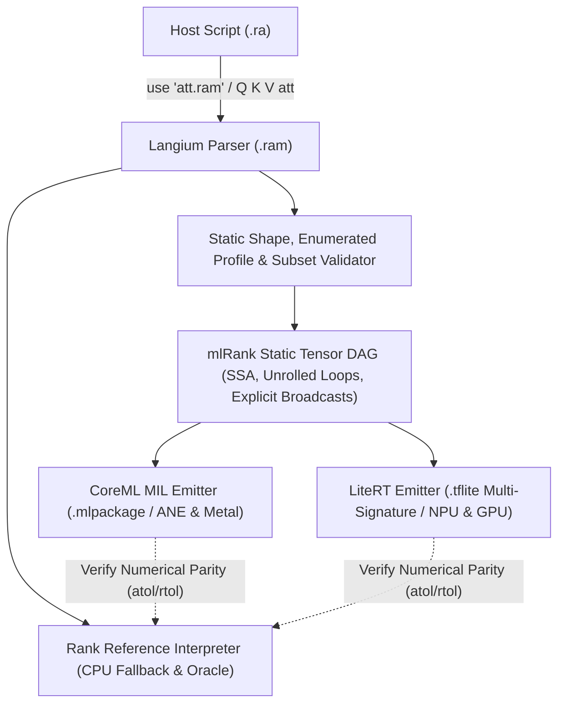

# mlRank (`.ram` MVP Specification)

## Implemented Hello World subset

The first prototype supports one fixed-shape real tensor input and
`return Input relu`. Import it with `use "hello.ram"` and call `X hello`.
See [the runnable example](../../demos/mlrank/main.ra).
The rest of this document describes proposed extensions.

From the repository root, with Node.js 22.12+ and `uv` installed:

```sh
npm run mlrank:setup
npm run build
npm run rank -- demos/mlrank/main.ra
node scripts/mlrank-check.mjs
```

`mlrank:setup` installs Python 3.12 and LiteRT 2.3.0 in
`node_modules/.cache/mlrank`. `RANK_ML_PYTHON` can select another Python
environment containing `ai-edge-litert==2.3.0` and NumPy.
The desktop bridge starts a Python process for each call; model preparation
and process startup are part of its cost. It does not yet retain a loaded
desktop model between calls.

The Android app includes LiteRT. Open **GPU Hello World** in the command menu,
then **Run program**. The upper tabs contain the main program and its attached
`hello.ram`. **+** creates another RAM module. Switching tabs keeps the main
REPL state and unfinished text; it does not execute code. Sources are saved
together in the notebook. Exporting a program with modules produces a ZIP
containing `main.ra`, the `.ram` sources and a notebook snapshot. The ZIP can
also be imported. Programs without modules keep their existing `.ra` export.

For a local Mac browser session, run `npm run dev --workspace @arrrank/web`
and open `/console.html`. The Vite development server supplies the native GPU
bridge. Static hosting does not supply this bridge. Desktop requests use POST bodies.
Android sends request bodies through Capacitor; the worker waits for the result
using an opaque request ID. Tensor data and model bytes never travel in URLs.

The prototype emits a TFLite graph and uses LiteRT GPU on every platform:
Metal on macOS, OpenCL on the tested Android devices, and WebGPU/Vulkan on
the tested Intel Linux host. CoreML and NPU execution remain proposals.
The shape has 1–4 positive dimensions, with at most 1,048,576 elements.
Inputs must contain finite Rank `real` values; integers are not narrowed.
`.f16` and `.f32` round at the input/output boundary. LiteRT transport uses
float32 tensors. This proves the declared ReLU result within the chosen
tolerance; it does not establish hardware FP16 arithmetic. Binary16 values
outside ±65504 are rejected.

The desktop runtime checks `is_fully_accelerated()` and rejects partial
delegation. Android requests only the GPU accelerator. Kotlin LiteRT 2.3.0
does not expose the corresponding placement query; verify its single ReLU
node using native delegate logs. The response reports `gpuOnlyRequested`,
not an invented placement result. There is no interpreter fallback when
the GPU runtime is unavailable.

Mac M5 and Intel UHD (Comet Lake) passed `mlrank-check.mjs`: maximum absolute
errors were 0 and 5.96e-8 respectively, against an absolute tolerance of 1e-4.
The standalone LiteRT probe delegated 1 of 1 nodes on Adreno 810 and Adreno 619.
The Android APK also ran the `.ra` example on OnePlus BE2029 (Android 11,
Adreno 619); its native log confirmed 1 of 1 delegated nodes. Three cached
calls matched the CPU reference with a maximum absolute error of 5.96e-8.
The notebook and its selected RAM tab survived a WebView reload.
These checks establish correctness and placement for this workload, not a
speedup. Linux WebGPU profiling in the standalone tool is unsupported; run
that probe without `--use_profiler=true`.

## Proposed full MVP

**Status:** Draft MVP — 2026-10-25  
**File extension:** `.ram` (Rank Accelerator Module)  
**Target backends:** Apple CoreML (MIL / ANE / Metal GPU), Google LiteRT (TFLite FlatBuffers / StableHLO / GPU & NPU Delegates), ARM TOSA, and Rank CPU Interpreter fallback.

`mlRank` is a **statically compilable subset of Rank** stored in `.ram` files and designed for hardware neural accelerators (NPUs and GPUs). Every `.ram` file is a self-contained Rank module that declares its typed/shaped tensor inputs via `option`, expresses computation using pure tensor dataflow, and returns its outputs via `return`.

Crucially, **no external JSON manifest is needed**, and **`.ram` modules can be imported and executed directly from ordinary `.ra` files** using Rank's standard `use` / `run` module mechanism.

*For an incremental, step-by-step implementation guide from a simple NPU "Hello World" to a full GPT-2 model, see the [Implementation Roadmap](ROADMAP.md). For on-device JIT compilation details on iPhone/iPad, see [CoreML on iOS](IOS_COREML.md). For interactive visualization (`use viz`) and the training environment design, see [Training Environment & Visualization](TRAINING_ENVIRONMENT.md).*

---

## 1. Core Design Principles

1. **Self-Contained `.ram` Modules:** A `.ram` file contains everything the compiler needs inside the source code itself: hardware precision tags (`.f16`, `.f32`, `.bf16`, `.i32`, `.i8`), static or enumerated shapes (`shape ...`), weights, and outputs (`return`).
2. **Callable `.ram` Functions from `.ra`:** Importing `use "att.ram"` registers `att` as a directly callable function in the `.ra` workspace (`Out = Q K V att`). On devices with CoreML or LiteRT, the runtime compiles `.ram` into an accelerator graph and caches it; on environments without an NPU/GPU (or in the browser/REPL), it executes natively in the Rank CPU interpreter.
3. **Hardware-Native Precision via Labels:** Hardware numeric types are written as standard Rank label literals (`.f16`, `.bf16`, `.f32`, `.f8`, `.i32`, `.i16`, `.i8`, `.u8`, `.bool`), avoiding new reserved keywords in the parser.
4. **Static & Enumerated Shapes:** Every intermediate tensor's rank ($R$) and dimensions ($[d_1, \dots, d_R]$) are decidable at compile time for each shape profile.

---

## 2. `.ram` Program Structure: `option`, Shapes & `return`

In `.ram`, `use ml` extends `option` declarations to accept **hardware precision labels** and **`shape` contracts**, while top-level `return` defines the graph's output tensor (or `record` of tensors).

### 2.1 Inputs vs. Constant Weights (`option`)

* **Runtime Input (`option` without `=`):** Declares a positional parameter of the `.ram` function in declaration order.
* **Baked Weight / Parameter (`option` with `= DefaultExpr`):** Declares a model weight or hyperparameter. When compiling to CoreML / LiteRT, its default value (or workspace override) is baked into the `.mlpackage` / `.tflite` constant buffer (enabling offline NPU weight packing and quantization).

```rank
rem att.ram
use linalg
use ml
use numbers
use sequences

rem Positional runtime inputs (no default '=')
option Q .f16 shape 16 64
option K .f16 shape 16 64
option V .f16 shape 16 64

rem Baked weight (has default '=')
option Gamma .f16 shape 64 = array shape 64 fill 1.0

Qn' = (Q 1e-5 rmsnorm) * Gamma
Kn' = (K 1e-5 rmsnorm) * Gamma

Out = Qn Kn V attention
return Out
```

Multiple outputs use an ordinary Rank `record`:

```rank
return record
  .logits = Logits
  .hidden = Hidden
end
```

### 2.2 Hardware Precision Labels

Because `.f16`, `.f32`, etc. are standard Rank `LabelLiteral` tokens (`.word`), they require zero new reserved words:

| Label | Meaning | CoreML MIL Type | LiteRT / TOSA Type | CPU Interpreter Execution |
| :--- | :--- | :--- | :--- | :--- |
| `.f32` | IEEE-754 float32 | `fp32` | `FLOAT32` | `real` (clamped/rounded to f32 at boundary) |
| `.f16` | IEEE-754 float16 | `fp16` (ANE native) | `FLOAT16` | `real` |
| `.bf16` | bfloat16 | `bf16` (M2+/A15+ GPU) | `BFLOAT16` | `real` |
| `.f8` | FP8 (E4M3 / E5M2) | Quantized LUT / `fp8` | `FLOAT8_E4M3FN` | `real` |
| `.i32` | 32-bit signed int | `int32` | `INT32` | `integer` (checked 32-bit range) |
| `.i16` | 16-bit signed int | `int16` | `INT16` | `integer` (checked 16-bit range) |
| `.i8` | 8-bit signed int | `int8` | `INT8` | `integer` (checked `-128..127`) |
| `.u8` | 8-bit unsigned int | `uint8` | `UINT8` | `integer` (checked `0..255`) |
| `.bool` | Boolean mask | `bool` | `BOOL` | `boolean` |

### 2.3 Fixed and Enumerated Shapes (`shape ... end`)

Hardware NPUs (both Apple Neural Engine and Qualcomm/MediaTek NPUs via LiteRT) require pre-allocated SRAM tile schedules and static arena layouts. Truly unbounded dynamic shapes often force an NPU fallback to CPU. However, **both CoreML and LiteRT natively support a finite list of enumerated shapes**:

* **CoreML (`ct.EnumeratedShapes`):** Allows up to ~128 predefined shapes per input (e.g. prompt buckets `[1, 64]`, `[1, 128]`, `[1, 256]` or image resolutions). ANE pre-compiles optimized plans for each shape in the set.
* **LiteRT (Multi-Signature Subgraphs / Shape Buckets):** Allows exporting a `.tflite` model with multiple named signatures (`shape_0`, `shape_1`, `shape_2`) sharing the exact same weight buffers in the FlatBuffer, or dispatching across pre-sized arena buckets with zero weight duplication.

In `.ram`, a single fixed shape is written inline, while **enumerated shapes** use a multi-line `shape ... end` block (one shape profile per line, matching `record ... end` and `array shape ... end`):

```rank
rem Single fixed shape (inline):
option Image .f16 shape 1 224 224 3

rem Enumerated shapes (one profile per line, closed by 'end'):
option Tokens .i32 shape
  1 64
  1 128
  1 256
end
```

If several inputs use `shape ... end` blocks, they must declare the same number of rows, and row $k$ across all inputs forms the $k$-th compilation profile.

---

## 3. Calling `.ram` from `.ra` as a Function

Importing a `.ram` file with `use "att.ram"` binds a callable function named after the file stem (`att`) — or the explicit alias in `use "att.ram" as my_att`.

Its positional parameters correspond to the `.ram` file's runtime `option` declarations (those without a `=` default), in top-to-bottom declaration order:

```rank
rem main.ra — ordinary Rank script (tables, I/O, text, loops allowed)
use sequences
use "att.ram"

rem Prepare inputs in full Rank
Q = array 1 to 1024 reshape 16 64 real
K = array 1 to 1024 reshape 16 64 real
V = array 1 to 1024 reshape 16 64 real

rem Call att.ram directly like a regular Rank function!
Out = Q K V att
Out shape print
```

To override baked weights or inspect module fields before compiling, use an alias:

```rank
use "att.ram" as M
M.Gamma = NewGamma
Out = Q K V M.att
```

### What happens when `Q K V att` is called:
1. **Static Validation:** The compiler verifies that `att.ram` obeys all `mlRank` subset rules and that the arguments `Q`, `K`, `V` match one of the declared `shape` profiles.
2. **Accelerator Compilation & Caching:**
   * **macOS / iOS:** Lowers `att.ram` to CoreML MIL, compiles `.mlmodelc` in cache (keyed by `.ram` source + weight hashes), and executes on ANE / Metal.
   * **Android / Linux (`@arrrank/mobile`):** Lowers `att.ram` to a LiteRT FlatBuffer (`.tflite`), initializes the GPU / NPU delegate, and runs inference.
   * **Fallback / Reference Mode:** Executes the `.ram` body directly in the Rank CPU interpreter, validating input/output precision and shape contracts.

---

## 4. Allowed vs. Forbidden Language Constructs (MVP)

To guarantee zero CPU fallbacks inside a `.ram` file, the validator enforces:

| Category | Allowed in `.ram` MVP | Forbidden in `.ram` MVP (Why) |
| :--- | :--- | :--- |
| **Data Types** | `.f32`, `.f16`, `.bf16`, `.f8`, `.i32`, `.i16`, `.i8`, `.u8`, `.bool`, homogeneous dense `array` (Rank $0..5$), closed `record` and `tuple`. | `text`, `bytes`, `table`, `map`, `set`, `heap`, `deque`, `dsu`, `graph`, heterogeneous arrays. |
| **Control Flow** | Straight-line statements; `for i in Start to/till End [by Step]` where bounds are compile-time constants (statically unrolled by compiler). | `while` loops, recursion, `for` over dynamic tensor values, `if` / `else` branching on tensor elements. |
| **Conditionals** | Elementwise `Mask choose TrueVal FalseVal` (lowers to `mb.select` / `tosa.select` with static shape). | Boolean mask filtering `Data Mask` or `filter` (produces data-dependent shapes, breaking NPU memory planners). |
| **Addressing** | Static slices (`0 till 16`), `#` whole-axis selectors, `transpose`, `reshape` (with static target shape), integer tensor indexing along leading axes (`Embeddings Tokens` $\rightarrow$ `gather`). | Out-of-bounds dynamic slicing, scatter updates with overlapping runtime indices. |
| **Functions** | Non-recursive user `fun` definitions (inlined as subgraph blocks during lowering). | First-class dynamic function closures or runtime callback dispatch. |
| **Side Effects** | None inside `.ram` (pure value transformations). | File I/O (`use io`), `stdin`, random generation (`use random`) inside inference graph, throwing dynamic exceptions. |

### Static Loop Unrolling Example in `.ram`

Transformer and CNN stacks use compile-time `for` loops over layer indices:

```rank
Hidden = Input
for i in 0 till 12
  W1 = Weights1 i
  W2 = Weights2 i
  Mid' = (Hidden W1 linear) gelu
  Hidden = Hidden + (Mid W2 linear)
end
return Hidden
```

---

## 5. Operator Catalogue & Hardware Lowering

`mlRank` combines core Rank tensor operations with the stateless `use ml` vocabulary ([Issue #413](https://github.com/kmmbvnr/rank/issues/413)). Every operation has a fixed intrinsic cell rank so Rank's frame-broadcasting model eliminates manual `unsqueeze` and `transpose` boilerplate.

### 5.1 Core Math, Reductions & Structural Ops

Already built into Rank (`core`, `use numbers`, `use linalg`, `use sequences`, `use stats`):

| Rank Form | Cell Rank | Shape Contract | CoreML MIL | LiteRT / TOSA |
| :--- | :--- | :--- | :--- | :--- |
| `+`, `-`, `*`, `/`, `**`, `min`, `max` | `0 0` | Broadcast frames | `mb.add`, `mb.mul`, `mb.real_div`, `mb.pow`, `mb.minimum`, `mb.maximum` | `ADD`, `MUL`, `DIV`, `POW`, `MINIMUM`, `MAXIMUM` |
| `equal`, `less`, `greater`, `and`, `or`, `not` | `0 0` / `0` | Broadcast frames | `mb.equal`, `mb.less`, `mb.logical_and`, ... | `EQUAL`, `LESS`, `LOGICAL_AND`, ... |
| `Mask choose A B` | `0 0 0` | `s, s, s -> s` | `mb.select` | `SELECT_V2` / `tosa.select` |
| `abs`, `sqrt`, `exp`, `log`, `sin`, `cos`, `tanh` | `0` | `s -> s` | `mb.abs`, `mb.sqrt`, `mb.exp`, `mb.log`, `mb.tanh` | `ABS`, `SQRT`, `EXP`, `LOG`, `TANH` |
| `sum`, `mean`, `min`, `max`, `std` (`[axis A]`) | `all` / `axis` | Collapses reduced axes | `mb.reduce_sum`, `mb.reduce_mean`, `mb.reduce_min`, `mb.reduce_max` | `SUM`, `MEAN`, `REDUCE_MIN`, `REDUCE_MAX` |
| `Values max .index` / `min .index` | `1` / `axis` | `['d'] -> []` | `mb.reduce_argmax`, `mb.reduce_argmin` | `ARG_MAX`, `ARG_MIN` |
| `A matmul B [rank 2 2]` | `all` / `2 2` | `[..., M, K], [..., K, N] -> [..., M, N]` | `mb.matmul` | `BATCH_MATMUL` / `tosa.matmul` |
| `A reshape D1 D2 ...` | `all` | Preserves element count | `mb.reshape` | `RESHAPE` |
| `A transpose [axis ...]` | `all` | Permutes axes | `mb.transpose` | `TRANSPOSE` |
| `Emb Indices` (array addressing) | special | Replaces leading axis with index shape | `mb.gather` | `GATHER` / `tosa.gather` |

### 5.2 Elementwise Activations & Clamping (`use ml`, Default Cell Rank: `0`)

Map scalars `s -> s` across any tensor shape and fuse directly into preceding `conv2d` / `linear` / `matmul` operations on NPU and GPU:

| Rank Form | Cell Rank | Formula | CoreML MIL | LiteRT / TOSA |
| :--- | :--- | :--- | :--- | :--- |
| `X relu` | `0` | $\max(0, x)$ | `mb.relu` | `RELU` / `tosa.clamp` |
| `X Alpha leakyrelu` | `0 0` | $\max(\alpha x, x)$ | `mb.leaky_relu` | `LEAKY_RELU` |
| `X Alpha elu` | `0 0` | $x \ge 0 ? x : \alpha(e^x - 1)$ | `mb.elu` | `ELU` |
| `X sigmoid` | `0` | $\frac{1}{1 + e^{-x}}$ | `mb.sigmoid` | `LOGISTIC` / `tosa.sigmoid` |
| `X silu` | `0` | $x \cdot \sigma(x)$ | `mb.silu` | `MUL(x, LOGISTIC(x))` |
| `X gelu` | `0` | $x \cdot \Phi(x)$ | `mb.gelu` | `GELU` |
| `X softplus` | `0` | $\ln(1 + e^x)$ | `mb.softplus` | `LOG(ADD(1, EXP(x)))` |
| `X Low High clip` | `0 0 0` | $\min(\max(x, \text{low}), \text{high})$ | `mb.clip` | `tosa.clamp` |

### 5.3 Vector Normalizations (`use ml`, Default Cell Rank: `1`)

Because these operations declare intrinsic cell rank `1` (`['d'] -> ['d']`), applying them to a 2D `[Batch, Dim]` or 3D `[Batch, Seq, Dim]` tensor automatically normalizes the trailing feature dimension without requiring `transpose` or `rank` modifiers:

| Rank Form | Cell Rank | Shape Contract | CoreML MIL | LiteRT / TOSA |
| :--- | :--- | :--- | :--- | :--- |
| `Scores softmax` | `1` | `['d'] -> ['d']` | `mb.softmax(axis=-1)` | `SOFTMAX` |
| `Scores logsoftmax` | `1` | `['d'] -> ['d']` | `mb.log_softmax(axis=-1)` | `LOG_SOFTMAX` |
| `X Eps layernorm` | `1 0` | `['d'], [] -> ['d']` | `mb.layer_norm(axes=[-1])` | Fused `MEAN` + `RSQRT` subgraph |
| `X Eps rmsnorm` | `1 0` | `['d'], [] -> ['d']` | `mb.rms_norm` / fused subgraph | Fused `MUL` + `MEAN` + `RSQRT` |
| `X normalize` | `1` | `['d'] -> ['d']` | `mb.l2_norm` | `L2_NORMALIZATION` |

*(Note: Explicit `axis A` overrides the default trailing axis and lowers to the `axis=A` attribute in CoreML MIL or an axis-specialized reduction in LiteRT).*

### 5.4 Linear, Spatial & Attention Macro-Kernels (`use ml`)

Providing explicit high-level operators allows the compiler to emit dedicated hardware macro-instructions (such as ANE convolution engines and Metal FlashAttention) instead of materializing intermediate `window` tensors:

| Rank Form | Default Cell Rank | Shape Contract | CoreML MIL | LiteRT / TOSA |
| :--- | :--- | :--- | :--- | :--- |
| `X W [Bias] linear` | `1 2 [1]` | `[..., In], [In, Out] -> [..., Out]` | `mb.linear` / `mb.matmul + mb.add` | `FULLY_CONNECTED` |
| `X Kernel conv2d [stride S] [padding P]` | spatial macro | `[..., H, W, Cin], [Kh, Kw, Cin, Cout] -> [..., Ho, Wo, Cout]` | `mb.conv` | `CONV_2D` / `tosa.conv2d` |
| `X Window maxpool2d [stride S] [padding P]` | spatial macro | `[..., H, W, C] -> [..., Ho, Wo, C]` | `mb.max_pool` | `MAX_POOL_2D` |
| `X Window avgpool2d [stride S] [padding P]` | spatial macro | `[..., H, W, C] -> [..., Ho, Wo, C]` | `mb.avg_pool` | `AVERAGE_POOL_2D` |
| `Q K V attention` | `2 2 2` | `[..., Nq, Dk], [..., Nk, Dk], [..., Nk, Dv] -> [..., Nq, Dv]` | `mb.scaled_dot_product_attention` | Fused SDPA subgraph |
| `Indices Classes onehot` | `0 0` | `[], [] -> ['classes']` | `mb.one_hot` | `ONE_HOT` |
| `Values K topk` | `1 0` | `['d'], [] -> tuple(['k'], ['k'])` | `mb.topk` | `TOP_K_V2` |

---

## 6. Compiler Lowering Pipeline



### Key Lowering Transformations

1. **Rank-Modifier Broadcast Insertion (`rank L R`):**
   In Rank, `Scores - Tops rank 1 0` subtracts a rank-0 scalar cell `Tops[b]` from each rank-1 row `Scores[b, :]`. CoreML MIL and LiteRT expect trailing-axis numpy-style broadcasting. The `mlRank` compiler automatically inserts a static `reshape` / `expand_dims` (`[B] -> [B, 1]`) on the lower-cell-rank operand.
2. **Enumerated Shapes Lowering (`shape ... end`):**
   When `option` declares a `shape ... end` block, the compiler propagates each row's shape profile through the DAG:
   * For **CoreML**, it emits `ct.EnumeratedShapes(shapes=[[1, 64], [1, 128], [1, 256]])` on the MIL function input.
   * For **LiteRT**, it emits multi-signature subgraphs (`shape_0`, `shape_1`, `shape_2`) sharing the constant weight buffers in a single `.tflite` file, selecting the matching signature when `Q K V att` is called based on the runtime input's actual shape.
3. **Window + Reduce Idiom Lifting:**
   Even if a user writes `B' = A window W stride S padding P` followed by `B max axis 2 3` (instead of `maxpool2d`), the `mlRank` IR recognizer fuses the lazy window view and reduction into a native `max_pool2d` operator without materializing the 4D windowed tensor.
4. **Layout Adaptation (`NHWC` vs `NCHW`):**
   Apple Neural Engine (CoreML) executes convolutions in `NCHW` (channels-first), whereas LiteRT GPU/NPU delegates require `NHWC` (channels-last). The `mlRank` compiler can insert layout transpositions at graph boundaries or fold weight transpositions at compile time.
